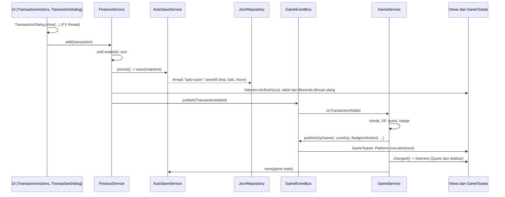

# Materi Java dan OOP di JalokDuitNow

Dokumen ini menunjukkan topik Java dan OOP yang dipakai di JalokDuitNow dan di mana tepatnya. Semua rujukan dicek ke kode
sumber; tidak ada kelas, method, atau nomor baris yang dikarang. Method dan field disebut dengan nama, bukan nomor baris,
supaya tidak ketinggalan saat kode berubah.

Semua path di bawah ini relatif terhadap `src/main/java/com/okto/jalokduitnow/` kecuali ditulis lain.

Daftar isi:

1. [Class dan Object](#1-class-dan-object)
2. [Java Variables](#2-java-variables)
3. [Inheritance](#3-inheritance)
4. [Encapsulation](#4-encapsulation)
5. [Polymorphism](#5-polymorphism)
6. [Abstraction](#6-abstraction)
7. [String](#7-string)
8. [Generics dan Collections](#8-generics-dan-collections)
9. [Exceptions dan Assertion](#9-exceptions-dan-assertion)
10. [Java IO](#10-java-io)
11. [JavaFX GUI](#11-javafx-gui)
12. [Multithreading](#12-multithreading)
13. [Ringkasan](#ringkasan)
14. [Diagram kelas](#diagram-kelas)
15. [Alur data](#alur-data)
16. [Celah materi](#celah-materi)

---

## 1. Class dan Object

### Penjelasan singkat

Class adalah cetakan yang mendefinisikan data (field) dan perilaku (method). Object adalah isi yang dibuat dari cetakan itu
dengan `new`. Di JalokDuitNow, setiap transaksi, kategori, kuis, dan badge adalah object dari class tertentu.

### Penerapan di JalokDuitNow

| Kelas/Berkas | Bagian kode | Keterangan |
|--------------|-------------|------------|
| `model/Category.java` | constructor `Category(...)`, `static create(...)`, `update(...)` | Constructor memvalidasi isi object; `create` adalah static factory yang membuat object baru dengan id acak. |
| `model/Expense.java` | dua constructor | Object `Expense` dibuat dengan `new Expense(date, categoryId, amount)` atau dengan id yang sudah ada. |
| `ui/MainApp.java` | method `start` | Membuat dan menyambungkan object service: `new FinanceService(new JsonRepository<>(...), clock)`, `GameEventBus`, `AutoBackupService`. |
| `reminder/AppNotification.java` | `static create(...)` | Static factory untuk membuat notifikasi dengan id dan waktu otomatis. |
| `schema/TextType.java` | method `createEditor` | Anonymous class: `new FieldEditor<>() { ... }` dibuat di tempat tanpa nama kelas. |
| `model/SavingsGoal.java`, `quest/QuestPeriod.java` | `record` | Record: class data yang tidak bisa diubah, dengan constructor, getter, `equals`, dan `toString` otomatis. Ada 43 record di proyek. |
| `reminder/NotificationAction.java`, `reminder/ReminderKind.java` | `enum` dengan field dan constructor | Enum yang membawa data (label, ikon, durasi berlaku). |
| `storage/FileSwapper.java` | `Swap` (inner class), `Replaced` (record) | Inner class non-static dan nested record di dalam kelas lain. |
| `util/Rupiah.java`, `achievement/AchievementCatalog.java` | constructor `private` | Utility class: constructor privat sehingga tidak bisa di-`new`. |

### Contoh kode

`model/Category.java`

```java
public static Category create(String name, CategoryType type, String iconKey, String color, Long monthlyBudget)
        throws InvalidCategoryException {
    return new Category(UUID.randomUUID(), name, type, iconKey, color, monthlyBudget, false);
}
```

### Kenapa dipakai di sini

Constructor dan static factory memusatkan pembuatan object di satu tempat, sehingga tidak ada `Category` yang lahir dengan
data tidak valid. Record dipilih untuk data kecil yang cukup dibaca saja, seperti hasil pencarian atau pratinjau.

### Pertanyaan yang mungkin ditanyakan dosen

**Apa beda class dan object? Tunjukkan di proyekmu.**
Class adalah rancangan, object adalah hasilnya. `Category` adalah class; `Category.create("Makan", ...)` menghasilkan satu
object kategori dengan id uniknya sendiri.

**Kenapa `Category.create(...)` dibuat sebagai method static, bukan langsung `new`?**
Karena membuat id acak dan memberi nilai awal `archived = false` adalah aturan pembuatan kategori baru. Constructor publik
tetap ada untuk memuat kategori lama dari file dengan id yang sudah ada.

---

## 2. Java Variables

### Penjelasan singkat

Variabel menyimpan data. Tipe primitif (`long`, `int`, `boolean`) menyimpan nilainya langsung; tipe reference (`String`,
`Long`, `List`) menyimpan alamat object dan bisa bernilai `null`. Di proyek ini uang disimpan sebagai `long` dalam Rupiah
penuh, tidak pernah `double`, supaya tidak ada kesalahan pembulatan.

### Penerapan di JalokDuitNow

| Kelas/Berkas | Bagian kode | Keterangan |
|--------------|-------------|------------|
| `model/Transaction.java` | field `private long amount` | Uang sebagai primitif `long`. Komentar kelas: "Amounts are Rupiah stored as long, never double". |
| `model/Category.java` | field `Long monthlyBudget` | Wrapper `Long` (reference) dipakai karena `null` berarti "tidak ada budget". |
| `model/Category.java` | `DEFAULT_ICON`, `MAX_NAME_LENGTH` | Konstanta `public static final`. |
| `service/AutoBackupService.java`, `service/DeleteDataService.java` | `KEEP_AUTO`, `CONFIRM_WORD`, `RESTORE_WINDOW` | Konstanta aplikasi yang bernama jelas (ada 91 deklarasi `static final` di proyek). |
| `model/XpPolicy.java` | field `private final int perEntry`, dst. | Field `final` diisi sekali di constructor dan tidak berubah. |
| `util/Rupiah.java` | `static final Locale ID` | Static: satu nilai bersama, bukan per object. |
| `model/GameProfile.java` | `levelProgress()` | `double` hanya untuk rasio (progres level); tidak ada `double` untuk uang. |
| `ui/GameToasts.java`, `reminder/MonthlyDonorReportReminder.java` | `var change = e.change();`, `var today = today(clock);` | `var` (inferensi tipe lokal) dipakai di 5 tempat, hanya bila tipenya jelas dari sisi kanan. |
| `thread/AutoSaveService.java` | field `private volatile Consumer<StorageException> errorHandler` | Variabel field dengan `volatile` untuk dibaca beberapa thread. |

### Contoh kode

`model/Category.java`

```java
public static final String DEFAULT_ICON = "other";
public static final int MAX_NAME_LENGTH = 40;

private final UUID id;
private final CategoryType type;
private String name;
private String color;          // "#rrggbb"
private Long monthlyBudget;    // Rupiah, null = no budget (expense categories only)
private boolean archived;
```

### Kenapa dipakai di sini

`long` dipakai untuk uang karena Rupiah tidak punya sen dan `double` bisa menghasilkan selisih pecahan. `id` dan `type`
dibuat `final` karena identitas dan jenis kategori tidak boleh berubah setelah dibuat.

### Pertanyaan yang mungkin ditanyakan dosen

**Apa beda `long` dan `Long`? Kapan kamu memakai masing-masing?**
`long` adalah primitif yang tidak bisa `null`; `Long` adalah object pembungkus yang bisa `null`. `Transaction.amount` memakai
`long` karena jumlah wajib ada, sedangkan `Category.monthlyBudget` memakai `Long` karena kategori boleh tanpa budget.

**Apa fungsi `final` pada `private final UUID id`?**
Field itu hanya boleh diisi sekali (di constructor). Id kategori tidak bisa diganti setelah object dibuat, jadi referensi dari
transaksi ke kategori tidak pernah putus.

---

## 3. Inheritance

### Penjelasan singkat

Inheritance membuat class baru dari class yang sudah ada dengan `extends`, sehingga field dan method induk dipakai ulang.
Di proyek ini ada beberapa keluarga class: transaksi, tipe kolom, kuis, badge, pengingat, dan pembuat laporan.

### Penerapan di JalokDuitNow

| Kelas/Berkas | Bagian kode | Keterangan |
|--------------|-------------|------------|
| `model/Transaction.java` | `abstract class Transaction` | Induk dengan field bersama (`id`, `date`, `categoryId`, `amount`) untuk `Income` dan `Expense`. |
| `model/Expense.java`, `model/Income.java` | `extends Transaction`, `super(...)` | Subclass memanggil constructor induk dan hanya menulis yang berbeda. |
| `schema/FieldType.java` | `abstract class FieldType<T>` | Induk untuk `TextType`, `NumberType`, `DateType`, `ChoiceType`, `BooleanType`. |
| `quest/Quest.java` | `abstract class Quest` | Induk untuk `LogDaysQuest`, `NoSpendDaysQuest`, `CategoryBudgetQuest`, `SavingsQuest`, `ChoiceShareQuest`. |
| `achievement/Achievement.java` | `abstract class Achievement` | Induk untuk 7 badge, misalnya `StreakAchievement`, `BudgetAchievement`. |
| `reminder/Reminder.java` | `abstract class Reminder` | Induk untuk `DailyLogReminder`, `StreakRiskReminder`, `MonthlyDonorReportReminder`, `BudgetThresholdReminder`. |
| `report/AbstractReportGenerator.java` | `extends` oleh `PersonalReportGenerator`, `DonorReportGenerator` | Dua tingkat: interface `ReportGenerator`, kelas abstrak, lalu dua kelas konkret. |
| `ui/MainApp.java`, `ui/TransactionTable.java` | `extends Application`, `extends TableView<Transaction>` | Mewarisi kelas JavaFX. Ada 19 kelas UI yang meng-extend kelas JavaFX (`VBox`, `HBox`, dan sebagainya). |
| `exception/StorageException.java` dan 7 lainnya | `extends Exception` | Exception kustom mewarisi `Exception`. |

### Contoh kode

`model/Expense.java`

```java
public class Expense extends Transaction {
    public Expense(UUID id, LocalDate date, UUID categoryId, long amount)
            throws InvalidTransactionException {
        super(id, date, categoryId, amount);
    }

    @Override public long signedAmount() { return -getAmount(); }
    @Override public CategoryType categoryType() { return CategoryType.EXPENSE; }
}
```

### Kenapa dipakai di sini

Pemasukan dan pengeluaran punya data yang sama (tanggal, kategori, jumlah) dan validasi yang sama, jadi disimpan di satu
induk. Hanya tanda jumlah dan jenis kategori yang berbeda, dan itu yang ditulis di subclass.

### Pertanyaan yang mungkin ditanyakan dosen

**Apa yang diwarisi `Expense` dari `Transaction`?**
Semua field privat (lewat getter dan setter publik), validasi `setDate`, `setCategoryId`, `setAmount`, serta penyimpanan nilai
kolom kustom. `Expense` hanya menambah `signedAmount()` dan `categoryType()`.

**Apa gunanya `super(...)` di constructor `Expense`?**
Memanggil constructor `Transaction` agar field induk diisi dan divalidasi. Constructor induk memanggil `setAmount`, jadi jumlah
nol atau negatif ditolak di satu tempat untuk semua jenis transaksi.

---

## 4. Encapsulation

### Penjelasan singkat

Encapsulation menyembunyikan data di dalam class dan hanya membuka lewat method yang menjaga aturan. Field dibuat `private`,
perubahan lewat setter yang memvalidasi. Di proyek ini hampir semua field model bersifat privat dan data yang keluar
disalin atau dibuat read-only.

### Penerapan di JalokDuitNow

| Kelas/Berkas | Bagian kode | Keterangan |
|--------------|-------------|------------|
| `model/Transaction.java` | `setAmount`, `setDate`, `setCategoryId` | Setter menolak nilai tidak valid dengan `InvalidTransactionException`. |
| `model/Transaction.java` | `getCustomValues()` | Mengembalikan `Collections.unmodifiableMap(customValues)`, sehingga pemanggil tidak bisa mengubah isinya langsung. |
| `model/GameProfile.java` | seluruh kelas | Tidak ada setter publik. Status hanya berubah lewat `addXp`, `recordActivity`, `rollTo`, `noteEntryXp`, `reset`. |
| `model/Category.java` | `update(...)` | Mengubah nama, ikon, warna, budget sekaligus; jika ada yang tidak valid, tidak ada yang berubah. |
| `service/FinanceService.java` | `getAll()` | Mengembalikan `List.copyOf(transactions)`, bukan list aslinya. |
| `schema/ColumnDefinition.java` | field privat, `setName`, `setType` | Setter memvalidasi nama dan tipe kolom. |
| `thread/AutoSaveService.java` | `save(List<T> snapshot)` | Menyimpan `List.copyOf(snapshot)` agar perubahan di luar tidak memengaruhi data yang akan ditulis. |

### Contoh kode

`model/Transaction.java`

```java
/** Read-only view of custom column values (column id -> typed value). */
public Map<String, Object> getCustomValues() { return Collections.unmodifiableMap(customValues); }

public void setAmount(long amount) throws InvalidTransactionException {
    if (amount <= 0) throw new InvalidTransactionException("Jumlah harus lebih dari 0");
    this.amount = amount;
}
```

### Kenapa dipakai di sini

Data keuangan tidak boleh rusak diam-diam. Dengan field privat dan setter yang memvalidasi, jumlah negatif atau tanggal kosong
tidak mungkin masuk ke object, dan service tetap pemilik tunggal daftar transaksi.

### Pertanyaan yang mungkin ditanyakan dosen

**Kenapa `getAll()` mengembalikan `List.copyOf(...)`?**
Agar pemanggil tidak bisa menambah atau menghapus isi daftar milik `FinanceService` tanpa lewat `add` atau `delete`. Perubahan
harus lewat service supaya data disimpan dan tampilan diperbarui.

**Apakah ada bagian yang kurang terenkapsulasi?**
Ada: `Category.setArchived(boolean)` adalah setter publik tanpa validasi, dan `UiState` sengaja membuka field `public final`
(properti JavaFX) karena memang berfungsi sebagai wadah status bersama.

---

## 5. Polymorphism

### Penjelasan singkat

Polymorphism berarti kode yang sama bekerja untuk berbagai jenis object, dan setiap jenis menjalankan versinya sendiri.
Ada dua bentuk: overriding (subclass menimpa method induk) dan overloading (beberapa method bernama sama dengan parameter
berbeda). Interface juga memungkinkan polymorphism tanpa pewarisan.

### Penerapan di JalokDuitNow

| Kelas/Berkas | Bagian kode | Keterangan |
|--------------|-------------|------------|
| `model/Expense.java`, `model/Income.java` | `signedAmount()` | Overriding: `Expense` mengembalikan `-getAmount()`, `Income` mengembalikan jumlah positif. `FinanceService.summaryFor` memakai tanda itu tanpa peduli jenisnya. |
| `service/GameService.java` | `evaluateBadges()` | Memanggil `a.check(context)` untuk setiap `Achievement` di `AchievementCatalog.all()`; tiap subclass punya aturan sendiri. |
| `thread/ReminderService.java` | loop `for (Reminder reminder : ReminderFactory.build(...))` | Memanggil `shouldFire(...)` dan `periodKey(...)` pada empat jenis pengingat lewat tipe induk. |
| `ui/TransactionDialog.java` | `editorFor(FieldType<T> type, ...)` | `type.createEditor()` menghasilkan kolom teks, angka, tanggal, pilihan, atau centang tergantung subclass `FieldType`. |
| `ui/ReportView.java` | `currentGenerator()` | Mengembalikan `ReportGenerator` (laporan pribadi atau donor); UI memanggil `generate(month)` tanpa tahu jenisnya. |
| `service/AutoBackupService.java` | `writeSafety(String)` dan `writeSafety(String, String)` | Overloading: versi pendek memakai alasan bawaan. |
| `storage/FileSwapper.java` | `swap(Path, Map)` dan `swap(Path, Map, Collection)` | Overloading: versi pertama memanggil versi kedua tanpa daftar penghapusan. |
| `model/Expense.java` | dua constructor | Overloading constructor: dengan atau tanpa `UUID`. |
| `thread/ReminderService.java` | `sinks` bertipe `List<NotificationSink>` | Polymorphism lewat interface: `SystemTrayNotifier implements NotificationSink`. |

### Contoh kode

`service/GameService.java`

```java
for (Achievement a : catalog) {
    if (unlockedBadges.containsKey(a.getId())) continue; // unlocked badges stay unlocked
    if (a.check(context)) {
        unlockedBadges.put(a.getId(), today);
        award(policy.badgeXp() + a.bonusXp(), "Badge baru");
        bus.publish(new GameEvent.BadgeUnlocked(a, today));
        any = true;
    }
}
```

### Kenapa dipakai di sini

Menambah badge atau pengingat baru cukup dengan membuat subclass baru; `GameService` dan `ReminderService` tidak perlu diubah.
Ini mengurangi `if/else` panjang per jenis.

### Pertanyaan yang mungkin ditanyakan dosen

**Tunjukkan satu overriding dan satu overloading di proyekmu.**
Overriding: `Expense.signedAmount()` menimpa method abstrak `Transaction.signedAmount()`. Overloading: `AutoBackupService`
punya `writeSafety(String)` dan `writeSafety(String, String)` dengan jumlah parameter berbeda.

**Bagaimana `GameService` bisa memeriksa badge tanpa tahu jenis badge-nya?**
Ia memegang `List<Achievement>` dan memanggil `check(...)`. Java memilih implementasi sesuai class asli tiap object saat
program berjalan (dynamic dispatch).

---

## 6. Abstraction

### Penjelasan singkat

Abstraction menyembunyikan detail dan hanya menampilkan apa yang perlu. Di Java ini dilakukan dengan abstract class
(sebagian sudah diimplementasi) dan interface (hanya kontrak). Pemanggil bergantung pada kontrak, bukan pada kelas konkret.

### Penerapan di JalokDuitNow

| Kelas/Berkas | Bagian kode | Keterangan |
|--------------|-------------|------------|
| `schema/FieldType.java` | `abstract displayName()`, `valueClass()`, `parse()`, `format()`, `createEditor()` | Kontrak tipe kolom; method `parseValue`, `check`, `formatValue` bersifat `final` dan memakai yang abstrak. |
| `report/AbstractReportGenerator.java` | `final generate(YearMonth)`, abstract `writeHeader`, `writeSummary`, `writeFooter`, `spendingOf` | Template method: urutan laporan tetap, isi bagian ditentukan subclass. |
| `storage/Repository.java` | `findAll()`, `saveAll(List<T>)` | Interface penyimpanan; service tidak tahu apakah datanya JSON atau yang lain. |
| `share/Sharer.java` | `name()`, `share(String)` | Kontrak "mengeluarkan teks dari aplikasi". |
| `share/UriOpener.java` | `open(URI)` | Kontrak membuka alamat; `WhatsAppSharer` tidak tahu `Desktop` dipakai atau tidak. |
| `ui/TrayBackend.java` | interface | Memisahkan notifikasi sistem dari AWT agar bisa diganti di tes. |
| `model/CategoryResolver.java` | interface | Dipakai saat memuat transaksi; `CategoryService implements CategoryResolver`. |
| `event/GameEvent.java` | `sealed interface` | Semua jenis event tercantum; tiap event adalah record. |

### Contoh kode

`report/AbstractReportGenerator.java`

```java
@Override
public final String generate(YearMonth month) {
    List<Transaction> monthTx = transactionsOf(month);
    StringBuilder out = new StringBuilder();
    writeHeader(out, month);
    writeSummary(out, month, monthTx);
    if (monthTx.isEmpty()) {
        out.append("Belum ada transaksi tercatat pada bulan ini.\n\n");
    } else {
        List<Transaction> spending = spendingOf(monthTx);
        writeCategories(out, spending);
        writeChoiceBreakdown(out, spending);
        if (options.includeDetails()) writeDetails(out, monthTx);
    }
    writeFooter(out);
    return out.toString().strip();
}
```

### Kenapa dipakai di sini

`FieldType` abstrak karena "tipe kolom" tidak pernah berdiri sendiri; selalu teks, angka, tanggal, pilihan, atau centang.
`generate` dibuat `final` agar kerangka laporan sama untuk laporan pribadi dan donor, sementara isinya berbeda per subclass.

### Pertanyaan yang mungkin ditanyakan dosen

**Apa beda abstract class dan interface? Kenapa `FieldType` abstract class, tetapi `Repository` interface?**
Abstract class boleh punya field dan method berisi; interface hanya kontrak. `FieldType` punya method bersama yang sudah
diimplementasi (`parseValue`, `check`), jadi cocok sebagai abstract class. `Repository` murni kontrak dua method tanpa
state, jadi interface.

**Apa itu template method dan di mana kamu memakainya?**
Satu method `final` menetapkan urutan langkah, langkah-langkahnya abstrak. Di `AbstractReportGenerator.generate`, subclass
`PersonalReportGenerator` dan `DonorReportGenerator` mengisi `writeHeader`, `writeSummary`, `writeFooter`, dan `spendingOf`.

---

## 7. String

### Penjelasan singkat

`String` bersifat immutable (tidak bisa diubah); setiap perubahan menghasilkan String baru. Untuk menyusun teks panjang dipakai
`StringBuilder`. Format angka dan tanggal harus mengikuti `Locale` supaya tampil sesuai kebiasaan Indonesia.

### Penerapan di JalokDuitNow

| Kelas/Berkas | Bagian kode | Keterangan |
|--------------|-------------|------------|
| `report/AbstractReportGenerator.java` | `generate`, `StringBuilder out` | Menyusun seluruh laporan dengan `StringBuilder`, lalu `toString().strip()`. |
| `storage/CsvExporter.java` | `appendRow`, `quote`, `neutralize` | `StringBuilder` untuk baris CSV; kutip ganda digandakan; teks yang berawalan `=`, `+`, `-`, `@` diberi `'` agar tidak jadi rumus di spreadsheet. |
| `util/Rupiah.java` | `format(long)` | `NumberFormat.getIntegerInstance(Locale)` dengan `Locale.forLanguageTag("id-ID")` menghasilkan "Rp 25.000". |
| `share/WhatsAppSharer.java` | `buildUri(String, String)` | `URLEncoder.encode(text, StandardCharsets.UTF_8).replace("+", "%20")` untuk URL `wa.me`. |
| `util/PhoneNumberNormalizer.java` | `normalize` | `replaceAll`, `matches`, `startsWith`, `substring` untuk merapikan nomor telepon. |
| `model/Category.java` | `update` | Regex `matches("#[0-9a-fA-F]{6}")` untuk warna dan `matches("[a-z0-9_]{1,32}")` untuk kunci ikon. |
| `storage/SafeDataFolder.java` | `CORRUPT_COPY`, `APP_BACKUP` | `Pattern.compile` untuk mengenali nama file buatan aplikasi saja. |
| `ui/TransactionTable.java` | `matches(Transaction, String)` | `StringBuilder` membangun teks pencarian, `toLowerCase(Locale.ROOT)` untuk pencocokan tanpa huruf besar-kecil. |
| `ui/Tiles.java`, `ui/TimeField.java` | `String.format("#%02x%02x%02x", ...)`, `String.format("%0...` | `String.format` untuk warna heksadesimal dan jam dua digit. |

### Contoh kode

`share/WhatsAppSharer.java`

```java
public static URI buildUri(String number, String text) throws ShareException {
    if (number != null && !number.matches("[0-9]{8,15}")) {
        throw new ShareException("Nomor tidak valid untuk WhatsApp: " + number);
    }
    String encoded = URLEncoder.encode(text, StandardCharsets.UTF_8).replace("+", "%20");
    return URI.create(BASE + (number == null ? "" : number) + "?text=" + encoded);
}
```

### Kenapa dipakai di sini

Laporan bisa berisi puluhan baris, jadi `StringBuilder` menghindari pembuatan banyak String sementara. URL WhatsApp harus di-encode
agar spasi dan huruf khusus sampai utuh; `URLEncoder` memakai `+` untuk spasi sehingga diganti `%20`.

### Pertanyaan yang mungkin ditanyakan dosen

**Kenapa memakai `StringBuilder` di `AbstractReportGenerator`, bukan `+`?**
`String` immutable, jadi `+` di dalam loop membuat object baru terus-menerus. `StringBuilder` menambah ke satu buffer
yang sama dan hasilnya diambil sekali dengan `toString()`.

**Kenapa `Rupiah.format` memakai `Locale`?**
Format angka bergantung locale: Indonesia memakai titik sebagai pemisah ribuan ("25.000"), sedangkan locale Inggris memakai
koma. Dengan `id-ID`, hasilnya sama di komputer mana pun, tidak tergantung pengaturan sistem.

---

## 8. Generics dan Collections

### Penjelasan singkat

Generics membuat class atau method bekerja untuk berbagai tipe dengan tetap aman tipe (`List<String>`, `Repository<T>`).
Collections adalah wadah data: `List` (berurutan), `Set` (tanpa duplikat), `Map` (pasangan kunci-nilai). Stream dan
`Comparator` dipakai untuk menyaring, mengelompokkan, dan mengurutkan.

### Penerapan di JalokDuitNow

| Kelas/Berkas | Bagian kode | Keterangan |
|--------------|-------------|------------|
| `schema/FieldType.java` | `abstract class FieldType<T>` | Class generik: `TextType extends FieldType<String>`, `NumberType extends FieldType<Long>`, `DateType extends FieldType<LocalDate>`. |
| `schema/FieldEditor.java` | `interface FieldEditor<T>` | Interface generik: editor yang tahu tipe nilainya. |
| `storage/Repository.java`, `storage/JsonRepository.java` | `Repository<T>`, `JsonRepository<T>` | Penyimpanan generik: satu kelas untuk transaksi, kategori, donor, dan lainnya. |
| `thread/AutoSaveService.java` | `AutoSaveService<T>`, `static <R> R exclusively(Callable<R>)` | Class generik dan generic method. |
| `event/GameEventBus.java` | `<E extends GameEvent> Runnable subscribe(Class<E> type, Consumer<? super E> listener)` | Bounded type (`E extends GameEvent`) dan wildcard `? super E`. |
| `ui/TransactionDialog.java` | `private static <T> FieldEditor<T> editorFor(FieldType<T> type, Object existingValue)` | Generic method; juga `FieldEditor<?>` (wildcard) di `Map<String, FieldEditor<?>>`. |
| `service/FinanceService.java` | `expenseByCategory`, `summaryByMonth` | `Collectors.groupingBy` + `summingLong`, `LinkedHashMap`, `TreeSet`, `TreeMap`/`SortedMap`. |
| `ui/CategoryManagerDialog.java` | `Comparator.comparing(Category::getType).reversed().thenComparing(...)` | Pengurutan berantai dengan `Comparator`. |
| `quest/LogDaysQuest.java` | `evaluate` | Stream `map(Transaction::getDate).collect(Collectors.toSet())` menghitung hari unik. |
| `ui/MainApp.java`, `reminder/ReminderSettings.java` | `new EnumMap<>(Page.class)`, `EnumMap<ReminderKind, Boolean>` | Map khusus enum. |

### Contoh kode

`event/GameEventBus.java`

```java
public <E extends GameEvent> Runnable subscribe(Class<E> type, Consumer<? super E> listener) {
    Subscription<E> s = new Subscription<>(type, listener);
    subscriptions.add(s);
    return () -> subscriptions.remove(s);
}
```

### Kenapa dipakai di sini

Satu `JsonRepository<T>` melayani sembilan jenis data tanpa menyalin kode. `subscribe` dibatasi `E extends GameEvent` agar
pendengar hanya bisa mendaftar untuk event game, dan `Class<E>` membuat penerimaan event aman tipe tanpa casting di pemanggil.

### Pertanyaan yang mungkin ditanyakan dosen

**Apa gunanya `<E extends GameEvent>` pada `subscribe`?**
Itu bounded type: `E` hanya boleh `GameEvent` atau turunannya. Jadi `subscribe(GameEvent.LevelUp.class, e -> ...)`
memberi `e` bertipe `LevelUp` langsung, dan mendaftar untuk tipe yang bukan event ditolak saat kompilasi.

**Kenapa `summaryByMonth` memakai `TreeMap`, bukan `HashMap`?**
`TreeMap` menjaga kunci terurut (`YearMonth` dari paling lama), sehingga grafik dan daftar bulan di Beranda tampil
berurutan tanpa mengurutkan ulang.

---

## 9. Exceptions dan Assertion

### Penjelasan singkat

Exception adalah cara melaporkan kesalahan tanpa menghentikan program secara mendadak. Checked exception wajib ditangani
atau dideklarasikan (`throws`). Assertion (`assert`) memeriksa asumsi internal programmer dan hanya aktif jika JVM dijalankan
dengan `-ea`.

### Penerapan di JalokDuitNow

| Kelas/Berkas | Bagian kode | Keterangan |
|--------------|-------------|------------|
| `exception/` (8 kelas) | `StorageException`, `InvalidTransactionException`, `InvalidCategoryException`, `InvalidColumnException`, `InvalidGoalException`, `InvalidRecipientException`, `InvalidSettingException`, `ShareException` | Exception kustom, semuanya checked (`extends Exception`), untuk kesalahan pengguna dan kesalahan penyimpanan. |
| `exception/StorageException.java` | constructor `(String message, Throwable cause)` | Exception chaining: penyebab asli (`IOException`) ikut dibawa. |
| `storage/JsonRepository.java` | `findAll`, `saveAll` | `try/catch (IOException e)` lalu melempar `StorageException`. |
| `thread/AutoSaveService.java` | `writePending`, `exclusively` | `try { ... } finally { GATE.unlock(); }` agar kunci selalu dilepas. |
| `ui/Theme.java` | `load`, `save` | `try (Reader in = Files.newBufferedReader(...))` dan `try (Writer out = ...)`: try-with-resources. |
| `ui/TransactionDialog.java`, `service/FinanceService.java` | `catch (InvalidTransactionException | InvalidColumnException | ...)` | Multi-catch. |
| `model/GameProfile.java`, `model/XpPolicy.java`, `reminder/Reminder.java` dan lainnya | `assert ...` | 24 pernyataan `assert` untuk invarian (misalnya `assert days > 0;`). |
| `pom.xml` | `enableAssertions` pada surefire, opsi `-ea` pada `javafx-maven-plugin` | Assertion aktif saat tes dan saat `mvn javafx:run`. |
| `service/DeleteDataService.java` | `runOnUi` | Menangkap `ExecutionException` dan `TimeoutException`, lalu membungkusnya menjadi `StorageException`. |

### Contoh kode

`thread/AutoSaveService.java`

```java
private void writePending() {
    GATE.lock();
    try {
        scheduled.set(false);
        List<T> snapshot = pending.getAndSet(null);
        if (snapshot == null) return;
        try {
            repository.saveAll(snapshot);
        } catch (StorageException e) {
            errorHandler.accept(e);
        }
    } finally {
        GATE.unlock();
    }
}
```

### Kenapa dipakai di sini

Kesalahan input pengguna (jumlah negatif) dan kegagalan disk adalah hal yang wajar, jadi dibuat checked supaya pemanggil
dipaksa menampilkan pesan. `assert` dipakai untuk "ini tidak boleh terjadi" di dalam kode, bukan untuk validasi input.

### Pertanyaan yang mungkin ditanyakan dosen

**Apa beda `assert` dan `throw new InvalidTransactionException`?**
`InvalidTransactionException` melaporkan input yang salah dari pengguna dan selalu aktif. `assert` memeriksa kesalahan
programmer (misalnya `assert days > 0` di `StreakAchievement`) dan hanya aktif dengan `-ea`, jadi tidak dipakai untuk
memvalidasi masukan.

**Kenapa ada `finally { GATE.unlock(); }`?**
Agar kunci dilepas apa pun yang terjadi, termasuk saat ada exception atau `return` di tengah blok. Tanpa itu, semua penyimpanan
lain akan menunggu selamanya.

---

## 10. Java IO

### Penjelasan singkat

Java IO membaca dan menulis file. Proyek ini memakai API modern `java.nio.file` (`Path`, `Files`) untuk file, Jackson untuk
JSON, dan menulis dengan pola aman: ke file sementara dulu, lalu dipindahkan ke tujuan.

### Penerapan di JalokDuitNow

| Kelas/Berkas | Bagian kode | Keterangan |
|--------------|-------------|------------|
| `storage/JsonRepository.java` | `saveAll`, `findAll`, `defaultDataDir` | Menulis ke `.tmp`, menyalin versi lama ke `.bak`, lalu `Files.move(..., REPLACE_EXISTING)`. File rusak disalin ke `.corrupt-<waktu>.bak`. Lokasi data: `Path.of(System.getProperty("user.home"), ".jalokduitnow")`. |
| `storage/ExportFile.java` | `write(Path, String, boolean withBom)` | Menulis teks UTF-8 ke file sementara lalu memindahkannya; opsi BOM agar Excel di Windows membaca huruf dengan benar. |
| `storage/FileSwapper.java` | `swap`, `Swap.commit`, `Swap.rollback`, `retryingMover` | Mengganti banyak file sekaligus: semua berubah atau tidak sama sekali; `ATOMIC_MOVE` dengan percobaan ulang untuk file terkunci. |
| `storage/CsvExporter.java` | `export`, `quote` | Ekspor CSV dengan pengutipan gaya RFC 4180 dan baris `CRLF`. |
| `storage/BackupDto.java`, `service/BackupService.java`, `service/RestoreService.java` | `backupJson`, `prepare`, `apply` | Cadangan lengkap dalam satu file JSON; pemulihan memvalidasi dulu (`BackupValidator`). |
| `service/AutoBackupService.java` | `writeDailyIfMissing`, `writeSafety`, `list` | Cadangan otomatis harian dan cadangan pengaman; `Files.list` dalam try-with-resources. |
| `storage/SafeDataFolder.java` | `existingDataFiles`, `resolveOwned` | Memeriksa path sebelum dihapus: tidak mengikuti symbolic link dan hanya file buatan aplikasi. |
| `ui/Theme.java` | `load`, `save` | `java.util.Properties` dan `Files.newBufferedReader/Writer` untuk `settings.properties`. |
| `storage/JsonSupport.java` | `newMapper()` | Konfigurasi Jackson (termasuk modul tanggal-waktu) dipakai bersama. |

### Contoh kode

`storage/JsonRepository.java`

```java
@Override
public void saveAll(List<T> items) throws StorageException {
    try {
        Files.createDirectories(file.toAbsolutePath().getParent());
        Path tmp = sibling(".tmp");
        mapper.writeValue(tmp.toFile(), items);
        if (Files.exists(file)) Files.copy(file, sibling(".bak"), StandardCopyOption.REPLACE_EXISTING);
        Files.move(tmp, file, StandardCopyOption.REPLACE_EXISTING);
    } catch (IOException e) {
        throw new StorageException("Gagal menyimpan data: " + file, e);
    }
}
```

### Kenapa dipakai di sini

Jika aplikasi mati saat menulis, file asli tidak boleh setengah tertulis. Dengan menulis ke `.tmp` lalu memindahkan, file
tujuan selalu utuh, dan `.bak` menyimpan versi sebelumnya. Charset ditulis eksplisit (`StandardCharsets.UTF_8`) agar hasilnya
sama di Windows dan macOS.

### Pertanyaan yang mungkin ditanyakan dosen

**Kenapa data tidak langsung ditulis ke file tujuan?**
Penulisan bisa terputus (aplikasi ditutup, daya mati) dan meninggalkan file rusak. Menulis ke file sementara lalu
memindahkannya membuat penggantian hampir atomik, sehingga data lama aman sampai data baru lengkap.

**Apa fungsi BOM pada `ExportFile`?**
BOM adalah tanda tiga byte di awal file UTF-8. Excel di Windows memakainya untuk mengenali UTF-8; tanpa itu huruf non-ASCII
bisa rusak. Opsi ini hanya untuk ekspor CSV, tidak untuk file JSON.

---

## 11. JavaFX GUI

### Penjelasan singkat

JavaFX membangun antarmuka sebagai scene graph: pohon node (tombol, label, layout) di dalam scene dan stage. Layout
(`VBox`, `HBox`, `BorderPane`) menata node. Properti dan binding menyambungkan data ke tampilan, dan CSS mengatur gaya.
UI proyek ini dibuat lewat kode Java (tidak memakai FXML).

### Penerapan di JalokDuitNow

| Kelas/Berkas | Bagian kode | Keterangan |
|--------------|-------------|------------|
| `ui/MainApp.java` | `start(Stage)` | Titik masuk `extends Application`; `BorderPane` sebagai akar (sidebar kiri, konten tengah, panel detail kanan), halaman disimpan di `EnumMap<Page, Node>` dan ditampilkan ke `StackPane`. |
| `ui/TransactionTable.java` | `extends TableView<Transaction>`, `setItems(rows)`, `setCellFactory` | `TableView` dengan `ObservableList`, kolom dibangun ulang dari skema kolom kustom, sel dengan cell factory. |
| `ui/DashboardView.java` | `PieChart pie`, `BarChart<String, Number> bar` | Grafik lingkaran (pengeluaran per kategori) dan grafik batang (per bulan). |
| `ui/UiState.java` | `ObjectProperty<Transaction> selected`, `ObjectProperty<YearMonth> period`, `StringProperty search` | Properti JavaFX sebagai status bersama antar-halaman. |
| `ui/MainApp.java`, `ui/SettingsView.java` | `bindBidirectional(...)` | `search.textProperty().bindBidirectional(state.search)` dan `dark.selectedProperty().bindBidirectional(Theme.darkProperty())`. |
| `ui/Theme.java`, `resources/com/okto/jalokduitnow/ui/style.css`, `theme-light.css`, `theme-dark.css` | `apply`, `styleDialog`, variabel CSS | Tema terang dan gelap lewat variabel CSS; `getStyleClass().add(...)` dipakai 219 kali. |
| `ui/TransactionDialog.java`, `ui/RestoreDialog.java`, `ui/DeleteDataDialog.java` | `Dialog<...>` | Dialog kustom; `Alert` untuk konfirmasi (`TransactionActions`) dan `FileChooser` untuk pilih file (`ExportPanel`). |
| `ui/QuestsView.java`, `ui/NotificationBell.java`, `ui/TransactionTable.java` | `add.setOnAction(...)`, `setOnMouseClicked(...)`, `addListener(...)` | Event handling dengan lambda: 52 `setOnAction` dan 51 `addListener` di seluruh proyek. |
| `ui/Motion.java` | `Timeline`, `KeyFrame`, `KeyValue`, `Interpolator.EASE_BOTH` | Animasi halus lewat `Timeline`. |

### Contoh kode

`ui/UiState.java`

```java
public final class UiState {
    public final ObjectProperty<Transaction> selected = new SimpleObjectProperty<>();
    public final ObjectProperty<YearMonth> period;
    public final StringProperty search = new SimpleStringProperty("");

    public UiState(Clock clock) {
        this.period = new SimpleObjectProperty<>(PeriodRange.current(clock));
    }
}
```

### Kenapa dipakai di sini

Beberapa halaman (Beranda, Transaksi, panel detail) harus selalu menampilkan bulan, pencarian, dan transaksi terpilih yang
sama. Dengan properti bersama, satu perubahan otomatis memperbarui semua tampilan tanpa saling memanggil.

### Pertanyaan yang mungkin ditanyakan dosen

**Apa itu property binding dan di mana kamu memakainya?**
Binding menghubungkan dua nilai agar yang satu mengikuti yang lain. Di `MainApp`, kolom pencarian dihubungkan dua arah ke
`state.search`; saat teks berubah, tabel di halaman Transaksi ikut menyaring.

**Kenapa UI dibuat dengan kode, bukan FXML?**
Karena banyak tampilan dibangun dinamis dari data (kolom kustom, kategori, tema). Sejauh ini seluruh UI proyek ditulis di
Java; tidak ada file FXML di proyek.

---

## 12. Multithreading

### Penjelasan singkat

Thread menjalankan pekerjaan secara bersamaan. UI JavaFX hanya boleh disentuh dari satu thread (FX thread), jadi pekerjaan
lambat (menulis file, membuka browser) dikerjakan di thread lain lalu hasilnya dikembalikan dengan `Platform.runLater`.
Data yang dipakai bersama harus dijaga dengan kunci atau tipe atomik.

### Penerapan di JalokDuitNow

| Kelas/Berkas | Bagian kode | Keterangan |
|--------------|-------------|------------|
| `thread/AutoSaveService.java` | `Executors.newSingleThreadScheduledExecutor`, `save`, `writePending` | Penyimpanan di thread latar belakang dengan jeda; perubahan cepat digabung (hanya snapshot terbaru yang ditulis). Thread daemon bernama `auto-save`. |
| `thread/DailyScheduler.java` | `ScheduledExecutorService timer`, `scheduleNext`, `fire` | Menjalankan tugas tiap tengah malam; thread timer hanya menyerahkan tugas ke `uiExecutor` (`Platform::runLater`). |
| `thread/ReminderService.java` | `ScheduledExecutorService`, `uiExecutor`, `CopyOnWriteArrayList<NotificationSink>` | Detak tiap menit di thread timer, pemeriksaan pengingat di FX thread. |
| `thread/ExportTask.java` | `extends Task<Path>`, `call()` | `javafx.concurrent.Task` untuk menulis file ekspor di luar FX thread. |
| `ui/RestoreDialog.java`, `ui/DeleteDataDialog.java` | `new Task<>() { call() }`, `progressProperty().bind(task.progressProperty())`, `setOnSucceeded`, `setOnFailed` | Pemulihan dan penghapusan data di `Task` dengan progress bar; hasil kembali di FX thread. |
| `ui/ReportView.java` | `CompletableFuture.runAsync(...)` + `Platform.runLater(...)` | Membuka WhatsApp di luar FX thread, lalu memperbarui tampilan di FX thread. |
| `service/DeleteDataService.java`, `service/RestoreService.java` | `runOnUi(UiStep)` (Delete) dan `runOnUi()` (Restore) | `CompletableFuture` + `done.get(60, TimeUnit.SECONDS)` untuk menunggu langkah yang harus jalan di FX thread. |
| `thread/AutoSaveService.java` | `ReentrantLock GATE`, `AtomicReference`, `AtomicBoolean`, `volatile`, `synchronized (INSTANCES)` | Sinkronisasi: satu kunci global agar pemulihan data tidak bisa ditimpa penyimpanan lama. |
| `event/GameEventBus.java` | `CopyOnWriteArrayList<Subscription<?>>` | Daftar pendengar aman dibaca sambil didaftarkan. |
| `ui/AwtTrayBackend.java` | `synchronized show`, `synchronized close` | Method `synchronized` untuk ikon tray. |
| `ui/` (24 tempat) | `Platform.runLater(...)` | Mengembalikan hasil kerja thread lain ke FX thread. |

### Contoh kode

`thread/DailyScheduler.java`

```java
private final ScheduledExecutorService timer = Executors.newSingleThreadScheduledExecutor(r -> {
    Thread t = new Thread(r, "daily-scheduler");
    t.setDaemon(true);
    return t;
});

private void scheduleNext() {
    long millis = Math.max(1, delayUntilNext.apply(clock).toMillis());
    timer.schedule(this::fire, millis, TimeUnit.MILLISECONDS);
}

private void fire() {
    uiExecutor.execute(task);
    scheduleNext();
}
```

### Kenapa dipakai di sini

Menyimpan ke disk bisa lambat; jika dilakukan di FX thread, jendela terasa macet. Thread timer hanya menjaga waktu, dan
semua perubahan data dikerjakan di FX thread agar tidak ada dua thread mengubah data yang sama. Thread dibuat daemon supaya
aplikasi bisa tertutup tanpa menunggu timer.

### Pertanyaan yang mungkin ditanyakan dosen

**Kenapa tidak boleh mengubah UI dari thread latar belakang? Apa solusinya di proyekmu?**
Scene graph JavaFX tidak thread-safe dan hanya boleh diubah dari FX thread. Solusinya: pekerjaan berat di `Task` atau
`CompletableFuture`, lalu hasilnya dikirim kembali dengan `Platform.runLater` (contoh: `ReportView` setelah `sharer.share(text)`).

**Apa fungsi `ReentrantLock GATE` di `AutoSaveService`?**
Semua penyimpanan memegang kunci ini saat menulis. Saat pemulihan data, `exclusively(...)` memegang kunci yang sama dan
membuang semua penyimpanan yang masih menunggu, sehingga data lama tidak bisa menimpa file yang baru dipulihkan.

---

## Ringkasan

Jumlah adalah hasil pencarian teks pada `src/main/java` (kemunculan, bukan jumlah kelas), jadi gunakan sebagai gambaran
kasar. Tanda "lemah" berarti topik ada tetapi pemakaiannya terbatas; lihat [Celah materi](#celah-materi).

| Topik | Jumlah tempat (perkiraan) | Contoh terbaik |
|-------|---------------------------|----------------|
| Class dan Object | 163 berkas; 43 record; 7 enum | `model/Category.java` |
| Java Variables | 91 `static final`; 5 `var`; `long` untuk uang | `model/Transaction.java`, `model/XpPolicy.java` |
| Inheritance | 27 subclass domain, 19 kelas UI, 8 exception | `model/Transaction.java` dengan `Expense`/`Income` |
| Encapsulation | 93 berkas dengan field privat; 147 `@Override` total | `model/GameProfile.java` |
| Polymorphism | 147 `@Override`; 4 pasang overloading | `service/GameService.java` (`evaluateBadges`) |
| Abstraction | 6 abstract class; 9 interface tingkat atas; 1 sealed interface | `schema/FieldType.java`, `report/AbstractReportGenerator.java` |
| String | 4 `StringBuilder`, 4 `String.format`, 15 regex, 9 `Locale`, 3 `URLEncoder` | `share/WhatsAppSharer.java`, `util/Rupiah.java` |
| Generics dan Collections | 5 class generik, 4 generic method; 84 stream; 35 `Optional` | `event/GameEventBus.java`, `storage/JsonRepository.java` |
| Exceptions dan Assertion | 8 exception, 129 `throw` kustom, 111 `catch`, 5 try-with-resources, 24 `assert` | `exception/StorageException.java`, `thread/AutoSaveService.java` |
| Java IO | 48 pemanggilan `Files.*` | `storage/JsonRepository.java`, `storage/FileSwapper.java` |
| JavaFX GUI | 52 `setOnAction`, 51 `addListener`, 219 `getStyleClass`; 1 `TableView`, 2 jenis grafik | `ui/MainApp.java`, `ui/TransactionTable.java` |
| Multithreading | 24 `Platform.runLater`, 10 `Task<`, 3 scheduler | `thread/AutoSaveService.java`, `thread/DailyScheduler.java` |

---

## Diagram kelas

Hanya kelas yang ada di kode. Atribut disingkat; lihat file sumber untuk daftar lengkap.

```mermaid
classDiagram
    class Transaction {
        <<abstract>>
        -UUID id
        -LocalDate date
        -UUID categoryId
        -long amount
        +signedAmount() long
        +categoryType() CategoryType
    }
    Transaction <|-- Income
    Transaction <|-- Expense

    class FieldType~T~ {
        <<abstract>>
        +displayName() String
        +valueClass() Class
        +parse(String) T
        +format(T) String
        +createEditor() FieldEditor
    }
    FieldType <|-- TextType
    FieldType <|-- NumberType
    FieldType <|-- DateType
    FieldType <|-- ChoiceType
    FieldType <|-- BooleanType

    class Quest {
        <<abstract>>
        +evaluate(List, Clock) QuestProgress
        +type() String
    }
    Quest <|-- LogDaysQuest
    Quest <|-- NoSpendDaysQuest
    Quest <|-- CategoryBudgetQuest
    Quest <|-- SavingsQuest
    Quest <|-- ChoiceShareQuest

    class Achievement {
        <<abstract>>
        +check(GameContext) boolean
        +bonusXp() int
    }
    Achievement <|-- StreakAchievement
    Achievement <|-- SavingsAchievement
    Achievement <|-- BudgetAchievement
    Achievement <|-- ColumnBuilderAchievement
    Achievement <|-- CategoryCustomizerAchievement
    Achievement <|-- TransparencyAchievement
    Achievement <|-- ConsistentAchievement

    class Reminder {
        <<abstract>>
        +shouldFire(ReminderContext, Clock) boolean
        +buildMessage(ReminderContext) String
        +periodKey(Clock) String
    }
    Reminder <|-- DailyLogReminder
    Reminder <|-- StreakRiskReminder
    Reminder <|-- MonthlyDonorReportReminder
    Reminder <|-- BudgetThresholdReminder

    class Sharer {
        <<interface>>
        +name() String
        +share(String)
    }
    Sharer <|.. WhatsAppSharer
    Sharer <|.. ClipboardSharer

    class ReportGenerator {
        <<interface>>
        +title() String
        +generate(YearMonth) String
    }
    class AbstractReportGenerator {
        <<abstract>>
        +generate(YearMonth) String
    }
    ReportGenerator <|.. AbstractReportGenerator
    AbstractReportGenerator <|-- PersonalReportGenerator
    AbstractReportGenerator <|-- DonorReportGenerator
```



---

## Alur data

Menambah transaksi, dari dialog sampai tampilan ikut berubah. Nama method diambil dari kode (`TransactionActions.add`,
`FinanceService.add`, `FinanceService.persist`, `GameService.onTransactionAdded`).



---

## Celah materi

Daftar jujur topik yang lemah atau tidak ada di kode, dengan saran bila ingin demonstrasi yang lebih kuat.

| Topik | Keadaan di kode | Saran penerapan |
|-------|-----------------|-----------------|
| Text block (`"""`) | Tidak dipakai sama sekali. | Teks panjang tetap di `AbstractReportGenerator` atau pesan di dialog bisa ditulis sebagai text block. |
| `Deque`, `Queue`, `PriorityQueue` | Tidak dipakai. Koleksi yang ada: `List`, `Set`, `Map`. | Antrean notifikasi yang menunggu jam tenang di `ReminderService` bisa memakai `ArrayDeque`. |
| `equals` dan `hashCode` | Tidak ditulis ulang di kelas biasa (hanya record yang mendapatkannya otomatis). | `Category` dan `Recipient` bisa meng-override keduanya berdasarkan `id`. |
| `Comparable` | Tidak ada kelas yang mengimplementasikannya; pengurutan memakai `Comparator`. | `Transaction` bisa `implements Comparable<Transaction>` berdasarkan tanggal. |
| Polymorphism lewat `Sharer` | Interface dan dua implementasi ada, tetapi `ReportView` memegang `WhatsAppSharer` dan `ClipboardSharer` secara konkret, bukan `List<Sharer>`. | Ubah menu bagikan menjadi daftar `Sharer` sehingga menambah kanal (misalnya email) tidak mengubah UI. |
| Default atau static method di interface | Tidak ada method `default` di interface mana pun. | Beri `Sharer` method `default boolean isAvailable()`. |
| Hierarki exception | Delapan exception kustom, semuanya checked dan sejajar langsung di bawah `Exception`. Tidak ada exception unchecked kustom dan tidak ada induk bersama. | Buat `AppException` sebagai induk, dan `InvalidInputException` untuk kelompok `Invalid*`. |
| Thread pool | Hanya executor satu thread dan `CompletableFuture` bawaan. Tidak ada `newFixedThreadPool`, `parallelStream`, atau `wait/notify`. | Ekspor CSV atau pembuatan cadangan besar bisa memakai pool kecil bersama. |
| Java IO klasik | Hampir seluruhnya `java.nio.file`. Stream klasik (`InputStream`, `ObjectOutputStream`, serialisasi) tidak dipakai; `Reader`/`Writer` hanya di `Theme`. | Tidak perlu; NIO adalah pilihan modern. Jika ingin demonstrasi, tampilkan `BufferedReader` pada impor CSV. |
| FXML | Tidak dipakai; seluruh UI dibuat lewat kode. | Satu dialog sederhana bisa ditulis dengan FXML dan controller untuk perbandingan. |
| Inheritance dalam | Hierarki hanya 1 sampai 2 tingkat (terdalam: `ReportGenerator` -> `AbstractReportGenerator` -> `DonorReportGenerator`). | Tidak perlu diperdalam; hierarki dangkal justru praktik yang baik. |
| `var` | Dipakai di 5 tempat saja. | Cukup; tidak perlu diperbanyak. |
| Encapsulation | `Category.setArchived` adalah setter publik tanpa validasi; `UiState` membuka field `public final`. | Jelaskan sebagai pilihan sadar (status UI bersama), atau ganti `setArchived` dengan `archive()` dan `restore()`. |
