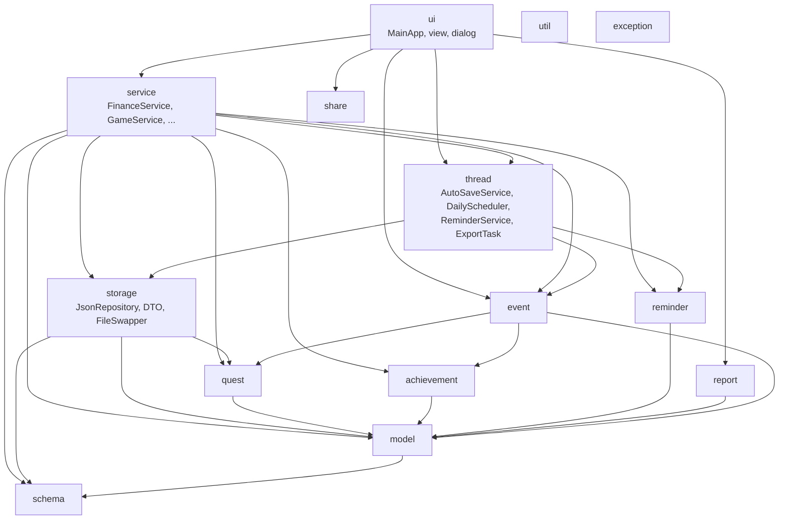

# Cara kerja aplikasi JalokDuitNow

Dokumen ini merangkum cara seluruh aplikasi bekerja, dari kode yang ada. Path kelas relatif terhadap `src/main/java/com/okto/jalokduitnow/`.
Rincian per fitur ada di [fitur/00-index.md](fitur/00-index.md). Peta topik OOP ada di [MATERI-OOP.md](MATERI-OOP.md).

## 1. Urutan startup

Titik masuk paket jpackage adalah `Launcher.main` (sengaja tidak mewarisi `Application` agar JavaFX di classpath tidak dipaksa menjadi modul bernama);
ia memanggil `Application.launch(MainApp.class, args)`. Berikutnya `ui/MainApp.start(Stage)`:

| # | Langkah | Kelas dan metode |
|---|---------|------------------|
| 1 | Menentukan folder data `~/.jalokduitnow` | `JsonRepository.defaultDataDir()` |
| 2 | Membaca tema tersimpan | `Theme.load(dir)` |
| 3 | Membuat satu jam untuk seluruh aplikasi | `new SystemClock()` |
| 4 | Membuat bus event | `new GameEventBus()` |
| 5 | Membuat semua service (tiap satu dengan `JsonRepository` miliknya): `FinanceService` (+ `setEventBus`), `SchemaService`, `CategoryService`, `RecipientService`, `DonorSettings`, `ReminderSettingsService`, `ReminderLog`, `NotificationCenter`, `AutoBackupService`, `GameService` | konstruktor masing-masing; `GameService` berlangganan event dan mendengarkan `SchemaService` serta `CategoryService` |
| 6 | Memasang penanganan error simpan (`setErrorHandler`) ke `Platform.runLater(showError)` | `MainApp.start` |
| 7 | Memuat data berurutan: `schemaService.load()`, `categoryService.load()`, `service.load(schema, categories)`, `recipientService.load()`, `donorSettings.load()`, `reminderSettings.load()`, `reminderLog.load()`, `notificationCenter.load()`, `gameService.load()` | skema dulu agar nilai kustom bisa dibaca; kategori sebelum transaksi karena transaksi menunjuk id |
| 8 | Mengejar waktu: streak, quest minggu ini, badge | `gameService.rollDay()` |
| 9 | Bila ada `StorageException` saat memuat | `showError(e.getMessage())` (Alert); aplikasi tetap dibuka |
| 10 | Membuat `UiState` dan `TransactionActions`, lalu semua halaman (`DashboardView`, `TransactionView`, `CategoryManagerDialog.createView`, `ColumnManagerDialog.createView`, `ReportView`, `QuestsView`, `SettingsView`) disimpan di `EnumMap<Page, Node>` | `MainApp.start` |
| 11 | Membuat `ReminderService`, `BackupService`, `DataReloader`, `RestoreService`, `DeleteDataService` | `MainApp.start` |
| 12 | Menyusun `Sidebar`, `DetailPanel`, header, `BorderPane`, `ToastHost`; `GameToasts.install(bus, toasts)`; sink pengingat (toast dan `SystemTrayNotifier`) | `MainApp.start` |
| 13 | `Scene(1360 x 840)`, `Theme.apply(scene)`, listener lebar untuk panel kanan, `stage.show()` | `MainApp.start` |
| 14 | Menjalankan pewaktu tengah malam | `new DailyScheduler(clock, gameService::rollDay, Platform::runLater).start()` |
| 15 | Mulai pengingat (langsung mengecek sekali) | `reminderService.start()` |
| 16 | Cadangan otomatis harian di latar | `makeDailyBackup(clock)` |

## 2. Arsitektur

Lapisan dan paket (panah = "bergantung pada", berdasarkan `import` di kode):

Arah utama: `ui` -> `service` -> `model`, `schema`, `storage`. Beberapa hal yang tidak rapi menurut `import` (bukan hasil analisis alat, saya mengelompokkan dari baris `import`):

- Ada siklus antarpaket: `service` <-> `quest` dan `achievement` (`QuestFactory` memakai `CategoryService`, `CategoryCustomizerAchievement` memakai `CategoryService`,
  `ColumnBuilderAchievement` memakai `SchemaService`; `GameService` memakai quest dan badge), dan `service` <-> `storage` (`storage.CsvExporter` memakai `CategoryService`;
  `service` memakai `storage`). Tidak ada modul Java yang melarangnya.
- `schema` bergantung pada JavaFX (`FieldType.createEditor` membuat kontrol `ComboBox`, `DatePicker`, `TextField`), jadi lapisan data menyentuh UI.
- `model` bergantung pada `schema` (`Transaction` memakai `ColumnDefinition` dan `TableSchema`).
- Paket `exception`, `util` dipakai di mana saja.

Pola yang dipakai: pewarisan dan polimorfisme (`Transaction`, `FieldType`, `Quest`, `Achievement`, `Reminder`, `AbstractReportGenerator`), antarmuka (`Repository<T>`,
`ReportGenerator`, `Sharer`, `UriOpener`, `NotificationSink`, `TrayBackend`), event bus bertipe, DTO terpisah dari model, dan `Clock` yang disuntikkan.

## 3. Alur event

`event/GameEventBus` adalah bus sinkron dengan pendengar bertipe (`subscribe(Class<E>, Consumer)`; berlangganan `GameEvent.class` menerima semua).
Pendengar dijalankan di thread penerbit; pendengar yang melempar `RuntimeException` dicatat ke `System.err` dan tidak menghentikan yang lain.
`GameEvent` adalah `sealed interface` dengan record:

| Event | Isi | Diterbitkan oleh | Didengar oleh |
|-------|-----|------------------|---------------|
| `TransactionAdded` | `Transaction` | `FinanceService.add` (hanya tambah) | `GameService.onTransactionAdded` |
| `XpGained` | `amount`, `reason` | `GameService.award` | `GameToasts` |
| `LevelUp` | `LevelUpResult` | `GameService.award` | `GameToasts` |
| `StreakChanged` | `StreakChange` | `GameService.onTransactionAdded`, `rollDay` | `GameToasts` |
| `QuestCompleted` | `Quest` | `GameService.evaluateQuests` | `GameToasts` |
| `BadgeUnlocked` | `Achievement`, `LocalDate` | `GameService.evaluateBadges` | `GameToasts` |
| `DonorReportShared` | `channel` | `ReportView.sendWhatsApp`, `copyToClipboard` | `GameService.onDonorReportShared` |
| `ReminderFired` | `reminderId` | `ReminderService.fire` | `GameService.onReminderFired` |

Selain bus, ada pola `addListener(Runnable)` di service (`FinanceService`, `SchemaService`, `CategoryService`, `GameService`, `RecipientService`, `DonorSettings`,
`ReminderSettingsService`, `NotificationCenter`) untuk menyegarkan tampilan; pendengar itu dipanggil di thread yang mengubah data. Juga, `GameService` mendengarkan
`SchemaService` dan `CategoryService` (`onStructureChanged`) untuk mengevaluasi badge.

## 4. Persistensi

Semua berkas ada di `~/.jalokduitnow`. `storage/JsonRepository<T>` menulis `List<T>` lewat `.tmp`, menyimpan `.bak`, dan menyalin berkas rusak ke `.corrupt-<waktu>.bak`
(rincian di [fitur/15](fitur/15-penyimpanan-dan-thread.md)).

| Berkas | Dibaca dan ditulis oleh | Tipe DTO |
|--------|-------------------------|----------|
| `transactions.json` | `FinanceService` | `TransactionDto` |
| `schema.json` | `SchemaService` | `ColumnDto` |
| `categories.json` | `CategoryService` | `CategoryDto` |
| `game.json` | `GameService` (daftar berisi satu elemen) | `GameStateDto` |
| `recipients.json` | `RecipientService` | `RecipientDto` |
| `donor-settings.json` | `DonorSettings` (satu elemen) | `DonorSettingsDto` |
| `reminders.json` | `ReminderSettingsService` (satu elemen) | `ReminderSettingsDto` |
| `reminder-log.json` | `ReminderLog` | `ReminderLogDto` |
| `notifications.json` | `NotificationCenter` | `NotificationDto` |
| `settings.properties` | `ui/Theme` (`Properties`, langsung di thread FX) | (tidak ada) |
| `backups/otomatis-*.json`, `sebelum-pemulihan-*.json`, `sebelum-hapus-*.json` | `AutoBackupService` | `BackupDto` |

Strategi penulisan: auto-save 300 ms dengan penggabungan (`AutoSaveService`); `.tmp` lalu pindah; `.bak` satu versi; pertukaran banyak berkas dengan `FileSwapper`
(`.restore-tmp` dan `.restore-rollback`, `ATOMIC_MOVE`, dicoba ulang); cadangan pengaman sebelum pemulihan atau penghapusan; `SafeDataFolder` membatasi apa yang boleh dihapus.

## 5. Model thread

| Thread | Dibuat oleh | Tugas | Melapor ke UI lewat |
|--------|-------------|-------|----------------------|
| FX | JavaFX | semua logika dan tampilan | (itu sendiri) |
| `auto-save` (daemon, satu per `AutoSaveService`) | `AutoSaveService` | menulis JSON | `errorHandler` -> `Platform.runLater(showError)` |
| `daily-scheduler` (daemon) | `DailyScheduler` | menunggu tengah malam | `uiExecutor` = `Platform::runLater` -> `rollDay` |
| `reminder-ticker` (daemon) | `ReminderService` | tick tiap menit | `uiExecutor` -> `tick` |
| `tray-notifier` (daemon) | `SystemTrayNotifier` | tampilkan notifikasi tray | tidak ada (kegagalan membuat tray nonaktif) |
| `export` (daemon) | `ExportPanel.write` | `ExportTask` | `setOnSucceeded`, `setOnFailed` |
| `restore-prepare`, `restore-apply`, `delete-data` | `RestoreDialog`, `DeleteDataDialog` | `Task` | `setOnSucceeded`, `setOnFailed`; `runOnUi` untuk muat ulang |
| `ForkJoinPool.commonPool` | `CompletableFuture.runAsync` | cadangan harian (`MainApp.makeDailyBackup`), buka WhatsApp (`ReportView`) | `Platform.runLater` |

Penutupan (`MainApp.stop`): `flush()` pada service data, `scheduler.stop()`, `reminderService.stop()` (`shutdownNow` dan tunggu 1 detik), `trayNotifier.close()`
(ikon tray bila tertinggal menahan proses), `flush()` pengaturan, log, notifikasi, game, penerima, donor, kategori. Semua thread pewaktu dan simpan adalah daemon.

## 6. Penanganan waktu

- `util/SystemClock` adalah satu-satunya jam produksi: membaca zona waktu tiap kali (`ZoneId.systemDefault()`), tidak membekukan zona saat startup. `ReminderService` mereset zona
  default sebelum tiap tick (`TimeZone.setDefault(null)` di `MainApp`).
- `Clock` disuntikkan lewat konstruktor ke `FinanceService`, `GameService`, `AutoBackupService`, `BackupService`, `ReminderService`, `DailyScheduler`, `ReminderContextProvider`,
  `DashboardView`, `ReportView`, `UiState`, `TransactionActions`, generator laporan, `DateRules`, dan `PeriodRange`. `Quest.evaluate` dan `Reminder.shouldFire` menerima `Clock` sebagai parameter.
- `GameProfile` tidak membaca jam sama sekali: pemanggil memberi tanggal.
- Pengecualian yang saya temukan: `JsonRepository.backupCorrupt` memakai `LocalDateTime.now()` untuk nama salinan; konstruktor `FinanceService(Repository)` memakai `Clock.systemDefaultZone()`
  (tidak dipakai `MainApp`); `TransactionDto.toTransaction` memakai `ZoneId.systemDefault()` untuk `createdAt` berkas lama.
- Tes memakai jam tetap: `TestClock` (siang hari di `Asia/Jakarta`, bisa digeser lewat `set(LocalDate)` dan `set(LocalDate, LocalTime)`) dan `MovableClock`; `Fixture.in(dir, clock)`
  merakit service dengan jam itu. `DailyScheduler` menerima fungsi jeda agar tes tidak menunggu tengah malam sungguhan.

## 7. Penanganan error

Semua pengecualian aplikasi adalah checked (`extends Exception`) di paket `exception`:

| Pengecualian | Dilempar oleh (contoh) | Ditampilkan di |
|--------------|------------------------|----------------|
| `StorageException` | `JsonRepository`, `BackupValidator`, `RestoreService`, `DeleteDataService`, `SafeDataFolder`, `FileSwapper`, `ExportFile`, `GameService.load` | `MainApp.showError` (Alert) untuk muat dan simpan; label atau `fail(...)` di `RestoreDialog` dan `DeleteDataDialog`; status dan Alert di `ExportPanel` |
| `InvalidTransactionException` | `Transaction` (setter), `DateRules`, `TransactionDto`, `TableSchema.applyInput` | label error di `TransactionDialog` (dialog tetap terbuka) |
| `InvalidColumnException` | `ColumnDefinition`, `TableSchema`, `FieldType` dan turunannya, `SchemaService` | `ColumnEditDialog`, `ColumnManagerDialog`, dan sebagai pesan per kolom di `TransactionDialog` |
| `InvalidCategoryException` | `Category`, `CategoryService` | `CategoryManagerDialog`, `TransactionDialog` |
| `InvalidGoalException` | `GameService.buildGoal` | `SavingsGoalDialog` |
| `InvalidRecipientException` | `Recipient`, `PhoneNumberNormalizer`, `RecipientService` | `RecipientDialog` |
| `InvalidSettingException` | `ReminderSettings` | `RemindersPanel` (`apply(...)` menangkapnya) |
| `ShareException` | `WhatsAppSharer`, `ClipboardSharer` | `Alert` di `ReportView` |

Saya memverifikasi tempat penampilan untuk `MainApp`, `TransactionDialog`, `RemindersPanel`, `ReportView`, `ExportPanel`, dan dialog pemulihan dan penghapusan; tempat lain
(`ColumnEditDialog`, `CategoryManagerDialog`, `SavingsGoalDialog`, `RecipientDialog`) saya ringkas dari pola yang sama tanpa membaca tiap metode.
Pengecualian runtime: `GameProfile.restore` dan `SavingsGoal` melempar `IllegalArgumentException`, yang dibungkus menjadi `StorageException` atau `InvalidGoalException`.
`assert` dipakai untuk invarian (`GameProfile.checkInvariants`, konstruktor `Quest` dan `Achievement`, `XpPolicy`); assertion hanya aktif bila JVM dijalankan dengan `-ea`
(saya tidak memeriksa apakah paket jpackage menyalakannya).

## 8. Titik perluasan

**Tipe kolom baru** (misalnya "Mata uang")
1. Buat `schema/<Nama>Type extends FieldType<T>`: `displayName`, `valueClass`, `parse`, `format`, `createEditor` (opsional `validate`, `display`, `options`).
2. Daftarkan di `@JsonSubTypes` pada `schema/FieldType` (nama string baru, misalnya `"CURRENCY"`).
3. Tambah entri di enum `schema/FieldKind` (label, kunci ikon) dan cabangnya di `create` dan `of` (switch pola).
4. Kolom langsung muncul di form (`TransactionDialog` memakai `createEditor`), tabel, ekspor CSV, dan laporan lewat `displayValue` dan `formatValue`.

**Jenis quest baru**
1. Buat `quest/<Nama>Quest extends Quest` dengan `evaluate(List<Transaction>, Clock)` dan `type()` (string unik).
2. Tambahkan pembuatannya di `QuestFactory.generate` (perhatikan `MAX_QUESTS` = 5, urutan menentukan yang terpotong).
3. Tambah cabang di `storage/GameStateDto.QuestDto.from` dan `toQuest` (jenis tak dikenal melempar `IllegalArgumentException`).
4. Opsional: format angka di `QuestsView.describe`.

**Badge baru**
1. Buat `achievement/<Nama>Achievement extends Achievement` dengan `check(GameContext)` (opsional `bonusXp()`); `id` harus unik dan stabil karena disimpan di `game.json`.
2. Tambahkan instansinya di `AchievementCatalog.all()`. Selesai: `GameService` mengevaluasinya otomatis. Bila butuh data baru, tambah field di `GameContext`
   (dan isi di dua tempat `new GameContext(...)` di `GameService`).

**Pengingat baru**
1. Buat `reminder/<Nama>Reminder extends Reminder`: `shouldFire`, `buildMessage`, `periodKey`, dan opsional `action()`.
2. Tambahkan ke `ReminderFactory.build`. `ReminderService` mengurus sekali-per-periode, jam tenang, dan pengiriman.
3. Bila perlu sakelar baru: tambah `ReminderKind`, pengaturan di `ReminderSettings`, `ReminderSettingsDto`, `ReminderSettingsService`, dan kontrol di `ui/RemindersPanel`.

**Sharer baru** (misalnya Telegram atau email)
1. Buat `share/<Nama>Sharer implements Sharer` (`name()`, `share(String) throws ShareException`); gunakan `UriOpener` bila perlu membuka tautan.
2. Pasang di `MainApp` dan panggil dari `ReportView`. Catatan: `ReportView` menerima `WhatsAppSharer` dan `ClipboardSharer` bertipe konkret, bukan daftar `Sharer`,
   jadi menambah tombol baru memerlukan perubahan UI; antarmuka `Sharer` hanya memudahkan implementasi dan tes.

**Laporan baru**: turunkan `report/AbstractReportGenerator` (`writeHeader`, `writeSummary`, `writeFooter`, `spendingOf`) dan tambahkan ke `ReportView.ReportType` serta `currentGenerator()`.
