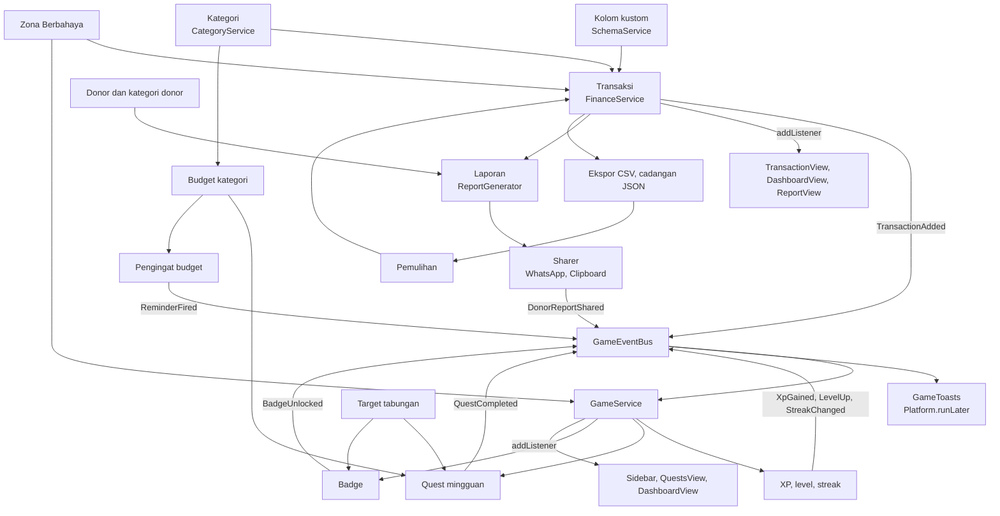

# Dokumentasi fitur JalokDuitNow

Dokumen ini dibuat dari membaca kode dan teks antarmuka yang ada, bukan dari rancangan. Setiap berkas membahas satu fitur
dengan struktur yang sama: Ringkasan, Cara memakai, Aturan dan batasan, Cara kerja (teknis), Data yang disimpan, Kasus tepi,
Keterkaitan, dan Catatan dan celah.

Semua path kelas di dokumen ini relatif terhadap `src/main/java/com/okto/jalokduitnow/` (misalnya `service/FinanceService.java`).
Nama berkas tes relatif terhadap `src/test/java/com/okto/jalokduitnow/`.

Gambaran seluruh aplikasi (startup, lapisan, event, thread, waktu, error, titik perluasan) ada di
[cara-kerja-aplikasi.md](../cara-kerja-aplikasi.md). Peta topik OOP per kelas ada di [MATERI-OOP.md](../MATERI-OOP.md).

## Daftar fitur

| Berkas | Ringkasan satu baris |
|--------|----------------------|
| [01-transaksi.md](01-transaksi.md) | Tambah, ubah, hapus, cari transaksi pemasukan dan pengeluaran. |
| [02-kolom-kustom.md](02-kolom-kustom.md) | Kolom buatan pengguna (teks, angka, tanggal, pilihan, ya/tidak) dan migrasi saat tipe berubah atau kolom dihapus. |
| [03-kategori.md](03-kategori.md) | Kategori dengan id tetap, ikon, warna, budget bulanan, arsip, gabung, dan hapus dengan pemindahan. |
| [04-dashboard.md](04-dashboard.md) | Beranda: pilihan bulan dan tahun, kartu ringkasan, grafik, 6 bulan terakhir. |
| [05-xp-level-streak.md](05-xp-level-streak.md) | Aturan XP dan batas harian, kurva level, gelar, streak dan freeze token. |
| [06-quest-mingguan.md](06-quest-mingguan.md) | Lima jenis quest, pembuatan tiap Senin, status, dan kapan XP dibayar. |
| [07-badge.md](07-badge.md) | Sepuluh badge di `AchievementCatalog` dengan aturan buka yang tepat. |
| [08-target-tabungan.md](08-target-tabungan.md) | Target tabungan yang terhubung ke kategori pengeluaran dan cara kemajuannya dihitung. |
| [09-laporan-bulanan.md](09-laporan-bulanan.md) | Laporan pribadi dan laporan donor dalam teks polos. |
| [10-kirim-ke-donatur.md](10-kirim-ke-donatur.md) | Daftar donor, normalisasi nomor, tautan WhatsApp, clipboard, dan bawaan privasi. |
| [11-pengingat-notifikasi.md](11-pengingat-notifikasi.md) | Empat jenis pengingat, jam tenang, sekali per periode, tray, dan pusat notifikasi. |
| [12-ekspor-cadangan-pemulihan.md](12-ekspor-cadangan-pemulihan.md) | Ekspor CSV dan JSON, cadangan otomatis harian, dan alur pemulihan. |
| [13-zona-berbahaya.md](13-zona-berbahaya.md) | Tiga tindakan hapus atau reset dengan konfirmasi dan cadangan pengaman. |
| [14-tampilan-tema-pengaturan.md](14-tampilan-tema-pengaturan.md) | Tema terang dan gelap, halaman Pengaturan, ikon vektor, tata letak responsif. |
| [15-penyimpanan-dan-thread.md](15-penyimpanan-dan-thread.md) | Folder data, berkas JSON, penulisan atomik, auto-save, thread latar, aturan `Platform.runLater`. |

## Peta keterkaitan

Cara membaca: transaksi yang ditambahkan menjadi event; `GameService` mendengarkannya dan memberi XP, memperbarui streak, dan
mengevaluasi quest serta badge; hasilnya diumumkan lagi lewat event yang didengar `GameToasts`, dan tampilan diperbarui lewat
`addListener`. Data transaksi, kategori, kolom, dan donor mengalir ke laporan, lalu ke WhatsApp atau clipboard.

## Dokumen pendamping

- [cara-kerja-aplikasi.md](../cara-kerja-aplikasi.md): startup, arsitektur, event, persistensi, thread, waktu, error, titik perluasan.
- [MATERI-OOP.md](../MATERI-OOP.md): topik Java dan OOP yang dipakai beserta lokasinya.

## Konvensi di dokumen ini

- "Contoh nyata" memakai angka dari aturan di kode (misalnya `XpPolicy` bawaan). Angka awal adalah contoh, bukan data nyata.
- "Catatan dan celah" berisi hal yang saya temukan saat membaca kode dan belum saya jalankan. Perilaku yang tidak bisa saya
  pastikan dari kode ditulis sebagai tidak terverifikasi.
- Tabel "Kasus tepi" menyebut tes yang membahas kasusnya (nama tes diambil dari berkas tes); tes tidak saya jalankan ulang dan isi tiap tes tidak saya baca baris demi baris.
