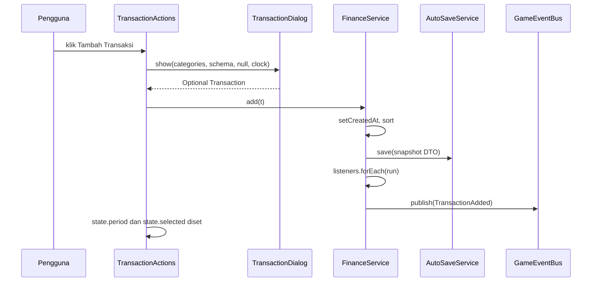

# 01. Transaksi

## Ringkasan

Transaksi adalah satu catatan uang masuk (`Income`) atau uang keluar (`Expense`). Setiap transaksi punya tanggal, kategori, dan
jumlah (kolom inti), ditambah nilai kolom kustom bila ada. Transaksi bisa ditambah, diubah, dihapus, dan dicari.

## Cara memakai

1. Klik **Tambah Transaksi** di sidebar kiri (atau tombol **Tambah Transaksi** pada sebuah notifikasi pengingat).
2. Di dialog **Tambah Transaksi**, isi **Tanggal** (bawaan: hari ini), **Tipe** (`Expense` atau `Income`), **Kategori**,
   **Jumlah (Rp)**, dan kolom kustom. Kolom wajib ditandai ` *`.
3. Klik OK. Bila ada yang salah, pesan merah muncul di dialog dan dialog tetap terbuka.
4. Untuk mengubah: klik dua kali sebuah baris tabel, atau pilih baris lalu klik **Ubah** di panel **Detail Transaksi**.
5. Untuk menghapus: pilih baris, klik **Hapus**, lalu konfirmasi pertanyaan `Hapus <kategori> <jumlah>?`.
6. Untuk mencari: ketik di kotak **Cari transaksi...** di bagian atas. Bila kamu mengetik saat berada di halaman selain
   Beranda atau Transaksi, aplikasi berpindah ke halaman **Transaksi**.

Panel **Detail Transaksi** di kanan hanya tampil di halaman Beranda dan Transaksi, dan hanya bila lebar jendela minimal 1180.
Tombol **Bagikan** di panel itu dinonaktifkan (tooltip "Segera hadir").

## Aturan dan batasan

| Aturan | Nilai | Sumber |
|--------|-------|--------|
| Jumlah | harus lebih dari 0; disimpan sebagai `long` (Rupiah, tanpa sen) | `Transaction.setAmount` |
| Input jumlah | semua karakter selain angka dibuang; kosong ditolak ("Jumlah wajib diisi"); terlalu besar ditolak ("Jumlah terlalu besar") | `ui/TransactionDialog.build` |
| Tanggal | wajib; hanya ditolak bila sebelum 1 Januari 2000 atau lebih dari 5 tahun setelah hari ini (menurut `Clock`) | `service/DateRules.check` |
| Kategori | wajib; tipenya harus sama dengan tipe transaksi; kategori yang diarsipkan tidak boleh dipilih baru | `CategoryService.requireUsable` |
| Kategori terarsip | transaksi lama boleh tetap memakainya saat diubah | `TransactionDialog.build` (`unchanged`) |
| Kolom kustom | divalidasi oleh tipe kolomnya; kolom wajib tidak boleh kosong | `TableSchema.applyInput` |
| Waktu pembuatan | `createdAt` diisi sekali saat `add` bila masih kosong | `FinanceService.add` |
| Urutan | tanggal terbaru di atas | `FinanceService.sort` |
| Pencarian | tanpa membedakan huruf besar kecil; mencocokkan nama kategori, tanggal (`dd MMM yyyy` dan ISO), jumlah (angka dan format Rupiah), tipe, dan nilai kolom kustom yang tampil | `ui/TransactionTable.matches` |
| Yang tidak diubah | mengubah atau menghapus transaksi tidak memberi atau mengambil XP | `GameService` (hanya `TransactionAdded`) |

Pewarisan: `model/Transaction.java` abstrak; `Income.signedAmount()` positif, `Expense.signedAmount()` negatif. Total dan saldo
memakai `signedAmount()` sehingga tidak ada percabangan tipe di service.

## Cara kerja (teknis)

### Alur langkah demi langkah

Menambah transaksi:

1. `ui/Sidebar` memanggil `TransactionActions.add()` (tombol **Tambah Transaksi**).
2. `TransactionDialog.show(...)` membangun form. Tombol OK memakai `addEventFilter`: bila `DateRules.check`, `TableSchema.applyInput`,
   atau `TransactionDialog.build` melempar `InvalidTransactionException`, `InvalidColumnException`, atau `InvalidCategoryException`,
   pesan dipasang di label error dan `ev.consume()` menjaga dialog tetap terbuka.
3. `build` membuat `Income` atau `Expense` dengan `UUID` baru lalu `replaceCustomValues(schema, custom)`.
4. `FinanceService.add(t)`: mengisi `createdAt` (`Instant.now(clock)`), `transactions.add`, `sort()`, `persist()`.
5. `persist()` mengambil snapshot `TransactionDto.from(...)`, menyerahkannya ke `AutoSaveService.save` (ditulis nanti di thread
   `auto-save`), lalu menjalankan semua listener (tabel, dashboard, laporan memanggil `refresh` atau `render`).
6. `FinanceService.add` menerbitkan `GameEvent.TransactionAdded(t)` ke `GameEventBus` (lihat [05](05-xp-level-streak.md)).
7. Kembali di `TransactionActions.add`: `state.period` diset ke bulan transaksi dan `state.selected` ke transaksi itu.

Mengubah: `TransactionActions.edit` -> `TransactionDialog.show(..., existing, ...)` -> `FinanceService.update(t)` (mengganti objek
dengan `id` yang sama, `sort`, `persist`; tidak menerbitkan event). Menghapus: `TransactionActions.delete` -> `FinanceService.delete(id)`.

### Contoh nyata

Sebelum: ada 12 transaksi; saldo bulan ini Rp 1.500.000 (pemasukan Rp 3.000.000, pengeluaran Rp 1.500.000).
Tambah `Expense` Rp 25.000 kategori Makan dengan input `25.000`.

- Input dibersihkan: `"25.000"` -> `"25000"` -> `Long 25000`.
- `Expense.signedAmount()` = -25000.
- Sesudah: 13 transaksi; pengeluaran bulan itu Rp 1.525.000; saldo = 3.000.000 - 1.525.000 = Rp 1.475.000.

### Diagram

### Apa yang terjadi di thread mana

| Langkah | Thread |
|---------|--------|
| Dialog, validasi, `FinanceService.add`, listener, `GameService.onTransactionAdded` | FX (JavaFX Application Thread) |
| Penulisan `transactions.json` | thread `auto-save` (daemon) milik `AutoSaveService` |
| Kegagalan simpan | handler dipanggil di thread `auto-save`; `MainApp` membungkusnya dengan `Platform.runLater` lalu menampilkan `Alert` |

### Apa yang disimpan dan kapan

`transactions.json` ditulis sekitar 300 ms setelah perubahan terakhir (perubahan cepat digabung). `MainApp.stop()` memanggil
`service.flush()` agar antrean terakhir tertulis. Penulisan memakai berkas sementara dan menyimpan versi lama sebagai
`transactions.json.bak` (lihat [15](15-penyimpanan-dan-thread.md)).

## Data yang disimpan

`transactions.json` berisi daftar `TransactionDto`: `id`, `type` ("Income" atau "Expense"), `date`, `categoryId`, `amount`,
`custom` (teks kanonik per id kolom), `createdAt`. Field `category` (nama) dan `description` hanya dibaca dari berkas versi lama
dan tidak pernah ditulis.

## Kasus tepi

| Kasus | Perilaku | Tes |
|-------|----------|-----|
| Berkas lama menyimpan nama kategori | nama diubah menjadi id lalu berkas ditulis ulang | `storage/CategoryMigrationTest` |
| `categoryId` tidak dikenal | jatuh ke kategori "Tanpa Kategori" (dibuat bila belum ada) | `storage/CategoryMigrationTest` |
| Deskripsi lama | dipindah ke kolom `keterangan` | `storage/JsonRepositoryTest.legacyDescriptionMovesIntoKeteranganColumn` |
| Nilai kolom yang sudah dihapus | dibuang saat dimuat | `storage/JsonRepositoryTest.valuesOfDeletedColumnsAreDroppedOnLoad` |
| Berkas lama tanpa `createdAt` | diisi pukul 12:00 pada tanggal transaksi, lalu disimpan ulang | `service/FinanceServiceTest` |
| Tanggal aneh (tahun 1999, atau 6 tahun ke depan) | ditolak dengan pesan rentang yang diizinkan | `service/DateRulesTest` |
| Transaksi di tahun yang berbeda | masuk ke bulan dan total yang benar | `service/YearBoundaryTest` |
| Berkas rusak | `StorageException` dan salinan `.corrupt-<waktu>.bak` | `storage/JsonRepositoryTest.corruptFileThrowsAndLeavesABackupCopy` |
| Hanya `add` yang diumumkan | `update`, `delete` tidak menerbitkan event | `service/FinanceServiceTest.onlyAddAnnouncesATransaction` |

## Keterkaitan

[02 Kolom kustom](02-kolom-kustom.md), [03 Kategori](03-kategori.md), [04 Dashboard](04-dashboard.md),
[05 XP, level, streak](05-xp-level-streak.md), [06 Quest](06-quest-mingguan.md), [09 Laporan](09-laporan-bulanan.md),
[12 Ekspor dan cadangan](12-ekspor-cadangan-pemulihan.md).

## Catatan dan celah

- **`createdAt` dipertahankan saat transaksi diubah.** `TransactionDialog.build` membuat objek baru tanpa `createdAt`, lalu
  `FinanceService.update` menyalin `createdAt` dari transaksi lama bila objek pengganti belum punya
  (tes: `FinanceServiceTest.editingKeepsTheOriginalCreationTime`). Sebelum perbaikan ini nilainya hilang pada transaksi yang diubah.
- **Filter periode hanya ada di Beranda.** README menyebut "filter per periode", tetapi halaman **Transaksi** (`TransactionView`)
  menampilkan semua bulan dan hanya difilter oleh kotak pencarian. Beranda menampilkan maksimal 8 transaksi terbaru di bulan terpilih
  (`DashboardView.RECENT_LIMIT`).
- Input jumlah membuang tanda minus: mengetik `-5000` menghasilkan 5000, bukan error.
- Tombol **Bagikan** di panel detail belum berfungsi.
- Urutan transaksi pada tanggal yang sama tidak dijamin di dokumen ini; kode hanya mengurutkan berdasarkan tanggal.
