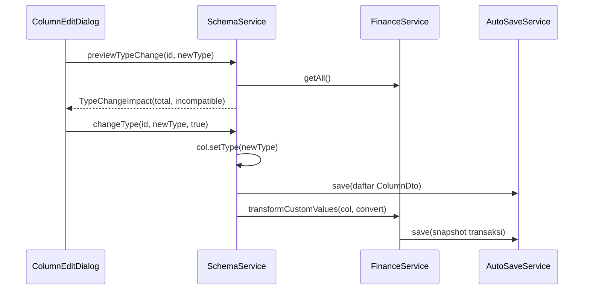

# 02. Kolom kustom

## Ringkasan

Selain kolom inti (tanggal, tipe, kategori, jumlah), pengguna bisa membuat kolom sendiri, misalnya "Jenis" dengan pilihan
Need dan Want. Kolom baru langsung muncul di form dan tabel transaksi tanpa restart. Mengubah tipe atau menghapus kolom tidak
pernah menghilangkan data secara diam-diam: pengguna melihat dampaknya dulu dan harus mengonfirmasi.

## Cara memakai

1. Buka halaman **Kolom** di sidebar. Bagian **Kolom Inti** (Tanggal, `Income / Expense`, Kategori, Jumlah) ditandai **Terkunci**
   ("Selalu ada dan tidak bisa diubah"). Bagian **Kolom Kustom** berisi kolom buatanmu.
2. Klik **Tambah Kolom**. Isi **Nama**, **Tipe** (**Teks**, **Angka**, **Tanggal**, **Pilihan**, **Ya/Tidak**), centang **Wajib diisi** bila perlu,
   lalu **Simpan**. Untuk **Pilihan**, tambahkan opsi lewat **Tambah opsi**.
3. Tiap baris kolom punya tombol ikon: **Naikkan**, **Turunkan** (urutan), mata (sembunyikan atau **Tampilkan lagi**),
   **Ubah kolom**, dan **Hapus kolom**.
4. **Ubah kolom** membuka dialog **Ubah Kolom**. Mengganti tipe memunculkan dialog **Ubah tipe kolom** yang menyebut berapa nilai
   dikonversi dan berapa dikosongkan, lalu tombol **Ubah Tipe**.
5. Menghapus opsi Pilihan yang masih dipakai membuka dialog **Pindahkan nilai** ("Opsi yang dihapus masih dipakai"): pilih opsi
   pengganti lalu **Pindahkan**.
6. **Hapus kolom** pada kolom yang punya nilai membuka dialog `Hapus kolom '<nama>'?` dengan tiga pilihan:
   **Sembunyikan saja** (aman), **Hapus tetap**, atau **Batal**.

## Aturan dan batasan

| Aturan | Nilai | Sumber |
|--------|-------|--------|
| Nama kolom | wajib, di-`trim`, unik tanpa membedakan huruf besar kecil | `TableSchema.checkNameFree` |
| Id kolom | permanen: `"c"` + 8 karakter acak; nama boleh berubah | `TableSchema.newId`, `ColumnDefinition` |
| Kolom bawaan | `keterangan` ("Keterangan", teks, tidak wajib) dibuat saat pertama jalan | `SchemaService.load` |
| Teks | maksimal 500 karakter | `schema/TextType.MAX_LENGTH` |
| Angka | bilangan bulat (`long`); titik dan spasi diterima sebagai pemisah ribuan | `schema/NumberType.parse` |
| Tanggal | disimpan ISO `yyyy-MM-dd`; input ISO atau `dd/MM/yyyy`, ketat; tampil `dd MMM yyyy` | `schema/DateType` |
| Ya/Tidak | disimpan `true`/`false`; menerima `true, ya, yes, y, false, tidak, no, n` | `schema/BooleanType.parse` |
| Pilihan | minimal 1 opsi, tanpa opsi ganda (tanpa membedakan huruf), kosong dibuang | `schema/ChoiceType` (konstruktor) |
| Kolom wajib | transaksi tidak bisa disimpan bila kosong; juga dipakai "entri lengkap" untuk XP | `TableSchema.applyInput`, `GameService.isComplete` |
| Menyembunyikan | nilai tetap tersimpan dan kembali saat kolom ditampilkan lagi | `SchemaService.setVisible` |
| Menghapus kolom berisi data | ditolak tanpa `confirmed = true` | `SchemaService.deleteColumn` |
| Mengubah tipe dengan nilai tak cocok | ditolak tanpa `confirmed = true`; nilai tak cocok dikosongkan | `SchemaService.changeType` |
| Hapus opsi yang dipakai tanpa pengganti | ditolak ("Pilih opsi pengganti") | `SchemaService.updateChoiceOptions` |

## Cara kerja (teknis)

Pewarisan dan polimorfisme: `schema/FieldType<T>` abstrak; `TextType`, `NumberType`, `DateType`, `ChoiceType`, `BooleanType`
masing-masing mengimplementasikan `parse`, `format`, `display`, dan `createEditor` (editor JavaFX yang sesuai).
`FieldKind` adalah enum pilihan di UI dan memetakan label ("Teks", "Angka", ...) ke `FieldType` lewat `FieldKind.create`.
Jackson menyimpan subtipe sebagai `"type": "TEXT"` dan seterusnya (`@JsonTypeInfo`).

### Alur langkah demi langkah

Mengubah tipe kolom "Biaya" dari Teks ke Angka:

1. `ColumnManagerDialog` (ikon **Ubah kolom**) memanggil `ColumnEditDialog.show(service, col)`.
2. Pada Simpan, `ColumnEditDialog` memanggil `SchemaService.validateName` dan `SchemaService.previewTypeChange(id, newType)`.
   Pratinjau menghitung `TypeChangeImpact(total, incompatible)` dengan `convert(old, new, value)`, yaitu
   `to.parseValue(from.formatValue(value))`.
3. Dialog **Ubah tipe kolom** menampilkan dampaknya. Bila pengguna menyetujui: `SchemaService.updateColumn(id, name, required)`,
   lalu `SchemaService.changeType(id, newType, true)`.
4. `changeType` memasang tipe baru, memanggil `save()`, lalu `FinanceService.transformCustomValues(col, fn)` yang mengubah
   tiap nilai (atau menghapusnya bila `fn` mengembalikan null atau validasi gagal) dan menyimpan transaksi satu kali.
5. `save()` menyimpan `schema.json` lewat `AutoSaveService` dan memanggil listener; `TransactionTable.rebuildColumns` membangun
   ulang kolom tabel.

### Contoh nyata

Kolom "Biaya" bertipe Teks. Dari 10 transaksi, 8 punya nilai: 6 berupa angka (`"25.000"`, `"15000"`, `"7500"`, dan 3 lain)
dan 2 berupa teks `"gratis"` dan `"-"`.

- Total nilai = 8, tidak cocok = 2 (`"gratis"` dan `"-"` gagal `NumberType.parseValue`).
- Dialog berkata 6 nilai dikonversi dan 2 dikosongkan.
- Sesudah konfirmasi: `"25.000"` -> `25000L`, `"15000"` -> `15000L`; `"gratis"` dan `"-"` dihapus; 2 transaksi tanpa nilai tidak berubah.

(Angka 8, 6, 2 adalah contoh; aturan konversinya dari `SchemaService.convert`.)

### Diagram

### Apa yang terjadi di thread mana

Semua langkah di atas berjalan di thread FX. Hanya penulisan `schema.json` dan `transactions.json` berjalan di thread `auto-save`.

### Apa yang disimpan dan kapan

`schema.json` ditulis lewat auto-save (sekitar 300 ms setelah perubahan terakhir). Perubahan tipe atau penghapusan kolom juga
menulis `transactions.json`. Versi sebelumnya tersimpan sebagai `.bak` (lihat [15](15-penyimpanan-dan-thread.md)).

## Data yang disimpan

`schema.json`: daftar `ColumnDto` (id, nama, urutan, terlihat, wajib, tipe, dan `options` untuk Pilihan). Nilai per transaksi ada di
`transactions.json` pada field `custom` (id kolom -> teks kanonik).

## Kasus tepi

| Kasus | Perilaku | Tes |
|-------|----------|-----|
| Nama kembar atau kosong | ditolak, tidak ada yang berubah | `service/ColumnManagementTest.duplicateAndEmptyNamesAreRefusedWithoutChangingAnything` |
| Pilihan tanpa opsi | ditolak | `service/ColumnManagementTest.aChoiceColumnNeedsAtLeastOneOption` |
| Mengganti nama opsi | nilai ikut berpindah | `service/ColumnManagementTest.renamingAnOptionCarriesItsValuesAlong` |
| Menghapus opsi yang dipakai | butuh pengganti; tidak ada nilai hilang | `service/ColumnManagementTest.removingAnOptionInUseNeedsAReplacementAndLosesNothing` |
| Angka ke teks | semua nilai dipertahankan | `service/ColumnManagementTest.numberToTextKeepsEveryValue` |
| Teks ke angka | hanya yang bisa di-parse yang dipertahankan; sisanya dilaporkan | `service/ColumnManagementTest.textToNumberKeepsOnlyValuesThatParseAndReportsTheRest` |
| Hapus kolom berisi data | butuh konfirmasi; sembunyikan menyimpan semua nilai | `service/SchemaServiceTest.deleteWithDataNeedsConfirmation`, `hidingKeepsValues` |
| Kolom kustom bernama sama dengan kolom inti di CSV | diberi akhiran ` (kolom)` | `storage/CsvExporterTest.aCustomColumnNamedLikeACoreColumnIsMarked` |
| Semua perubahan setelah restart | tetap ada | `service/ColumnManagementTest.allChangesSurviveARestart` |

## Keterkaitan

[01 Transaksi](01-transaksi.md) (form dan tabel), [06 Quest](06-quest-mingguan.md) (`ChoiceShareQuest` memakai kolom Pilihan),
[07 Badge](07-badge.md) (`ColumnBuilderAchievement`), [09 Laporan](09-laporan-bulanan.md) (rincian per kolom Pilihan),
[12 Ekspor](12-ekspor-cadangan-pemulihan.md) (CSV memuat kolom tersembunyi juga).

## Catatan dan celah

- Menghapus kolom tanpa nilai memakai `Alert` konfirmasi biasa; dialog tiga pilihan hanya muncul bila ada nilai
  (`ColumnManagerDialog.confirmDelete`).
- Saya tidak merinci kontrol `ui/OptionListEditor` (tombol per opsi) karena tidak dibaca sampai tuntas; yang pasti, urutan opsi bisa
  diubah dan nilai tetap aman (`ColumnManagementTest.reorderingOptionsKeepsValuesAndChangesOnlyTheOrder`).
- Kolom inti (tanggal, tipe, kategori, jumlah) tidak bisa disembunyikan atau dihapus; hanya kolom kustom yang bisa.
