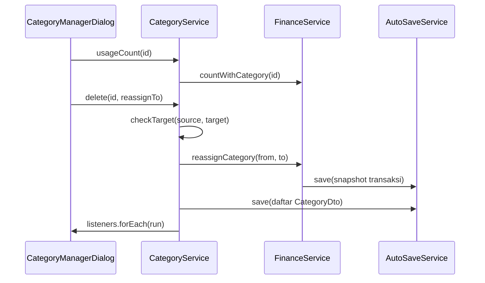

# 03. Kategori

## Ringkasan

Kategori mengelompokkan transaksi (misalnya Makan, Gaji). Setiap kategori punya id tetap (`UUID`), sedangkan transaksi hanya
menyimpan id itu. Jadi mengganti nama, ikon, warna, atau budget langsung berlaku di semua transaksi, dan kategori yang dihapus
atau digabung selalu memindahkan transaksinya lebih dulu.

## Cara memakai

1. Buka halaman **Kategori**. Daftar menampilkan nama, tipe, dan keterangan seperti `· budget ...` atau `· diarsipkan`.
2. Klik **Baru** untuk mengosongkan formulir, lalu isi **Nama kategori**, **Tipe**, **Ikon**, **Warna**, dan
   **Budget/bulan** (kosongkan = tanpa budget; hanya untuk Expense). Tombol simpan bertuliskan **Tambah** saat membuat kategori baru.
3. Untuk mengubah, pilih kategori yang ada, ubah isinya, lalu klik **Simpan** (tombol yang sama berganti label saat mengedit).
4. **Arsipkan** menyembunyikan kategori dari pilihan transaksi baru; transaksi lama tetap. **Aktifkan** membatalkannya.
5. **Gabung ke...** memindahkan semua transaksi ke kategori tujuan (dialog `Gabungkan '<nama>'` dengan **Kategori tujuan:** lalu
   **Pindahkan transaksi**).
6. **Hapus...** pada kategori yang dipakai membuka dialog **Kategori masih dipakai**: pilih kategori tujuan lalu
   **Pindahkan lalu hapus**, atau **Arsipkan saja**. Bila tidak ada kategori lain bertipe sama, muncul pesan
   "Tidak ada kategori lain sebagai tujuan. Tambah dulu satu."

## Aturan dan batasan

| Aturan | Nilai | Sumber |
|--------|-------|--------|
| Nama | wajib, di-`trim`, maksimal 40 karakter | `model/Category.update`, `MAX_NAME_LENGTH` |
| Keunikan nama | per tipe, tanpa membedakan huruf besar kecil; ganti huruf besar kecil pada nama sendiri diizinkan | `CategoryService.checkNameFree` |
| Ikon | kunci ke katalog ikon, pola `[a-z0-9_]{1,32}`; kosong menjadi `other` | `Category.update`, `ui/IconCatalog` |
| Warna | `#rrggbb`, disimpan huruf kecil | `Category.update` |
| Budget | hanya kategori Expense; harus lebih dari 0; `null` berarti tanpa budget | `Category.update` |
| Tipe | tidak pernah berubah setelah dibuat | `Category` (field `final`) |
| Bawaan pertama jalan | Expense: Makan, Transport, Belanja, Hiburan, Tagihan, Kesehatan, Tabungan. Income: Gaji, Freelance, Bonus | `CategoryService.seedDefaults` |
| Kategori cadangan | "Tanpa Kategori" (ikon `other`, warna `#7d8b99`) dibuat bila id tidak dikenal saat memuat | `CategoryService.resolve` |
| Hapus kategori terpakai | wajib ada tujuan; tujuan harus beda, bertipe sama, tidak diarsipkan | `CategoryService.delete`, `checkTarget` |
| Arsip | hilang dari pilihan (`active(type)`), transaksi tetap | `CategoryService.archive` |

## Cara kerja (teknis)

### Alur langkah demi langkah

Menghapus kategori "Hiburan" (dipakai 6 transaksi) dengan tujuan "Belanja":

1. `ui/CategoryManagerDialog` memanggil `CategoryService.usageCount(id)` -> `FinanceService.countWithCategory(id)` = 6.
2. Pengguna memilih tujuan; UI memanggil `CategoryService.delete(id, reassignTo)`.
3. `delete` memeriksa `checkTarget` (beda id, tipe sama, tidak diarsipkan).
4. `FinanceService.reassignCategory(from, to)` mengganti `categoryId` pada 6 transaksi lalu `persist()` satu kali.
5. `categories.remove(id)`, lalu `save()` menyimpan `categories.json` lewat `AutoSaveService` dan menjalankan listener
   (`TransactionTable.refresh`, `DashboardView.refresh`, `ReportView.render`, dan seterusnya).

`merge(source, target)` memvalidasi target lebih dulu (juga bila sumber belum dipakai) lalu memanggil `delete(source, target)`.

### Contoh nyata

Sebelum: Hiburan punya 6 transaksi, Belanja punya 9, jumlah transaksi total 40.
Sesudah hapus dengan pemindahan: Hiburan tidak ada; Belanja punya 9 + 6 = 15; total tetap 40; tidak ada transaksi yatim.
Tanpa tujuan, `delete` melempar `InvalidCategoryException`: "6 transaksi memakai kategori 'Hiburan'. Pilih kategori tujuan, atau arsipkan saja."

### Diagram

### Apa yang terjadi di thread mana

Seluruh logika berjalan di thread FX. `categories.json` dan `transactions.json` ditulis di thread `auto-save`.

### Apa yang disimpan dan kapan

`categories.json` lewat auto-save (sekitar 300 ms). Bila berkas lama masih memakai emoji sebagai ikon, `CategoryService.load`
menulisnya ulang dengan kunci ikon.

## Data yang disimpan

`categories.json`: daftar `CategoryDto` (id, nama, tipe, kunci ikon, warna, budget bulanan, status arsip). Transaksi menyimpan
`categoryId`. Budget kategori dipakai oleh [quest](06-quest-mingguan.md), [badge](07-badge.md) dan [pengingat](11-pengingat-notifikasi.md).

## Kasus tepi

| Kasus | Perilaku | Tes |
|-------|----------|-----|
| Pertama jalan | kategori bawaan dibuat dan bisa diedit; jalan kedua tidak menimpa edit | `service/CategoryServiceTest.firstRunSeedsEditableDefaults`, `secondRunKeepsEditsInsteadOfReseeding` |
| Ganti nama | tampil di semua transaksi karena hanya id yang disimpan | `CategoryServiceTest.renamePropagatesToEveryTransactionBecauseTheyOnlyHoldTheId` |
| Nama kembar per tipe | ditolak | `CategoryServiceTest.namesAreUniquePerTypeIgnoringCase` |
| Hapus terpakai tanpa tujuan | ditolak | `CategoryServiceTest.deleteWithTransactionsNeedsATarget` |
| Gabung ke diri sendiri atau tipe lain | ditolak | `CategoryServiceTest.mergeNeedsADifferentTargetOfTheSameType` |
| Berkas lama dengan nama kategori | nama menjadi id | `storage/CategoryMigrationTest.oldNamesBecomeIdsAndTheFileIsRewritten` |
| Id kategori tidak dikenal | jatuh ke "Tanpa Kategori" | `storage/CategoryMigrationTest.unknownCategoryIdsFallBackInsteadOfLeavingOrphans` |
| Ikon emoji lama | diganti kunci ikon | `storage/CategoryIconMigrationTest` |
| Kunci ikon tak dikenal | memakai ikon `other` | `ui/IconCatalogTest.unknownKeysFallBackToOther` |

## Keterkaitan

[01 Transaksi](01-transaksi.md), [04 Dashboard](04-dashboard.md) (kartu kategori dan budget), [06 Quest](06-quest-mingguan.md),
[07 Badge](07-badge.md) (`BudgetAchievement`, `CategoryCustomizerAchievement`), [08 Target tabungan](08-target-tabungan.md),
[10 Donatur](10-kirim-ke-donatur.md) (kategori pemasukan donor), [11 Pengingat](11-pengingat-notifikasi.md) (budget).

## Catatan dan celah

- `BudgetAchievement.check` tidak menyaring kategori yang diarsipkan: kategori berbudget yang diarsipkan tetap dihitung.
  `QuestFactory` dan `ReminderFactory` justru melewati kategori yang diarsipkan.
- Mengganti tipe kategori tidak mungkin; untuk itu pengguna harus membuat kategori baru dan menggabungkan.
- Dialog `CategoryManagerDialog` juga punya judul **Kelola Kategori** (dipakai bila dibuka sebagai dialog); halaman **Kategori**
  memakai `CategoryManagerDialog.createView`. Tata letak tepatnya tidak saya rinci.
