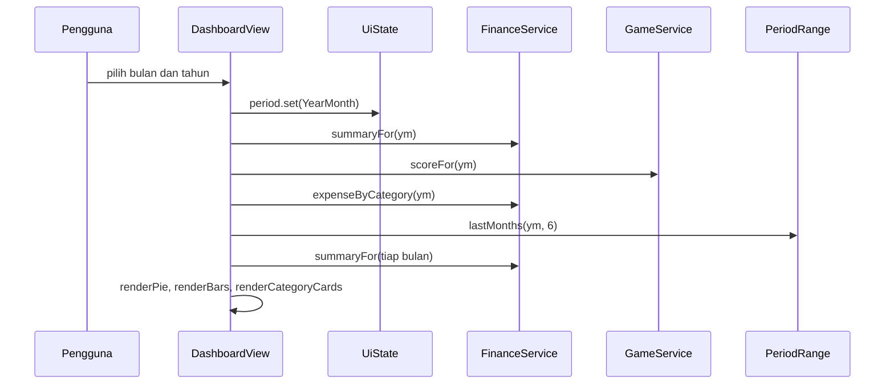

# 04. Dashboard (Beranda)

## Ringkasan

Beranda menampilkan ringkasan satu bulan: pemasukan, pengeluaran, saldo, grafik lingkaran pengeluaran per kategori, grafik batang
6 bulan terakhir, kartu per kategori, dan transaksi terbaru. Bulan dan tahun dipilih dengan dua kotak pilihan. Rentang tahun
dihitung dari data dan jam sistem, tidak pernah ditulis di kode.

## Cara memakai

1. Klik **Beranda** di sidebar. Di baris **Periode**, pilih bulan lalu tahun. Pilihan ini dibagikan ke halaman **Laporan**
   dan ke panel di kanan lewat `UiState.period`.
2. Baca tiga kartu: **Pemasukan**, **Pengeluaran**, **Saldo** (hijau bila positif, merah bila negatif).
3. Di kanan baris periode ada dua chip: `Nilai bulan ini: A` (atau `-` bila tidak ada aktivitas) dan jumlah hari streak.
4. Grafik **Pengeluaran per Kategori** (lingkaran, tooltip nama dan jumlah) dan **6 Bulan Terakhir** (batang, seri **Pemasukan** dan
   **Pengeluaran**).
5. **Kategori Bulan Ini**: satu kartu per kategori yang punya pengeluaran bulan itu, dengan bilah kemajuan.
6. **Transaksi Terbaru**: maksimal 8 transaksi bulan itu. Klik **Lihat semua** untuk membuka halaman **Transaksi**.
7. Kotak **Cari transaksi...** di header juga menyaring daftar **Transaksi Terbaru**.

## Aturan dan batasan

| Aturan | Nilai | Sumber |
|--------|-------|--------|
| Saldo bulan | pemasukan dikurangi pengeluaran bulan itu (pengeluaran termasuk tabungan) | `FinanceService.summaryFor`, `MonthSummary.balance` |
| Bulan awal | bulan sekarang bila ada data atau tidak ada data sama sekali; bila bulan sekarang kosong, bulan terakhir yang punya data (hanya saat refresh pertama) | `PeriodRange.defaultMonth`, `DashboardView.refresh` |
| Rentang tahun | dari tahun terkecil di antara (tahun sekarang, tahun data tertua, tahun terpilih) sampai terbesar di antara (tahun depan, tahun data terbaru, tahun terpilih); tanpa celah | `PeriodRange.years` |
| 6 bulan terakhir | 6 bulan berakhir di bulan terpilih, terlama dulu, melewati pergantian tahun | `PeriodRange.lastMonths` |
| Kartu kategori | dengan budget: `X% dari budget Rp ...`, bilah dibatasi 100% dan gaya `over` bila lebih; tanpa budget: `X% dari pengeluaran` | `DashboardView.categoryCard` |
| Nilai bulan | A bila (pemasukan - pengeluaran) / pemasukan >= 30%, B >= 15%, C >= 0, D bila negatif; D bila ada pengeluaran tanpa pemasukan; tanpa aktivitas: `-` | `model/MonthlyScore.of` |
| Transaksi terbaru | maksimal 8 | `DashboardView.RECENT_LIMIT` |

## Cara kerja (teknis)

### Alur langkah demi langkah

Mengganti bulan ke Desember 2026:

1. `monthBox` atau `yearBox` memanggil `DashboardView.pickPeriod()` (diabaikan bila `updating` true).
2. `pickPeriod` mengisi `state.period` dengan `YearMonth.of(tahun, bulan)` lalu `render()`.
3. `render()` memanggil `FinanceService.summaryFor(ym)` untuk tiga kartu, `GameService.scoreFor(ym)` (-> `MonthlyScore.of`) untuk chip nilai,
   `FinanceService.expenseByCategory(ym)` untuk lingkaran dan kartu, dan `PeriodRange.lastMonths(ym, 6)` untuk batang.
4. `recent.setRows(...)` mengisi `TransactionTable` kompak dengan 8 transaksi bulan itu yang cocok dengan pencarian.
5. Bila data berubah (`FinanceService` atau `CategoryService` memanggil listener), `refresh()` -> `syncPicker()` -> `ensureYear` memperbarui
   daftar tahun lewat `PeriodRange.years`, lalu `render()`.

### Contoh nyata

Data November 2026: pemasukan Rp 5.000.000, pengeluaran Rp 3.200.000.

- Saldo = 5.000.000 - 3.200.000 = Rp 1.800.000.
- Rasio = 1.800.000 / 5.000.000 = 0,36 -> 36% >= 30% -> nilai **A**.
- Pindah ke Januari 2027: 6 bulan terakhir = Agustus, September, Oktober, November, Desember 2026 dan Januari 2027 (urutan dari terlama).
- Kartu kategori "Makan" dengan budget Rp 1.000.000 dan pengeluaran Rp 1.250.000: 1.250.000 / 1.000.000 = 125% -> teks "125% dari budget Rp 1.000.000", bilah penuh bergaya `over`.

### Diagram

### Apa yang terjadi di thread mana

Semua penggambaran berjalan di thread FX. Tidak ada thread latar. `GameService.addListener(this::renderGame)` memperbarui chip nilai
dan streak setiap `GameService.changed()` (juga di thread FX).

### Apa yang disimpan dan kapan

Beranda tidak menyimpan apa pun sendiri. Bulan terpilih hanya hidup di `UiState` (memori) dan kembali ke bulan sekarang
(atau bulan terakhir yang punya data) saat aplikasi dibuka lagi.

## Data yang disimpan

Tidak ada data khusus. Angka dihitung dari `transactions.json` dan `categories.json` setiap kali digambar.

## Kasus tepi

| Kasus | Perilaku | Tes |
|-------|----------|-----|
| Tanpa data | rentang tahun = tahun ini dan tahun depan; bulan awal = bulan sekarang | `service/PeriodRangeTest.withNoDataTheRangeIsThisYearAndNextYear`, `withNoDataTheDefaultMonthIsTheCurrentMonth` |
| Data di 2024 dan 2027 | semua tahun di antaranya muncul tanpa celah | `PeriodRangeTest.dataIn2024And2027GivesEveryYearBetweenThem` |
| Tahun terpilih di luar data | tetap ada di daftar | `PeriodRangeTest.theSelectedYearIsAlwaysIncluded` |
| Pergantian tahun | grafik 6 bulan dan pergeseran bulan benar | `PeriodRangeTest.theLastSixMonthsRunAcrossNewYearInOrder`, `movingAMonthCrossesTheYearBoundaryBothWays`, `service/YearBoundaryTest.theLastSixMonthsChartDataIsRightAcrossNewYear` |
| Nilai bulan Januari untuk data Desember | benar | `YearBoundaryTest.theMonthlyGradeWorksInJanuaryForDecemberData` |
| Bulan sekarang kosong | memakai bulan terakhir yang punya data | `PeriodRangeTest.whenTheCurrentMonthIsEmptyTheLatestMonthWithDataIsUsed` |
| Bulan tanpa pengeluaran | teks "Belum ada pengeluaran di bulan ini" | (tidak ada tes khusus yang saya temukan) |

## Keterkaitan

[01 Transaksi](01-transaksi.md), [03 Kategori](03-kategori.md) (budget), [05 XP, level, streak](05-xp-level-streak.md) (chip streak),
[09 Laporan](09-laporan-bulanan.md) (memakai `UiState.period` yang sama).

## Catatan dan celah

- **Tidak ada "group by" yang bisa dipilih pengguna.** Pengelompokan di Beranda hanya per kategori (`expenseByCategory`).
  Pengelompokan per kolom Pilihan (misalnya Need dan Want) hanya ada di laporan (lihat [09](09-laporan-bulanan.md)), bukan di Beranda.
- Saldo dan pengeluaran Beranda ikut menghitung tabungan sebagai pengeluaran (lihat [08](08-target-tabungan.md)), sehingga menabung
  menurunkan "Saldo" dan "Nilai bulan ini".
- Panel kanan **Ringkasan Bulanan** memakai label "Tingkat tabungan" untuk rasio saldo terhadap pemasukan
  (`DetailPanel.renderOverview`). Itu bukan jumlah yang ditabung ke kategori Tabungan; labelnya bisa membingungkan.
- Panel kanan tersembunyi bila lebar jendela di bawah 1180 (`MainApp.SHOW_DETAIL_FROM`).
