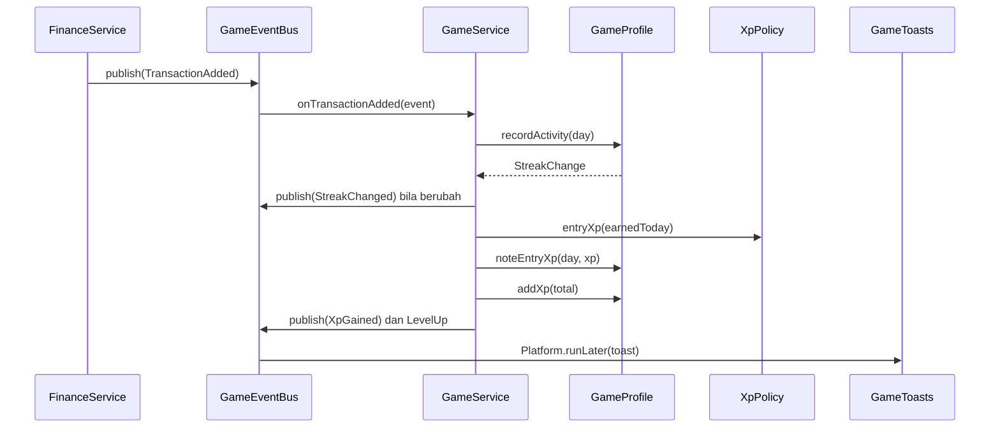

# 05. XP, level, dan streak

## Ringkasan

Setiap kali pengguna menambah transaksi, aplikasi memberi XP. XP mengisi level (kartu di sidebar), dan mencatat transaksi
setiap hari membangun streak. Satu freeze token per minggu menyelamatkan satu hari yang terlewat. XP hanya diberikan untuk transaksi
yang ditambahkan, tidak untuk perubahan atau penghapusan.

## Cara memakai

1. Tambah transaksi seperti biasa ([01](01-transaksi.md)). Toast `+N XP` ("Transaksi baru") muncul di kanan bawah.
2. Lihat kartu level di sidebar: `Level N`, gelar, `x / y XP`, dan bilah kemajuan.
3. Buka **Quest & Badge**: kartu streak menampilkan jumlah hari berturut-turut, **Rekor**, dan **Freeze token** (`n / 2`).
   Teks bantuan: "Satu freeze token baru setiap minggu menyelamatkan satu hari yang terlewat."
4. Di **Beranda**, chip di kanan baris **Periode** menampilkan streak saat ini.
5. Toast lain: **Naik level!**, **Streak N hari**, **Streak terputus**, **Streak diselamatkan** ("Freeze token dipakai").

## Aturan dan batasan

Angka XP (semua dari `model/XpPolicy`, konstruktor bawaan `new XpPolicy()` yang dipakai `MainApp`):

| Sumber XP | Nilai | Catatan |
|-----------|-------|---------|
| Per transaksi ditambahkan | +5 | dibatasi total 30 XP per hari dari sumber ini (`entryXp`) |
| Batas harian XP per transaksi | 30 | pembatas hanya untuk +5 ini |
| Transaksi pertama hari itu | +10 | tidak ikut batas 30 |
| Transaksi lengkap | +3 | semua kolom wajib terisi; tidak ikut batas 30 |
| Quest selesai | +50 | dibayar sekali per quest |
| Badge terbuka | +100 | ditambah `bonusXp()` badge (Konsisten: +25) |
| Laporan donor pertama dibagikan | +25 | sekali saja |

Level dan gelar (`model/GameProfile`):

| Aturan | Nilai |
|--------|-------|
| XP naik dari level n ke n+1 | `round(100 * n^1.5)` (`xpForLevel`) |
| Contoh biaya | level 1: 100, 2: 283, 3: 520, 4: 800, 5: 1118 |
| Gelar | berubah tiap 3 level; daftar: Jalok Pemula, Pemburu Receh, Penjaga Dompet, Juragan Hemat, Sultan Jalok, Raja Tabungan, Maestro Rupiah, Legenda Dompet, Dewa Hemat, Jalok Abadi |
| Pemetaan | level 1-3 -> Jalok Pemula, 4-6 -> Pemburu Receh, ... , 28 ke atas -> Jalok Abadi (`titleFor`) |
| Level naik lebih dari satu | mungkin dalam satu pemberian XP (`addXp` menghitung level sebelum dan sesudah) |

Streak:

| Aturan | Nilai |
|--------|-------|
| Hari yang dihitung | tanggal pembuatan entri (`createdAt` menurut zona `Clock`), bukan tanggal transaksi yang diketik |
| Beberapa entri sehari | dihitung satu hari |
| Freeze token | +1 tiap minggu baru (Senin), maksimal 2 (`MAX_FREEZE_TOKENS`) |
| Hari terlewat | dibayar token satu per hari bila cukup; bila token kurang dari hari terlewat, streak menjadi 0 |
| Rekor | `longestStreak`, tidak turun saat streak putus |

## Cara kerja (teknis)

### Alur langkah demi langkah

Pada penambahan transaksi (`GameService.onTransactionAdded`, dipanggil lewat `GameEventBus`):

1. `FinanceService.add(t)` menerbitkan `GameEvent.TransactionAdded`; `GameService` berlangganan di konstruktornya.
2. Hari = `LocalDate.ofInstant(t.getCreatedAt(), clock.getZone())` (atau hari ini bila `createdAt` null).
3. `firstOfDay = !profile.hasActivityOn(day)`.
4. `profile.recordActivity(day)` -> `rollTo(day)` (beri token mingguan, bayar hari terlewat) lalu menambah `streak`. Bila
   `streak.changed()`, `GameEvent.StreakChanged` diterbitkan.
5. `xp = policy.entryXp(profile.entryXpEarnedOn(day))`; `profile.noteEntryXp(day, xp)`; `+10` bila `firstOfDay`; `+3` bila `isComplete(t)`.
6. `award(xp, "Transaksi baru")`: `profile.addXp(xp)`, terbitkan `XpGained`, dan `LevelUp` bila level naik.
7. Lanjut ke quest dan badge ([06](06-quest-mingguan.md), [07](07-badge.md)), lalu `changed()` menyimpan `game.json` dan menjalankan listener.

Pada pergantian hari: `DailyScheduler` -> `GameService.rollDay()` -> `profile.rollTo(today)` (token mingguan dan penyelesaian hari terlewat).
`MainApp.start` memanggil `rollDay()` sekali saat startup.

### Contoh nyata 1: XP dan level

Sebelum: XP 370. Level: 370 - 100 = 270 (level 2, butuh 283) -> level 2, `270 / 283`.
Pengguna menambah transaksi pertamanya hari itu, semua kolom wajib terisi (atau tidak ada kolom wajib):

- Entri: `entryXp(0)` = min(5, 30 - 0) = 5
- Pertama hari ini: +10
- Lengkap: +3
- Total = 5 + 10 + 3 = **18** XP -> XP 388.

Sesudah: 388 - 100 = 288 >= 283 -> level 3, sisa 288 - 283 = 5, tampil `5 / 520`; gelar tetap "Jalok Pemula" (level 1-3).
`LevelUp` diterbitkan dengan `LevelUpResult(2, 3, "Jalok Pemula")` dan toast "Naik level!".

Transaksi ke-7 pada hari yang sama: `entryXp(30)` = max(0, min(5, 0)) = 0; hanya +3 bila lengkap.

### Contoh nyata 2: streak dan freeze token

Sebelum: streak 6, rekor 6, token 1, aktif terakhir Senin; Selasa tidak ada entri; sekarang Rabu.
Pengguna menambah entri Rabu: `rollTo(Rabu)`: hari terlewat = 1 (Selasa). Karena streak > 0 dan 1 <= 1 token, token menjadi 0 dan streak tetap 6
(`StreakChange` mencatat `freezeTokensUsed = 1`). Lalu `recordActivity` menambah streak menjadi **7**, rekor 7.
Toast "Streak diselamatkan" lalu "Streak 7 hari". Badge "Seminggu Konsisten" kemudian terbuka ([07](07-badge.md)).
(Angka awal adalah contoh; perhitungannya dari `GameProfile.rollTo`.)

### Diagram

### Apa yang terjadi di thread mana

`GameService.onTransactionAdded` berjalan di thread yang menerbitkan event, yaitu thread FX (karena transaksi ditambah dari UI).
`GameService` tidak thread-safe dan dirancang hanya dipakai dari thread FX. `GameToasts` membungkus tiap toast dengan
`Platform.runLater`. `DailyScheduler` hanya menjaga waktu di thread `daily-scheduler`; `rollDay` dijalankan di FX lewat `Platform::runLater`.

### Apa yang disimpan dan kapan

`GameService.changed()` memanggil `autoSave.save(...)` (thread `auto-save`, sekitar 300 ms) lalu listener. `game.json` juga disimpan
saat `MainApp.stop()` lewat `gameService.flush()`.

## Data yang disimpan

`game.json` berisi `GameStateDto.ProfileDto`: `xp`, `streak`, `longestStreak`, `freezeTokens`, `lastActiveDate`, `settledThrough`,
`lastTokenWeek`, `entryXpDate`, `entryXpToday`. Level dan gelar tidak disimpan; keduanya dihitung dari `xp`.

## Kasus tepi

| Kasus | Perilaku | Tes |
|-------|----------|-----|
| Kurva level | `round(100 * n^1.5)` | `model/GameProfileTest.levelCurveIs100TimesNToThePowerOnePointFive` |
| Naik beberapa level sekaligus | didukung | `GameProfileTest.oneBigAwardCanSkipLevels` |
| Batas 30 XP per hari dan reset hari berikut | berlaku | `service/GameServiceTest.entryXpIsCappedAtThirtyPerDay`, `theCapResetsOnTheNextDay` |
| Ubah atau hapus transaksi | XP tidak berubah | `GameServiceTest.editingOrDeletingNeverChangesXp` |
| Hapus lalu tambah lagi | bonus hari pertama tidak bisa dipanen | `GameServiceTest.deletingAndReAddingDoesNotFarmFirstOfDayXp` |
| Satu hari terlewat dengan token | streak selamat | `GameProfileTest.aMissedDayIsSavedByAFreezeToken` |
| Tanpa token | streak putus | `GameProfileTest.withoutATokenAMissedDayBreaksTheStreak` |
| Celah lebih panjang dari token | putus meski masih ada token | `GameProfileTest.aGapLongerThanTheTokensBreaksEvenIfTokensExist` |
| Token mingguan dengan batas 2 | berlaku | `GameProfileTest.oneNewTokenEachWeekUpToTheCap` |
| Pergantian tahun | streak dan token tetap benar | `service/YearBoundaryTest` (beberapa tes) |
| Entri sebelum dan sesudah tengah malam | dua hari | `YearBoundaryTest.entriesJustBeforeAndJustAfterMidnightAreTwoDaysOfStreak` |
| Pertama jalan tanpa `game.json` | streak dibangun dari riwayat tanpa XP | `GameServiceTest.theFirstRunRebuildsTheStreakFromExistingEntriesWithoutGivingXp` |
| Pulihkan cadangan | tidak memberi XP | `restore/RestoreServiceTest.restoredDataDoesNotTriggerXpOrBadges` |
| Data profil tidak valid saat dimuat | `GameProfile.restore` menolak; `GameService.load` melempar `StorageException` | (tidak ada tes khusus yang saya temukan) |

## Keterkaitan

[01 Transaksi](01-transaksi.md), [06 Quest](06-quest-mingguan.md), [07 Badge](07-badge.md), [11 Pengingat](11-pengingat-notifikasi.md)
(Penjaga streak), [13 Zona Berbahaya](13-zona-berbahaya.md) (reset progres game).

## Catatan dan celah

- Streak dihitung dari saat entri dibuat, bukan tanggal transaksi. Mencatat transaksi bertanggal mundur hari ini tetap menghitung
  hari ini (tes `RemindersTest.theEntryDateIsWhenItWasCreatedNotWhichDayItIsFor` mendokumentasikan hal serupa untuk pengingat).
- Token pertama diberikan pada `rollTo` pertama (karena `lastTokenWeek` kosong), jadi pengguna baru langsung punya 1 token setelah
  `rollDay()` pertama.
- Bonus +3 "lengkap" tidak ikut batas harian 30, sehingga entri ke-7 dan seterusnya masih memberi +3 bila lengkap.
- Dengan konfigurasi bawaan, penghasilan XP terbesar per hari dari transaksi adalah 30 (entri) + 10 (pertama) + 3 per entri lengkap.
