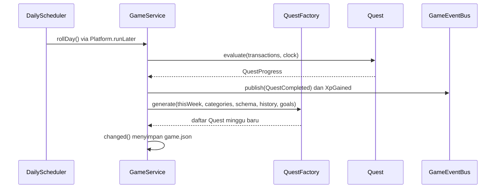

# 06. Quest mingguan

## Ringkasan

Quest adalah tantangan satu minggu (Senin sampai Minggu). Aplikasi membuat sampai 5 quest dari kategori, target tabungan, dan kolom
Pilihan milik pengguna. Progres quest tidak disimpan sebagai angka: selalu dihitung ulang dari transaksi, sehingga mengubah atau
menghapus transaksi langsung tercermin. XP quest (+50) dibayar sekali.

## Cara memakai

1. Buka **Quest & Badge**. Bagian **Quest Minggu Ini** menampilkan rentang tanggal minggu (misalnya `16 Nov - 22 Nov`).
2. Tiap kartu quest menampilkan judul, bilah kemajuan, angka (`x / y hari`, `Rp x / Rp y`, atau `x% / maks y%`), dan chip:
   `+50 XP` (belum selesai), centang dengan `+50 XP` (selesai atau sudah dibayar), atau **Gagal**.
3. Catat transaksi seperti biasa. Kartu diperbarui otomatis; saat quest selesai muncul toast **Quest selesai**.
4. Bila belum ada quest, teks "Belum ada quest. Quest baru dibuat setiap Senin." tampil.

## Aturan dan batasan

Jenis quest (semua turunan `quest/Quest`; dibuat oleh `quest/QuestFactory.generate`):

| Jenis (`type()`) | Judul contoh | Target dipilih dari | Sumber |
|------------------|--------------|---------------------|--------|
| `LOG_DAYS` (`LogDaysQuest`) | "Catat transaksi di 5 hari berbeda" | konstanta 5 hari | `QuestFactory.generate` |
| `NO_SPEND_DAYS` (`NoSpendDaysQuest`) | "Punya 2 hari tanpa pengeluaran" | konstanta 2 hari | `QuestFactory.generate` |
| `CATEGORY_BUDGET` (`CategoryBudgetQuest`) | "<Kategori> tidak lebih dari Rp ..." | budget bulanan x 7 / 30, dibulatkan ke atas ke kelipatan Rp 1.000; tanpa budget: 90% dari rata-rata mingguan 4 minggu sebelumnya, juga dibulatkan ke atas | `weeklyLimit`, `roundUp` |
| `SAVINGS` (`SavingsQuest`) | "Sisihkan Rp ... untuk <target>" atau "Menabung Rp 50.000 minggu ini" | seperempat target tabungan pertama (minimal Rp 1.000, dibulatkan ke atas); bila tidak ada target: konstanta Rp 50.000 untuk kategori Expense "Tabungan" yang tidak diarsipkan | `savingsQuest` |
| `CHOICE_SHARE` (`ChoiceShareQuest`) | "<Kolom> 'Want' di bawah 30% pengeluaran" | kolom Pilihan terlihat pertama dengan >= 2 opsi; opsi "Want" bila ada, kalau tidak opsi terakhir; batas konstanta 30% | `choiceQuest` |

Aturan lain:

| Aturan | Nilai | Sumber |
|--------|-------|--------|
| Hari awal minggu | Senin, ditulis langsung `DayOfWeek.MONDAY`; tidak memakai `Locale` | `QuestPeriod.weekOf` |
| Penentuan minggu ini | `QuestPeriod.weekOf(LocalDate.now(clock))` | `GameService.ensureQuestsForThisWeek` |
| Maksimal quest | 5; jika lebih, yang terpotong adalah yang paling akhir dalam daftar | `QuestFactory.MAX_QUESTS`, `subList(0, 5)` |
| Kandidat budget | maksimal 2 kategori Expense, tidak diarsipkan, bukan "Tanpa Kategori": yang berbudget (urut nama) dulu, lalu pengeluaran terbesar | `budgetCandidates` |
| Acak atau rotasi | tidak ada; seluruh pembuatan deterministik | `QuestFactory` (tidak memakai `Random`) |
| Id quest | stabil per minggu dan templat, misalnya `log-days:2026-11-16`, `budget:<minggu>:<idKategori>` | `QuestFactory` |
| XP | `policy.questXp()` = 50, dibayar sekali; id yang sudah dibayar disimpan selamanya | `GameService.evaluateQuests`, `rewardedQuests` |

Kapan status berubah (`evaluate` pada tiap kelas):

| Jenis | COMPLETED | FAILED | Selain itu |
|-------|-----------|--------|------------|
| `LOG_DAYS` | jumlah hari berbeda >= target | minggu sudah lewat dan target belum tercapai | IN_PROGRESS |
| `NO_SPEND_DAYS` | jumlah hari yang sudah berakhir (sebelum hari ini) tanpa pengeluaran >= target | minggu sudah lewat dan kurang | IN_PROGRESS; hari ini belum dihitung |
| `CATEGORY_BUDGET` ("tetap di bawah X") | hanya bila minggu sudah lewat dan pengeluaran <= batas | seketika pengeluaran > batas | IN_PROGRESS sepanjang minggu selama masih di bawah batas |
| `SAVINGS` | jumlah di kategori selama minggu >= target | minggu lewat dan kurang | IN_PROGRESS |
| `CHOICE_SHARE` | hanya saat minggu lewat: ada pengeluaran dan persentase <= batas | saat minggu lewat: tanpa pengeluaran, atau persentase > batas | IN_PROGRESS sepanjang minggu |

Kapan XP "tetap di bawah X" dibayar: `GameService.evaluateQuests` membayar quest yang `isCompleted()` dan belum ada di `rewardedQuests`.
Karena `CATEGORY_BUDGET` baru COMPLETED setelah minggu berakhir, XP-nya dibayar pada pemanggilan `rollDay()` pertama setelah tengah
malam Senin (`DailyScheduler`, atau saat aplikasi dibuka), atau pada transaksi berikutnya. Bila sempat FAILED, XP tidak pernah dibayar.

## Cara kerja (teknis)

### Alur langkah demi langkah

1. Saat startup, `MainApp.start` memanggil `GameService.load()` lalu `rollDay()`.
2. `rollDay()`: `profile.rollTo(today)`; `evaluateQuests()` (membayar quest minggu yang baru selesai); `ensureQuestsForThisWeek()`;
   `evaluateQuests()` lagi; `evaluateBadges()`; `changed()`.
3. `ensureQuestsForThisWeek()` keluar lebih awal bila `quests` tidak kosong dan periode quest pertama sama dengan minggu ini. Selain itu
   memanggil `QuestFactory.generate(thisWeek, categories, schema, history, goals)`.
4. Saat transaksi ditambah (`onTransactionAdded`): `ensureQuestsForThisWeek()`, `evaluateQuests()`, `evaluateBadges()`, `changed()`.
5. `evaluateQuests()` memanggil `quest.evaluate(finance.getAll(), clock)`. Bila `isCompleted()`: `rewardedQuests.add(id)`,
   `award(q.getRewardXp(), "Quest selesai")`, dan `GameEvent.QuestCompleted`.
6. `QuestsView` membaca `game.quests()`, `game.progressOf(q)` (`quest.evaluate` baru), dan `game.isRewarded(q)`.

Pertanyaan umum:

- **Apakah dua minggu berturut-turut sama?** Log hari dan hari tanpa pengeluaran sama persis. Quest tabungan dan pilihan sama bila target
  tabungan dan kolom tetap. Quest budget dengan budget bulanan sama; tanpa budget, batasnya berubah karena jendela 4 minggu bergeser,
  dan kategorinya dapat berganti. Id selalu berbeda karena memuat tanggal awal minggu.
- **Menambah kategori, target tabungan, atau kolom Pilihan di tengah minggu?** Quest baru tidak muncul sampai Senin berikutnya
  (`ensureQuestsForThisWeek` tidak membangun ulang minggu yang sudah ada). `onStructureChanged` hanya mengevaluasi badge.
- **Quest minggu lalu?** Yang selesai dibayar (lihat di atas). Yang tidak selesai berstatus FAILED lalu diganti daftar baru tanpa XP dan
  tanpa penalti. Hanya id yang sudah dibayar tersimpan (`rewardedQuests`); objek quest lama dan riwayat gagal tidak disimpan dan tidak ada
  tampilan riwayat.

### Contoh nyata

Quest budget "Makan tidak lebih dari Rp 140.000" (budget bulanan Makan Rp 600.000: 600.000 x 7 / 30 = 140.000, sudah kelipatan 1.000).

| Waktu | Pengeluaran Makan | Status | XP |
|-------|-------------------|--------|----|
| Rabu | Rp 90.000 | IN_PROGRESS, 90.000 / 140.000 | tidak ada |
| Jumat | Rp 120.000 | IN_PROGRESS, 120.000 / 140.000 | tidak ada |
| Senin 00:00:01 (`rollDay`) | tetap Rp 120.000 | COMPLETED | +50 XP, `QuestCompleted` |
| (alternatif) Kamis | Rp 150.000 | FAILED seketika | tidak pernah dibayar |

Contoh quest log hari: progres 2 / 5 menjadi 3 / 5 saat transaksi pertama di hari ke-3. Bila itu hari ke-5, `evaluate` mengembalikan
COMPLETED dan satu aksi menghasilkan: +18 XP (5 + 10 + 3 untuk transaksi pertama hari itu) lalu +50 XP quest; XP 1000 menjadi 1068.

Contoh target tanpa budget: pengeluaran kategori itu dalam 4 minggu sebelum periode total Rp 800.000 -> 800.000 / 4 = 200.000 ->
200.000 x 0,9 = 180.000 -> sudah kelipatan 1.000 -> batas Rp 180.000. Contoh target tabungan: target Rp 2.000.000 -> / 4 = Rp 500.000.

### Diagram

### Apa yang terjadi di thread mana

Timer thread `daily-scheduler` hanya menyerahkan `rollDay` ke thread FX (`Platform::runLater`). Evaluasi, XP, event, dan penyimpanan antrean
terjadi di FX; hanya penulisan `game.json` di thread `auto-save`. Toast dan tampilan diperbarui di FX.

### Apa yang disimpan dan kapan

`game.json`: `quests` (definisi: jenis, id, judul, periode, XP, id kategori atau kolom, opsi, target), `rewardedQuests` (id yang sudah dibayar).
Progres tidak disimpan. Ditulis lewat `changed()` -> auto-save, dan saat aplikasi ditutup (`flush`).

## Data yang disimpan

`game.json` -> `GameStateDto.QuestDto` dan `rewardedQuests` (lihat atas). Konversi `QuestDto.from` / `toQuest` memakai `switch` pola atas
lima kelas quest; jenis tak dikenal melempar `IllegalArgumentException`.

## Kasus tepi

| Kasus | Perilaku | Tes |
|-------|----------|-----|
| Minggu Senin-Minggu | berlaku | `quest/QuestTest.weekRunsMondayToSunday` |
| Budget: IN_PROGRESS sampai minggu berakhir, FAILED seketika bila lewat batas | berlaku | `QuestTest.budgetQuestStaysInProgressUnderTheLimitUntilTheWeekEnds`, `budgetQuestFailsAsSoonAsTheLimitIsExceeded` |
| Hari ini belum dihitung hari tanpa pengeluaran | berlaku | `QuestTest.todayDoesNotCountUntilItIsOver` |
| `ChoiceShare` tanpa pengeluaran | tidak selesai gratis | `QuestTest.choiceShareWithNoSpendingDoesNotCompleteForFree` |
| Progres fungsi murni dari transaksi | berlaku | `QuestTest.progressIsAPureFunctionOfTheTransactions` |
| Maksimal 5 quest, id stabil | berlaku | `quest/QuestFactoryTest.neverMoreThanFiveQuestsAndIdsAreStablePerWeek` |
| Kategori terarsip dan cadangan tanpa quest budget | berlaku | `QuestFactoryTest.archivedAndFallbackCategoriesGetNoBudgetQuest` |
| Dibayar sekali, edit atau hapus tidak mengubah | berlaku | `service/GameServiceTest.aQuestPaysItsRewardOnceAndEditsOrDeletesNeverChangeThat` |
| Budget dibayar saat minggu berakhir | berlaku | `GameServiceTest.aBudgetQuestIsPaidWhenItsWeekEndsWithinTheLimit`, `anOverspentBudgetQuestIsNeverPaid` |
| Minggu melewati tahun baru | satu periode, dihitung dua sisi | `service/YearBoundaryTest.theWeekAcrossNewYearIsOneQuestPeriod` dan tes quest lain di berkas itu |
| Reset game dengan data lama yang sudah memenuhi quest | tidak dibayar | `restore/DeleteDataServiceTest.aQuestThatOldDataAlreadySatisfiesIsNotPaidOutAfterTheReset` |

## Keterkaitan

[03 Kategori](03-kategori.md) (budget), [02 Kolom kustom](02-kolom-kustom.md) (Pilihan), [08 Target tabungan](08-target-tabungan.md),
[05 XP](05-xp-level-streak.md), [13 Zona Berbahaya](13-zona-berbahaya.md).

## Catatan dan celah

- **Quest Pilihan bisa terpotong diam-diam.** Maksimal 5 dari kemungkinan 6 (log, tanpa pengeluaran, 2 budget, tabungan, pilihan);
  `subList(0, 5)` membuang yang terakhir, yaitu quest `CHOICE_SHARE`, bila ada 2 quest budget dan quest tabungan.
- **Tidak ada quest baru di tengah minggu**, dan UI tidak menjelaskannya selain teks "dibuat setiap Senin".
- **Tidak ada riwayat minggu lalu.** Quest gagal atau selesai lama tidak bisa dilihat.
- Quest budget baru dibayar setelah minggu berakhir, berbeda dari jenis lain yang dibayar segera; UI tidak menjelaskannya.
- Batas tanpa budget (90% rata-rata) bisa terus mengecil bila pengguna terus memenuhinya, dan bernilai 0 (tanpa quest) untuk
  kategori yang tidak dipakai 4 minggu terakhir.
- Hanya target tabungan pertama yang dipakai: loop di `savingsQuest` langsung `return` pada iterasi pertama.
- `onTransactionAdded` memanggil `ensureQuestsForThisWeek()` sebelum `evaluateQuests()`. Bila transaksi ditambah setelah Senin tetapi sebelum
  `rollDay()` berjalan (misalnya timer tengah malam terlewat), quest minggu lalu yang belum dibayar diganti tanpa dievaluasi. Ini
  kasus yang jarang; saya tidak menjalankannya.
- Quest dibuat dari data awal saat `rollDay()` pertama; sebelum itu `game.quests()` kosong.
