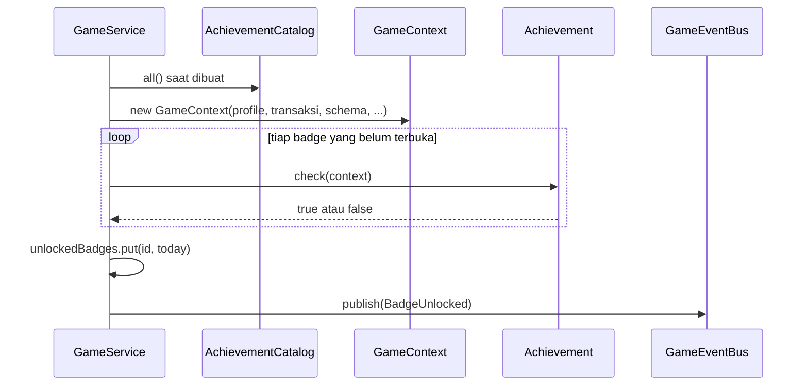

# 07. Badge

## Ringkasan

Badge adalah lencana yang terbuka ketika sebuah aturan terpenuhi. Ada 10 badge di `achievement/AchievementCatalog`. Tiap badge
adalah turunan `achievement/Achievement` yang mendefinisikan aturannya sendiri di `check(GameContext)`. Badge yang sudah terbuka
tidak pernah dicabut, walau aturannya tidak lagi benar.

## Cara memakai

1. Buka **Quest & Badge**. Bagian **Badge** menampilkan `N dari 10 terbuka`.
2. Badge terbuka menampilkan `Dibuka <tanggal>`; badge terkunci menampilkan petunjuk (deskripsinya) dan tooltip `Terkunci: <deskripsi>`.
3. Saat badge terbuka, toast **Badge baru** muncul dengan nama badge.

## Aturan dan batasan

Semua badge, urut seperti di `AchievementCatalog.all()`:

| # | id | Nama | Deskripsi di UI | Aturan buka yang tepat | Kelas |
|---|----|------|-----------------|------------------------|-------|
| 1 | `streak-7` | Seminggu Konsisten | Catat transaksi 7 hari berturut-turut | `profile.getLongestStreak() >= 7` | `StreakAchievement(7, ...)` |
| 2 | `streak-14` | Dua Minggu Rajin | Catat transaksi 14 hari berturut-turut | `longestStreak >= 14` | `StreakAchievement(14, ...)` |
| 3 | `streak-30` | Sebulan Penuh | Catat transaksi 30 hari berturut-turut | `longestStreak >= 30` | `StreakAchievement(30, ...)` |
| 4 | `budget-month` | Anggaran Terjaga | Selesaikan satu bulan penuh tanpa melewati budget kategori mana pun | Bulan sebelum bulan sekarang: ada minimal satu kategori Expense berbudget; ada minimal satu transaksi (jenis apa pun) di bulan itu; pengeluaran tiap kategori berbudget di bulan itu <= budgetnya | `BudgetAchievement` |
| 5 | `savings-50` | Setengah Jalan | Capai 50% dari salah satu target tabungan | ada target tabungan dengan `progress(...).percent() >= 50` | `SavingsAchievement(50, ...)` |
| 6 | `savings-100` | Target Tercapai | Capai 100% dari salah satu target tabungan | ada target dengan persen >= 100 | `SavingsAchievement(100, ...)` |
| 7 | `column-builder` | Perancang Kolom | Buat kolom kustom pertamamu | jumlah kolom selain `keterangan` >= 1 | `ColumnBuilderAchievement(1)` |
| 8 | `category-customizer` | Penata Kategori | Buat minimal 3 kategori sendiri | jumlah kategori yang tidak diarsipkan, bukan "Tanpa Kategori", dan namanya bukan salah satu dari 10 nama bawaan (tanpa membedakan huruf) >= 3 | `CategoryCustomizerAchievement(3)` |
| 9 | `transparent` | Transparan | Bagikan laporan donor pertamamu | `context.donorReportShared()` true | `TransparencyAchievement` |
| 10 | `consistent` | Konsisten | Catat 7 hari berturut-turut setelah pengingat pertama muncul | `firstReminderDay` ada, streak saat ini >= 7, dan awal streak (`lastActiveDate - (streak - 1)`) tidak lebih awal dari `firstReminderDay` | `ConsistentAchievement(7)` |

XP: tiap badge memberi `policy.badgeXp()` = 100, ditambah `bonusXp()`. Hanya `ConsistentAchievement` yang punya bonus: +25
(`BONUS_XP`), jadi 125 XP.

Ikon: tiap badge punya `iconKey` (kunci katalog ikon, bukan emoji): `flame`, `shield`, `star`, `trophy`, `columns`, `categories`, `share`, `check`.

## Cara kerja (teknis)

### Alur langkah demi langkah

1. `GameService` memegang `catalog = AchievementCatalog.all()` (daftar `List<Achievement>`).
2. `evaluateBadges()` dipanggil dari: `onTransactionAdded`, `rollDay`, `onDonorReportShared`, `onReminderFired`, `onStructureChanged`
   (perubahan kolom atau kategori; dilewati bila `!loaded` atau `rewardsSuspended`), `addGoal`, dan `updateGoal`.
3. `evaluateBadges()` membuat `GameContext(profile, finance.getAll(), schema, categories, goals, clock, donorReportShared, firstReminderDay)`.
4. Untuk tiap badge yang belum ada di `unlockedBadges`: bila `a.check(context)` true, `unlockedBadges.put(id, today)`,
   `award(policy.badgeXp() + a.bonusXp(), "Badge baru")`, dan `GameEvent.BadgeUnlocked(a, today)` diterbitkan.
5. `GameToasts` menampilkan toast; `QuestsView.badgeGrid` membaca `game.unlockedOn(a)` untuk tanggalnya.
6. Setelah reset game atau reset pabrik, `startQuestWeek()` -> `syncBadgesSilently()` membuka badge yang sudah dipenuhi data lama tanpa XP,
   event, atau toast.

### Contoh nyata 1: badge streak

Sebelum: streak 6, `longestStreak` 6; `streak-7` terkunci; `Badge: 3 dari 10 terbuka`.
Pengguna menambah transaksi yang menaikkan streak ke 7:

- `check`: `getLongestStreak() >= 7` -> 7 >= 7 -> true.
- `unlockedBadges["streak-7"] = 2026-11-21` (tanggal contoh, dari `LocalDate.now(clock)`).
- XP: +100 (`badgeXp`), bonus 0. Contoh: XP 400 + 18 (transaksi pertama hari itu) + 100 (badge) = 518.
- Sesudah: `Badge: 4 dari 10 terbuka`; kartu menampilkan "Dibuka ..." dengan tanggal tersebut.

### Contoh nyata 2: badge Konsisten

`firstReminderDay` = 10 Nov 2026. Streak 7, aktif terakhir 20 Nov: awal streak = 20 - 6 = 14 Nov, tidak lebih awal dari 10 Nov -> terbuka,
XP = 100 + 25 = **125**. Bila streak 12 dan aktif terakhir 19 Nov: awal = 19 - 11 = 8 Nov, lebih awal dari 10 Nov -> tidak terbuka.

### Diagram

### Apa yang terjadi di thread mana

Evaluasi berjalan di thread FX (dipicu dari transaksi, `rollDay` lewat `Platform::runLater`, dialog kolom dan kategori, atau berbagi laporan).
Toast memakai `Platform.runLater`. `game.json` ditulis di thread `auto-save`.

### Apa yang disimpan dan kapan

`game.json` -> `badges`: peta id badge ke tanggal buka (`LocalDate`), plus `donorReportShared` dan `firstReminderDay`. Ditulis oleh
`changed()` setelah evaluasi (auto-save sekitar 300 ms) dan saat aplikasi ditutup.

## Data yang disimpan

`game.json`: `badges` (`Map<String, LocalDate>`), `donorReportShared` (Boolean), `firstReminderDay` (LocalDate, hari pengingat pertama).

## Kasus tepi

| Kasus | Perilaku | Tes |
|-------|----------|-----|
| Setiap badge punya kunci ikon, bukan emoji | berlaku | `achievement/AchievementTest.everyAchievementHasAnIconKeyNotAnEmoji` |
| Streak 7, 14, 30 | terbuka pada ambangnya | `AchievementTest.streakAchievementsUnlockAtSevenFourteenAndThirtyDays` |
| Budget tanpa bulan aktif atau tanpa budget | tidak terbuka gratis | `AchievementTest.budgetAchievementIgnoresMonthsWithNoActivityOrNoBudgets` |
| Budget bulan Desember dilihat di Januari | memakai Desember tahun lalu | `service/YearBoundaryTest.theBudgetBadgeInJanuaryLooksAtDecemberOfTheYearBefore` |
| Kolom pertama membuka badge sekali dan XP sekali | berlaku | `service/GameServiceTest.creatingTheFirstCustomColumnUnlocksTheBadgeAndAwardsXpOnce` |
| Penata Kategori hanya menghitung kategori buatan yang dipertahankan | berlaku | `AchievementTest.customizerCountsOnlyCategoriesTheUserMadeAndKept` |
| Transparan hanya setelah laporan donor dibagikan | berlaku | `AchievementTest.transparencyUnlocksOnlyOnceADonorReportWasShared` |
| Konsisten: streak yang sudah berjalan sebelum pengingat tidak dihitung | berlaku | `service/ConsistentBadgeTest.aStreakThatWasAlreadyRunningBeforeTheReminderDoesNotCount` |
| Konsisten: bonus dibayar sekali | berlaku | `ConsistentBadgeTest.theBonusIsPaidOnlyOnce` |
| Pemulihan cadangan | badge dan XP apa adanya, tidak ada yang baru | `restore/RestoreServiceTest.restoredBadgesAndXpAreKeptAsTheyWere` |
| Reload dengan reward ditangguhkan | tidak membuka badge | `restore/ReloadTest.suspendedRewardsBlockBadgesFromColumnAndCategoryChangesUntilResumed` |
| Setelah reset game, badge yang dipenuhi data lama | tanpa XP dan event | `restore/DeleteDataServiceTest.afterAResetBadgesThatOldDataSatisfyGiveNoXpAndNoEvent` |

## Keterkaitan

[05 XP](05-xp-level-streak.md) (streak, XP badge), [08 Target tabungan](08-target-tabungan.md), [03 Kategori](03-kategori.md) (budget),
[02 Kolom kustom](02-kolom-kustom.md), [10 Donatur](10-kirim-ke-donatur.md) (Transparan), [11 Pengingat](11-pengingat-notifikasi.md) (Konsisten).

## Catatan dan celah

- `BudgetAchievement` tidak menyaring kategori yang diarsipkan, dan ia menilai bulan lalu dengan budget yang berlaku sekarang
  (budget yang baru dibuat ikut menilai bulan lalu).
- Syarat aktivitas di `BudgetAchievement` hanya "ada transaksi apa pun di bulan itu", bukan transaksi di kategori berbudget.
- Penata Kategori menghitung kategori yang namanya bukan nama bawaan; mengganti nama kategori bawaan menjadi nama lain bisa membuatnya
  terhitung sebagai "buatan sendiri".
- Aturan "Konsisten" memakai streak saat ini (bukan rekor), jadi badge hanya terbuka bila saat evaluasi streak 7 hari itu sedang berjalan
  dan dimulai pada atau setelah hari pengingat pertama. Setelah terbuka, badge tetap terbuka.
- Penulisan "10 badge" mengikuti isi `AchievementCatalog.all()` saat dokumen ini dibuat; menambah badge baru menambah jumlahnya.
