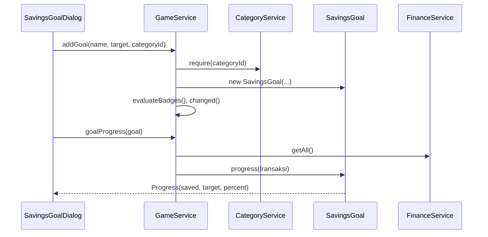

# 08. Target tabungan

## Ringkasan

Target tabungan adalah tujuan menabung dengan nama dan jumlah (misalnya "Laptop baru", Rp 5.000.000) yang terhubung ke satu kategori
pengeluaran. Tidak ada jenis transaksi "tabungan" tersendiri: menabung berarti mencatat pengeluaran (`Expense`) di kategori itu.
Kemajuan dihitung dari semua transaksi di kategori tersebut.

## Cara memakai

1. Buka **Quest & Badge**, bagian **Target Tabungan**, klik **Tambah Target**.
2. Di dialog **Target Tabungan Baru** isi **Nama** (contoh: Laptop baru), **Kategori** (kategori Expense yang aktif), dan **Target (Rp)**
   (contoh: 5000000). Dialog mengingatkan: "Kemajuan dihitung dari semua transaksi di kategori yang dipilih."
3. Catat transaksi `Expense` di kategori itu (misalnya **Tabungan**). Kartu target menampilkan persen dan `Rp x / Rp y`.
4. **Ubah** membuka dialog **Ubah Target Tabungan**. **Hapus** meminta konfirmasi
   `Hapus target '<nama>'? Transaksimu tidak ikut terhapus.`
5. Bila belum ada target, teks "Belum ada target tabungan. Buat satu untuk memantau kemajuanmu." tampil.

## Aturan dan batasan

| Aturan | Nilai | Sumber |
|--------|-------|--------|
| Nama | wajib, di-`trim` | `model/SavingsGoal` (konstruktor kompak) |
| Target | harus lebih dari 0 (`long`); input kosong: "Target wajib diisi"; terlalu besar: "Target terlalu besar" | `SavingsGoal`, `ui/SavingsGoalDialog` |
| Kategori | wajib ("Pilih kategori tabungan"); pilihan di dialog hanya kategori Expense yang tidak diarsipkan | `GameService.buildGoal`, `SavingsGoalDialog` (`categories.active(CategoryType.EXPENSE)`) |
| Jenis transaksi tabungan | `Expense` (tidak ada jenis terpisah) | `SavingsGoalDialog`, `CategoryService.seedDefaults` ("Tabungan" bertipe Expense) |
| Perhitungan kemajuan | jumlah `getAmount()` semua transaksi dengan `categoryId` itu, tanpa batas tanggal; persen = `min(100, saved * 100 / target)` | `SavingsGoal.progress` |
| Efek ke Saldo | karena `Expense`, tabungan mengurangi saldo dan ikut dalam total pengeluaran Beranda | `FinanceService.summaryFor` |
| Efek ke laporan | laporan pribadi: ikut "Pengeluaran", plus baris "Termasuk ditabung"; laporan donor: dipisah sebagai "Ditabung" dan tidak masuk "Total pengeluaran" | `PersonalReportGenerator`, `DonorReportGenerator` |
| Hapus target | transaksi tidak ikut terhapus; badge yang sudah terbuka tetap | `GameService.deleteGoal` |

Kategori tabungan di laporan dikenali lewat nama "Tabungan" (tanpa membedakan huruf) atau ikon `savings`
(`AbstractReportGenerator.isSavings`), bukan lewat target tabungan.

## Cara kerja (teknis)

### Alur langkah demi langkah

1. `QuestsView` memanggil `SavingsGoalDialog.show(game, categories, existing)`.
2. Pada Simpan: `GameService.addGoal(name, targetAmount, categoryId)` atau `updateGoal(id, ...)`.
3. `buildGoal`: bila `categoryId` null -> `InvalidGoalException("Pilih kategori tabungan")`; `categories.require(categoryId)`; lalu
   `new SavingsGoal(id, name, targetAmount, categoryId)`. `InvalidCategoryException` atau `IllegalArgumentException` dibungkus menjadi
   `InvalidGoalException` (pesan ditampilkan di dialog).
4. `goals.add(goal)`, `evaluateBadges()` (target yang sudah terpenuhi data lama bisa langsung membuka badge), `changed()` menyimpan `game.json`.
5. `QuestsView` memanggil `game.goalProgress(goal)` -> `goal.progress(finance.getAll())` untuk menggambar kartu.
6. Target juga memengaruhi `QuestFactory.savingsQuest` (seperempat target per minggu) dan badge `SavingsAchievement` ([06](06-quest-mingguan.md), [07](07-badge.md)).

### Contoh nyata

Target "Laptop baru" Rp 2.000.000 terhubung ke kategori Tabungan.

| Sebelum | Aksi | Sesudah |
|---------|------|---------|
| 3 transaksi Tabungan: Rp 400.000 + 300.000 + 300.000 = Rp 1.000.000; persen = 1.000.000 x 100 / 2.000.000 = 50 | tambah `Expense` Rp 500.000 di Tabungan | Rp 1.500.000; persen = 75 |
| Badge **Setengah Jalan** sudah terbuka (>= 50) | tambah `Expense` Rp 500.000 lagi | Rp 2.000.000; persen = 100; badge **Target Tercapai** terbuka |
| Saldo bulan itu Rp 3.000.000 | tabungan Rp 500.000 tercatat sebagai pengeluaran | saldo bulan itu berkurang Rp 500.000 |

Quest tabungan untuk target ini: 2.000.000 / 4 = Rp 500.000 per minggu ("Sisihkan Rp 500.000 untuk Laptop baru").

### Diagram

### Apa yang terjadi di thread mana

Semua di thread FX; `game.json` ditulis di thread `auto-save`.

### Apa yang disimpan dan kapan

`game.json` -> `goals` (`GoalDto`: id, nama, jumlah target, id kategori). Disimpan lewat `changed()` setiap tambah, ubah, atau hapus.
Kemajuan tidak disimpan: dihitung ulang dari transaksi.

## Data yang disimpan

`game.json` -> `GameStateDto.GoalDto(id, name, targetAmount, categoryId)`. Cadangan JSON ikut membawa target (`BackupDto.game`).

## Kasus tepi

| Kasus | Perilaku | Tes |
|-------|----------|-----|
| Validasi dan kemajuan | nama, target, kategori divalidasi; kemajuan mengikuti transaksi | `service/GameServiceTest.savingsGoalsAreValidatedAndTrackProgress`, `model/SavingsGoalTest` |
| Setoran melintasi tahun | dijumlahkan | `service/YearBoundaryTest.aSavingsGoalAddsUpDepositsFromBothYears` |
| Badge mengikuti kemajuan | berlaku | `achievement/AchievementTest.savingsAchievementsFollowGoalProgress` |
| Quest tabungan mengikuti target atau kategori Tabungan | berlaku | `quest/QuestFactoryTest.savingsQuestFollowsAGoalOrTheTabunganCategory` |
| Hapus semua transaksi | target tetap | `restore/DeleteDataServiceTest` (kasus `TRANSACTIONS`) |
| Reset progres game | target ikut dihapus ("savings goals are part of the game progress") | `DeleteDataServiceTest` (kasus `GAME`) |
| Pulihkan cadangan | `BackupValidator` mewajibkan bagian `goals` pada `game`; target ikut dipulihkan | `restore/BackupValidatorTest.theGameProfileAndGoalsAreRequired` |

## Keterkaitan

[03 Kategori](03-kategori.md), [06 Quest](06-quest-mingguan.md), [07 Badge](07-badge.md), [09 Laporan](09-laporan-bulanan.md),
[13 Zona Berbahaya](13-zona-berbahaya.md).

## Catatan dan celah

- **Target tidak mengikuti kategori yang dihapus atau digabung (dari pembacaan kode).** `CategoryService.delete` dan `merge` memindahkan
  transaksi tetapi tidak menyentuh `GameService.goals`. Target yang menunjuk id kategori lama akan menampilkan kemajuan 0 dan (bila kartu tidak
  menemukan kategori) ikon abu-abu bawaan. Saya tidak menjalankan skenario ini.
- **Kemajuan tidak dibatasi tanggal.** Semua transaksi di kategori dihitung sejak awal, termasuk yang dicatat sebelum target dibuat.
- **Tabungan terhitung sebagai pengeluaran** di Beranda, di "Nilai bulan ini", dan di laporan pribadi. Hanya laporan donor yang memisahkannya.
- Kategori tabungan dikenali dengan dua cara berbeda: lewat id di target tabungan, dan lewat nama "Tabungan" atau ikon `savings` di laporan.
  Target yang menunjuk kategori bernama lain tidak muncul sebagai "Ditabung" di laporan donor.
- **Dua perilaku reset yang tidak sama.** `GameService.reset()` (kode dan javadoc: "Savings goals and transactions are kept") tidak dipanggil dari
  kode aplikasi yang saya baca; tombol **Reset progres game** memakai `DeleteDataService` (`DeleteAction.GAME`) yang justru menulis `game.json`
  tanpa target tabungan. Teks di **Zona Berbahaya** menyebut target tabungan ikut direset, jadi UI dan perilaku konsisten, tetapi javadoc
  `GameService.reset()` dan `GameServiceTest.resetStartsOverButKeepsGoalsAndTransactions` menggambarkan perilaku lain.
- Tidak ada konsep menarik tabungan (mengurangi kemajuan): kategori target bertipe Expense, sehingga tidak ada transaksi `Income` di dalamnya.
