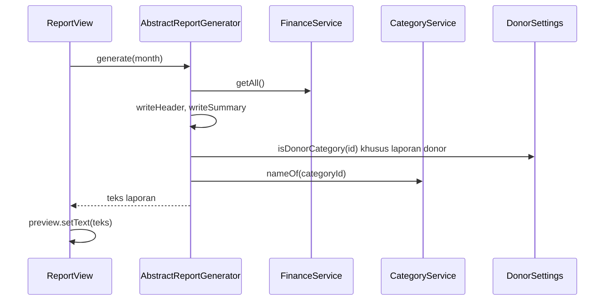

# 09. Laporan bulanan

## Ringkasan

Halaman **Laporan** membuat teks polos untuk satu bulan: **Laporan Pribadi** (ringkasan untuk diri sendiri) atau **Laporan Donor**
(penggunaan dana untuk donatur). Teks muncul sebagai pratinjau dan bisa dikirim lewat WhatsApp atau disalin. Kedua laporan memakai satu antarmuka
`ReportGenerator`, jadi UI memperlakukan keduanya sama.

## Cara memakai

1. Buka **Laporan**. Di kartu **Atur Laporan**, pilih bulan dengan panah (tooltip **Bulan sebelumnya** dan **Bulan berikutnya**).
   Bulan ini sama dengan bulan di Beranda (`UiState.period`).
2. Pilih **Jenis laporan**: **Pribadi** atau **Donor**.
3. (Opsional) Pilih **Penerima**, untuk laporan donor biasanya penerima utama terpilih otomatis.
4. (Opsional) **Rincian pilihan**: pilih sebuah kolom Pilihan (misalnya Jenis) untuk memecah pengeluaran per opsi. Pilihan awal: **Tanpa rincian**.
5. (Opsional) Centang **Sertakan detail transaksi** ("Menambahkan tanggal, kategori, jumlah, dan catatan setiap transaksi.").
6. Baca **Pratinjau** ("Teks yang akan dikirim"). Pratinjau berubah setiap pilihan atau data berubah.
7. Kirim atau salin: lihat [10 Kirim ke donatur](10-kirim-ke-donatur.md).

## Aturan dan batasan

| Aturan | Nilai | Sumber |
|--------|-------|--------|
| Format teks | teks polos berbahasa Indonesia, tanpa emoji dan tanpa markup; Rupiah dengan `Locale` id-ID (`Rp 25.000`) | `report/AbstractReportGenerator`, `util/Rupiah` |
| Kerangka | header, ringkasan, pengeluaran per kategori, rincian kolom Pilihan (opsional), detail transaksi (opsional), footer | `AbstractReportGenerator.generate` (template method, `final`) |
| Detail transaksi | mati secara bawaan (`ReportOptions.defaults()`); maksimal 50 baris, sisanya "(+N transaksi lain tidak ditampilkan)" | `ReportOptions`, `MAX_DETAIL_LINES` |
| Persen | `Math.round(100.0 * bagian / total)`; 0 bila total <= 0 | `AbstractReportGenerator.percent` |
| Urutan kategori | jumlah terbesar dulu, lalu nama | `writeCategories` |
| Rincian kolom Pilihan | tiap opsi dengan jumlah > 0, lalu "Belum diisi" untuk nilai kosong; diabaikan bila kolom hilang atau bukan Pilihan | `writeChoiceBreakdown` |
| Bulan kosong | tetap ada header, ringkasan (nol), dan footer; bagian kategori diganti "Belum ada transaksi tercatat pada bulan ini." | `generate` |
| Pengeluaran "spending" | laporan pribadi: semua pengeluaran; laporan donor: semua pengeluaran kecuali tabungan | `PersonalReportGenerator.spendingOf`, `DonorReportGenerator.spendingOf` |
| Ringkasan pribadi | Pemasukan, Pengeluaran, Saldo (bertanda minus bila negatif), "Termasuk ditabung" bila > 0 | `PersonalReportGenerator.writeSummary` |
| Ringkasan donor | Dana diterima dari donor, Total pengeluaran, Ditabung, Sisa dana (= diterima - pengeluaran - ditabung) | `DonorReportGenerator.writeSummary` |
| Penentuan tabungan | kategori bernama "Tabungan" atau berikon `savings` | `AbstractReportGenerator.isSavings` |

Isi laporan pribadi (urutan bagian):

```
LAPORAN KEUANGAN - <Bulan> <Tahun>
Dibuat pada <d MMMM yyyy>

Pemasukan: ...
Pengeluaran: ...
Saldo: ...
Termasuk ditabung: ...        (hanya bila ada)

Pengeluaran per kategori:
- <Kategori>: Rp ... (xx%)
...
Dibuat dengan JalokDuitNow
```

Laporan donor dimulai dengan `Halo <nama penerima>,` (atau `Halo,` bila tanpa nama) dan "Berikut laporan penggunaan dana bulan <Bulan> <Tahun>.",
dan diakhiri "Terima kasih atas dukungan dan kepercayaannya."

## Cara kerja (teknis)

### Alur langkah demi langkah

1. Pilihan di `ui/ReportView` memanggil `render()`.
2. `currentGenerator()` membuat `ReportOptions(details.isSelected(), kolomRincian)` dan memilih `DonorReportGenerator(finance, categories,
   schemaService, donorSettings, namaPenerima, clock, options)` atau `PersonalReportGenerator(...)`.
3. `generator.generate(month)` (di `AbstractReportGenerator`) memanggil `transactionsOf(month)`, `writeHeader`, `writeSummary`, lalu
   (bila ada transaksi) `spendingOf`, `writeCategories`, `writeChoiceBreakdown`, `writeDetails`, dan `writeFooter` dan mengembalikan `out.toString().strip()`.
4. Teks dipasang ke `TextArea preview`; teks tombol kirim menjadi `Kirim via WhatsApp` atau `Kirim ke <nama> via WhatsApp`.
5. `ReportView` mendengarkan `finance`, `categories`, `donorSettings`, `recipients`, `schemaService`, dan `state.period`, sehingga pratinjau selalu mutakhir.

### Contoh nyata

Laporan pribadi November 2026. Data: pemasukan Gaji Rp 5.000.000; pengeluaran Makan Rp 1.200.000, Transport Rp 500.000, Tabungan Rp 800.000.

- Pengeluaran = 1.200.000 + 500.000 + 800.000 = Rp 2.500.000; Saldo = 5.000.000 - 2.500.000 = Rp 2.500.000; Termasuk ditabung = Rp 800.000.
- Persen per kategori (dari 2.500.000): Makan 48%, Tabungan 32%, Transport 20%.
- Laporan donor dengan Gaji ditandai kategori donor: Dana diterima Rp 5.000.000; Total pengeluaran (tanpa tabungan) = 1.700.000; Ditabung Rp 800.000;
  Sisa dana = 5.000.000 - 1.700.000 - 800.000 = Rp 2.500.000.

### Diagram



### Apa yang terjadi di thread mana

Pembuatan teks berjalan di thread FX setiap `render()`. Tidak ada thread latar saat membuat laporan; thread latar baru dipakai saat
membuka WhatsApp ([10](10-kirim-ke-donatur.md)).

### Apa yang disimpan dan kapan

Laporan tidak disimpan. Teksnya hanya hidup di pratinjau. Pengaturan donor tersimpan di `donor-settings.json` ([10](10-kirim-ke-donatur.md)).

## Data yang disimpan

Tidak ada data laporan. Dihitung dari `transactions.json`, `categories.json`, `schema.json`, dan `donor-settings.json`.

## Kasus tepi

| Kasus | Perilaku | Tes |
|-------|----------|-----|
| Bulan kosong | pesan "Belum ada transaksi" | `report/ReportGeneratorTest.anEmptyMonthIsReportedGracefully`, `thePersonalReportHandlesAnEmptyMonthAndNegativeBalance` |
| Sisa dana negatif | ditampilkan dengan minus | `ReportGeneratorTest.theRemainingBalanceCanBeNegative` |
| Tanpa pemasukan donor | catatan, tetap menampilkan pengeluaran | `ReportGeneratorTest.aMonthWithNoDonorIncomeSaysSoAndStillShowsTheSpending` |
| Belum ada kategori donor | catatan menunjuk ke Pengaturan | `ReportGeneratorTest.whenNoDonorCategoryIsChosenTheReportPointsToSettings` |
| Detail mati bawaan, dibatasi 50 | berlaku | `ReportGeneratorTest.transactionDetailsAreOffByDefaultAndListedWhenAsked`, `theDetailsListIsCappedSoTheMessageStaysSendable` |
| Rincian kolom Pilihan | memecah per opsi; kolom hilang diabaikan | `ReportGeneratorTest.aChoiceColumnBreakdownSplitsSpendingByOption`, `aBreakdownColumnThatIsMissingOrNotAChoiceIsIgnored` |
| Teks tanpa emoji dan markup | berlaku | `ReportGeneratorTest.reportsAreAsciiPlainTextWithNoEmojiOrMarkup` |
| Laporan tidak mengubah data, hasil sama dua kali | berlaku | `ReportGeneratorTest.generatingTwiceGivesTheSameTextAndDoesNotChangeTheData` |
| Ganti nama kategori | nama baru muncul | `ReportGeneratorTest.renamingACategoryShowsTheNewNameInTheReport` |
| Bulan di tahun lain | benar | `service/YearBoundaryTest.aTransactionInANewYearIsReportedAndExported` |

## Keterkaitan

[10 Kirim ke donatur](10-kirim-ke-donatur.md), [08 Target tabungan](08-target-tabungan.md) (tabungan), [02 Kolom kustom](02-kolom-kustom.md) (rincian),
[04 Dashboard](04-dashboard.md) (bulan yang sama).

## Catatan dan celah

- Laporan pribadi menghitung tabungan sebagai pengeluaran (konsisten dengan Beranda); laporan donor memisahkannya. Pengguna perlu tahu bedanya
  saat membandingkan angka.
- Dua laporan memakai definisi tabungan berbasis nama atau ikon, bukan target tabungan (lihat [08](08-target-tabungan.md)).
- Tes bernama `reportsAreAsciiPlainTextWithNoEmojiOrMarkup` hanya saya baca namanya. Nama kategori atau opsi buatan pengguna yang memuat huruf non-ASCII
  akan muncul apa adanya.
- Tidak ada ekspor laporan ke berkas; satu-satunya keluaran adalah WhatsApp dan clipboard.
