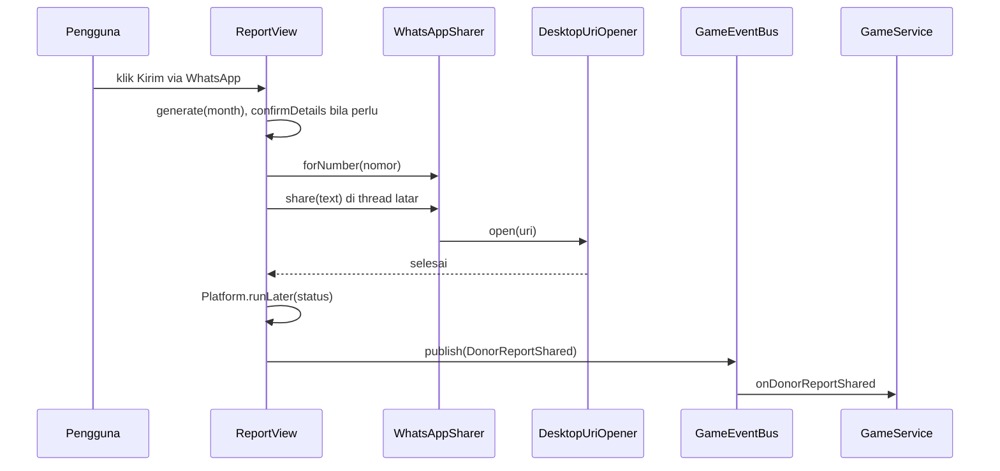

# 10. Kirim ke donatur

## Ringkasan

Pengguna menyimpan daftar donor (nama dan nomor WhatsApp), menandai kategori pemasukan mana yang dianggap dana donor, lalu mengirim
laporan donor lewat WhatsApp atau menyalinnya. Aplikasi tidak pernah mengirim pesan sendiri: WhatsApp hanya dibuka dengan pesan
yang sudah terisi, dan pengguna sendiri menekan Kirim.

## Cara memakai

1. Buka **Pengaturan**, bagian **Donor**. Klik **Tambah Donor**, isi **Nama** (contoh: Pak Budi), **Nomor WhatsApp**
   (contoh: 0812-3456-7890; "Nomor ditulis dengan awalan 0 atau +62."), dan **Catatan**, lalu **Simpan**. Dialog menampilkan
   `Akan disimpan sebagai +<nomor>`.
2. Pilih **Jadikan penerima utama** untuk satu donor (ditandai **Utama**). Donor pertama otomatis menjadi utama.
3. Di bagian **Pemasukan dari donor**, centang kategori pemasukan yang dihitung sebagai dana dari donor
   ("Pilih kategori pemasukan yang dihitung sebagai dana dari donor di laporan donor.").
4. Buka **Laporan**, pilih **Jenis laporan** = **Donor**, pilih **Penerima**.
5. Klik **Kirim via WhatsApp** (atau `Kirim ke <nama> via WhatsApp`). Bila **Sertakan detail transaksi** dicentang, dialog
   **Bagikan detail transaksi?** menyebut jumlah transaksi dan tujuan; pilih **Lanjutkan** atau **Batal**.
6. WhatsApp terbuka dengan pesan siap kirim ("Kamu tetap perlu menekan tombol Kirim di WhatsApp."). Alternatifnya klik **Salin**
   ("Laporan disalin ke clipboard.").

## Aturan dan batasan

| Aturan | Nilai | Sumber |
|--------|-------|--------|
| Nama donor | wajib, maksimal 60 karakter | `model/Recipient.update` |
| Catatan | maksimal 200 karakter | `Recipient.update` |
| Nomor telepon | wajib; spasi, `-`, `.`, `(`, `)`, `+` dibuang; harus hanya angka; awalan `00` dibuang; awalan `0` menjadi `62`; `620...` diperbaiki menjadi `62...`; panjang 10 sampai 15 angka | `util/PhoneNumberNormalizer.normalize` |
| Disimpan sebagai | hanya angka (contoh `6281234567890`), tampil `+6281234567890` | `Recipient.phoneNumber`, `displayPhone` |
| Penerima utama | selalu tepat satu bila ada donor; donor pertama otomatis utama; menghapus yang utama menyerahkan peran ke donor berikutnya | `service/RecipientService` |
| Kategori donor | himpunan id kategori pemasukan; bawaan kosong | `service/DonorSettings` |
| Pemasukan donor di laporan | hanya pemasukan di kategori yang ditandai | `DonorReportGenerator.writeSummary` |
| Dikecualikan dari "Total pengeluaran" laporan donor | pengeluaran kategori tabungan | `DonorReportGenerator.spendingOf` |
| Tautan WhatsApp | `https://wa.me/<nomor>?text=<teks>` atau `https://wa.me/?text=<teks>` tanpa nomor | `share/WhatsAppSharer.buildUri` |
| Pengodean teks | UTF-8 percent-encoding, spasi menjadi `%20` (bukan `+`) | `WhatsAppSharer.buildUri` |
| Nomor untuk tautan | harus cocok `[0-9]{8,15}` | `WhatsAppSharer.buildUri` |
| Panjang tautan | maksimal 8000 karakter; lebih dari itu ditolak dengan saran mematikan detail atau memakai **Salin** | `WhatsAppSharer.MAX_URI_LENGTH` |
| Bawaan privasi | detail transaksi mati; WhatsApp tanpa penerima bila tidak dipilih; dialog konfirmasi bila detail dikirim | `ReportOptions.defaults`, `ReportView.confirmDetails` |
| Hadiah | laporan donor pertama yang dibagikan memberi +25 XP dan membuka badge Transparan, sekali saja; laporan pribadi tidak | `GameService.onDonorReportShared` |

## Cara kerja (teknis)

Antarmuka dan polimorfisme: `share/Sharer` (`name()`, `share(String)`) diimplementasikan `WhatsAppSharer` dan `ClipboardSharer`.
`UriOpener` adalah titik sambung agar tes tidak membuka peramban; `DesktopUriOpener` memakai `Desktop.browse` dan, bila tidak didukung,
cadangan `getHostServices().showDocument` (dipasang di `MainApp`).

### Alur langkah demi langkah

1. Pada **Kirim via WhatsApp**, `ReportView.sendWhatsApp()` membuat teks lewat `currentGenerator().generate(month)`.
2. Bila detail dicentang, `confirmDetails(month, r)` menampilkan peringatan; **Batal** menghentikan alur.
3. `whatsApp.forNumber(r == null ? null : r.getPhoneNumber())` membuat `WhatsAppSharer` yang mengarah ke nomor itu.
4. Tombol dinonaktifkan; `CompletableFuture.runAsync(...)` memanggil `sharer.share(text)` di thread latar (membuka peramban bisa lambat).
5. `WhatsAppSharer.share` menolak teks kosong, membuat URI, menolak URI > 8000 karakter, lalu `opener.open(uri)`. Kegagalan dibungkus
   `ShareException`.
6. Hasil kembali lewat `Platform.runLater`: status "WhatsApp dibuka dengan pesan siap kirim ..." lalu, untuk laporan donor,
   `bus.publish(new GameEvent.DonorReportShared("WhatsApp"))`. Pada kegagalan: `Alert` dengan pesan `ShareException`.
7. `GameService.onDonorReportShared`: bila belum pernah, `donorReportShared = true`, `award(policy.donorReportXp(), ...)`,
   `evaluateBadges()` (membuka Transparan), `changed()`.

Tombol **Salin**: `ClipboardSharer.share(preview.getText())` langsung di thread FX (clipboard JavaFX harus di FX); untuk laporan donor
menerbitkan `DonorReportShared("Clipboard")`.

### Contoh nyata

Donor Pak Budi, nomor diketik `0812-3456-7890`.

- `normalize`: buang `-` -> `081234567890` (12 angka); awalan `0` diganti `62`: `62` + `81234567890` = `6281234567890` (13 angka, dalam batas 10 sampai 15).
- Teks laporan `Halo Pak Budi,\n\nBerikut ...` dikodekan menjadi `Halo%20Pak%20Budi%2C%0A%0ABerikut...`.
- URI: `https://wa.me/6281234567890?text=Halo%20Pak%20Budi%2C%0A%0ABerikut...`.
- XP sebelum 500, belum pernah berbagi: sesudah berbagi pertama 525 (+25) dan badge **Transparan** terbuka (+100) = 625 XP;
  berbagi kedua tidak menambah apa pun.

### Diagram

### Apa yang terjadi di thread mana

| Langkah | Thread |
|---------|--------|
| Membuat teks, dialog konfirmasi, tombol **Salin** | FX |
| `sharer.share(text)` (membuka peramban) | thread `ForkJoinPool` dari `CompletableFuture.runAsync` |
| Pembaruan status, `bus.publish(DonorReportShared)`, `GameService` | FX (lewat `Platform.runLater`) |
| Cadangan `getHostServices().showDocument` | dibungkus `Platform.runLater` di `MainApp` |

### Apa yang disimpan dan kapan

`recipients.json` dan `donor-settings.json` ditulis lewat auto-save setelah tambah, ubah, hapus, atau centang kategori. Teks laporan dan
tautan tidak disimpan. `game.json` menyimpan `donorReportShared`.

## Data yang disimpan

- `recipients.json`: `RecipientDto` (id, nama, nomor ternormalisasi, catatan, penerima utama).
- `donor-settings.json`: `DonorSettingsDto` (daftar id kategori donor).
- `game.json`: `donorReportShared` (boolean).
- Cadangan JSON memuat donor bila kotak **Sertakan daftar donor dan nomor telepon** dicentang (bawaan: dicentang).

## Kasus tepi

| Kasus | Perilaku | Tes |
|-------|----------|-----|
| Nomor lokal, `+62`, dengan spasi atau tanda hubung | menjadi digit-only | `util/PhoneNumberNormalizerTest` |
| Batas panjang nomor | 10 sampai 15 | `PhoneNumberNormalizerTest.lengthBoundaries` |
| Spasi di teks | `%20`, bukan `+` | `share/SharerTest.spacesAreEncodedAsPercent20NotPlus` |
| Karakter khusus | UTF-8 selamat | `SharerTest.textIsEncodedAsUtf8SoSpecialCharactersSurvive`, `theWholeReportRoundTripsThroughTheAddress` |
| Nomor tidak valid | ditolak | `SharerTest.anInvalidNumberIsRefused` |
| Pesan terlalu panjang | ditolak dengan saran | `SharerTest.aMessageThatIsTooLongIsRefusedWithAHint` |
| Peramban gagal | menjadi `ShareException` | `SharerTest.aBrowserFailureBecomesAShareException` |
| Teks kosong | ditolak | `SharerTest.blankTextIsRefusedAndNothingOpens` |
| Satu penerima utama selalu | berlaku | `service/RecipientServiceTest.settingADefaultClearsTheOldOneSoThereIsExactlyOne`, `deletingTheDefaultHandsTheRoleToTheNextRecipient` |
| Berkas donor rusak | `StorageException` dan salinan cadangan | `RecipientServiceTest.aCorruptFileThrowsStorageExceptionAndKeepsACopy` |
| Berbagi donor pertama | XP dan badge sekali; laporan pribadi tidak | `service/GameServiceTest.theFirstSharedDonorReportPaysTheBonusAndUnlocksTheBadgeOnce`, `sharingAPersonalReportIsNotAnEventSoNothingIsAwarded` |
| Cadangan tanpa donor | donor sekarang dipertahankan saat pulih | `restore/RestoreServiceTest.aBackupMadeWithoutDonorDataKeepsTheCurrentDonors` |

## Keterkaitan

[09 Laporan](09-laporan-bulanan.md), [03 Kategori](03-kategori.md) (kategori pemasukan), [07 Badge](07-badge.md) (Transparan),
[05 XP](05-xp-level-streak.md), [11 Pengingat](11-pengingat-notifikasi.md) (Laporan donor bulanan), [12 Cadangan](12-ekspor-cadangan-pemulihan.md).

## Catatan dan celah

- Aturan panjang nomor tidak sama di dua tempat: `PhoneNumberNormalizer` mensyaratkan 10 sampai 15 angka, sedangkan `WhatsAppSharer.buildUri`
  menerima 8 sampai 15. Karena nomor penerima selalu sudah dinormalisasi, praktisnya batas 10 yang berlaku.
- Normalisasi diasumsikan kode negara Indonesia (`62`) untuk nomor berawalan `0`; nomor luar negeri harus diketik dengan `+` atau `00`.
- Ada kategori donor = nol secara bawaan, sehingga laporan donor menampilkan "Dana diterima dari donor: Rp 0" sampai pengguna memilih kategori
  (aplikasi menampilkan petunjuk di **Laporan** dan di isi laporan).
- Event `DonorReportShared("WhatsApp")` diterbitkan setelah peramban berhasil dibuka, bukan setelah pesan benar-benar terkirim; pengguna
  masih bisa membatalkan di WhatsApp dan XP tetap diberikan.
- Cadangan JSON menyertakan nomor telepon donor secara bawaan; pengguna harus mencabut centang untuk mengecualikannya.
- Detail transaksi dibatasi 50 baris, tetapi bagian sisanya tidak dikirim sama sekali (hanya diberi catatan jumlah yang tidak ditampilkan).
