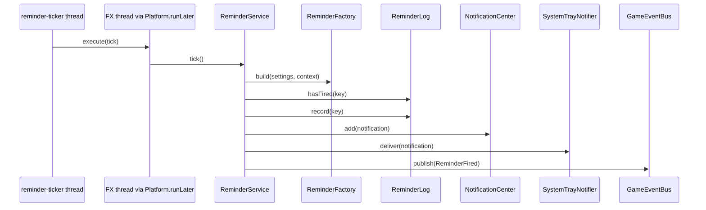

# 11. Pengingat dan notifikasi

## Ringkasan

Aplikasi punya empat jenis pengingat yang ramah dan bisa dimatikan: Pengingat mencatat, Penjaga streak, Laporan donor bulanan, dan Batas budget.
Setiap pengingat muncul paling banyak sekali per periode (hari atau bulan), tidak berbunyi selama jam tenang, dan muncul sebagai toast, entri di
lonceng notifikasi, dan (bila didukung) notifikasi sistem lewat tray.

## Cara memakai

1. Buka **Pengaturan**, kartu **Pengingat** ("Pengingat yang ramah, tidak pernah menyalahkan. Semuanya bisa dimatikan kapan saja.").
2. Nyalakan atau matikan tiap jenis; atur jam (dan **Tanggal** untuk laporan donor; "Jika bulan itu lebih pendek (misalnya tanggal 31 di Februari),
   dipakai hari terakhir bulan tersebut.") serta **Peringatan di** (persen ambang budget; "Pemberitahuan kedua muncul saat budget 100% tercapai.").
3. **Jam tenang**: centang **Aktifkan jam tenang**, atur **Mulai** dan **Selesai**. Teks bantuan menjelaskan: "Pengingat yang jatuh tempo muncul setelah
   jam tenang selesai, selama harinya belum berganti."
4. **Notifikasi sistem**: "Tampilkan juga sebagai notifikasi sistem". Bila tidak didukung: "Tidak didukung di sistem ini. Notifikasi tetap muncul di dalam aplikasi."
5. **Kirim notifikasi uji** menguji tampilan ("Notifikasi uji dikirim. Lihat ikon lonceng di bagian atas.").
6. Ikon lonceng di header membuka daftar **Notifikasi**: **Tandai semua dibaca**, **Hapus semua**, jumlah belum dibaca, dan tombol aksi pada tiap notifikasi.

## Aturan dan batasan

Jenis pengingat (semua turunan `reminder/Reminder`; dibangun `reminder/ReminderFactory.build`):

| Jenis (`ReminderKind`) | Kelas | Aktif bawaan | Jam atau jadwal bawaan | Kapan muncul | Kunci periode | Tombol |
|------------------------|-------|--------------|-------------------------|--------------|---------------|--------|
| Pengingat mencatat (`DAILY_LOG`) | `DailyLogReminder` | ya | 20:00 | jam sudah tercapai dan belum ada entri dibuat hari ini | tanggal hari ini | **Tambah Transaksi** |
| Penjaga streak (`STREAK_RISK`) | `StreakRiskReminder` | ya | 21:00 | jam tercapai, streak > 0, belum ada entri hari ini; pesan menyebut freeze token bila ada | tanggal hari ini | **Tambah Transaksi** |
| Laporan donor bulanan (`DONOR_REPORT`) | `MonthlyDonorReportReminder` | tidak | tanggal 1, 09:00 | hanya pada hari yang dipilih (dibatasi ke hari terakhir bulan pendek), setelah jam tercapai, dan ada minimal satu donor | bulan (`yyyy-MM`) | **Buka Laporan** |
| Batas budget (`BUDGET`) | `BudgetThresholdReminder`, sepasang per kategori Expense berbudget yang tidak diarsipkan | ya | peringatan 80% (bisa 50 sampai 99), tercapai 100% | peringatan: pengeluaran bulan itu >= ambang dan masih < budget; tercapai: >= budget | bulan (`yyyy-MM`) | **Lihat Kategori** |

Aturan umum:

| Aturan | Nilai | Sumber |
|--------|-------|--------|
| Frekuensi cek | tiap 1 menit (`DEFAULT_INTERVAL`); juga sekali saat `start()` | `thread/ReminderService` |
| Sekali per periode | kunci `id@periode` dicatat di `ReminderLog` sebelum dikirim | `ReminderService.tick`, `fire`; `service/ReminderLog` |
| Riwayat kunci | dibuang setelah sekitar 62 hari | `ReminderLog.KEEP` |
| Jam tenang bawaan | aktif, 22:00 sampai 07:00 (boleh melewati tengah malam); mulai tidak boleh sama dengan selesai bila aktif | `ReminderSettings` |
| Pengingat tertinggal | muncul pada tick pertama setelah jam tenang selesai bila harinya atau bulannya masih sama; yang lebih lama tidak diulang | `ReminderService` (javadoc), `ReminderServiceTest` |
| Pengingat laporan donor | tidak diputar ulang bila aplikasi tertutup pada harinya | `MonthlyDonorReportReminder` (javadoc) |
| Ambang peringatan budget | 50 sampai 99 | `ReminderSettings.setBudgetWarnPercent` |
| Tanggal laporan donor | 1 sampai 31 | `ReminderSettings.setDonorReport` |
| Waktu | dibulatkan ke menit | `ReminderSettings.requireTime` |
| Pusat notifikasi | menyimpan 50 terbaru, terbaru di atas, ada tanda dibaca | `service/NotificationCenter.MAX_KEPT` |
| Tombol notifikasi | `NONE`, `ADD_TRANSACTION`, `OPEN_REPORT`, `OPEN_CATEGORIES`, `OPEN_RESTORE` ("Pulihkan", hanya 15 menit) | `reminder/NotificationAction` |
| Notifikasi uji | selalu tampil, mengabaikan jam tenang dan log, tidak dihitung sebagai pengingat | `ReminderService.sendTest` |
| Nada | ramah dan netral, tidak menyalahkan | `Reminder` (javadoc) |

## Cara kerja (teknis)

### Alur langkah demi langkah

1. `MainApp.start` membuat `ReminderService(settings, log, center, ReminderContextProvider, bus, clock, Platform::runLater, DEFAULT_INTERVAL, beforeTick)`
   dan memasang dua `NotificationSink`: toast (`ToastHost` via `Platform.runLater`) dan `SystemTrayNotifier`. Lalu `reminderService.start()`.
2. `start()` menjalankan `tick` segera lewat `uiExecutor` (FX), lalu `timer.scheduleWithFixedDelay(...)` tiap menit di thread `reminder-ticker`.
3. Pada tiap tick timer: `beforeTick.run()` (`TimeZone.setDefault(null)` agar zona waktu baru terbaca) lalu `uiExecutor.execute(this::tick)`.
4. `tick()` (di FX): `settings.current()` (salinan); `isQuiet(now)` -> berhenti bila hening; `contextSupplier.get()` -> `ReminderContext` (salinan data, hanya-baca);
   `ReminderFactory.build(...)`.
5. Untuk tiap pengingat aktif: `key = id + "@" + periodKey(clock)`; lewati bila `log.hasFired(key)` atau `!shouldFire(context, clock)`.
6. `fire(...)`: `log.record(key, now)` lebih dulu (supaya tidak berulang walau pengiriman gagal), membuat `AppNotification` dari `buildMessage`, `deliver(n)` ke
   `NotificationCenter` dan tiap sink (kegagalan satu sink tidak menghalangi yang lain), lalu `bus.publish(new GameEvent.ReminderFired(id))`.
7. `GameService.onReminderFired` menyimpan `firstReminderDay` (hanya yang pertama) dan mengevaluasi badge ([07](07-badge.md), Konsisten).
8. `SystemTrayNotifier.deliver` menjalankan `backend.show` di thread `tray-notifier`. Tray tidak didukung atau gagal: `unavailable = true` untuk sisa sesi,
   toast dan lonceng tetap bekerja.

### Contoh nyata

Pengingat mencatat 20:00, tanggal 21 Nov 2026, belum ada entri hari itu, jam tenang 22:00-07:00.

| Waktu | Keadaan | Hasil |
|-------|---------|-------|
| 20:00 | `reached(20:00)` benar, `hasEntryOn` salah, bukan jam tenang, kunci `daily-log@2026-11-21` belum ada | pengingat "Waktunya mencatat" muncul; kunci dicatat |
| 20:01 | kunci sudah ada | dilewati |
| 21:00 | Penjaga streak, streak 5, belum ada entri | "Streak 5 hari sedang berjalan. Satu catatan hari ini akan melanjutkannya." (+ freeze token bila ada) |
| 22:30 | jam tenang | tidak ada yang berbunyi |
| hari berikutnya 20:00 | kunci baru `daily-log@2026-11-22` | boleh muncul lagi |

Budget: Makan Rp 600.000, ambang 80%. Pengeluaran Makan bulan ini Rp 480.000: 480.000 x 100 = 48.000.000 >= 600.000 x 80 = 48.000.000 dan 480.000 < 600.000
-> peringatan `budget:<id>:80@2026-11` muncul. Bila satu pengeluaran melompat ke Rp 650.000, peringatan 80% tidak berlaku lagi (sudah di atas budget) dan hanya pengingat
"mencapai budget" (`budget:<id>:100@2026-11`) yang muncul.

### Diagram

### Apa yang terjadi di thread mana

| Komponen | Thread |
|----------|--------|
| Penjaga waktu | `reminder-ticker` (daemon, `ScheduledExecutorService`), hanya menyerahkan tick |
| `tick()`, membaca data, `ReminderLog`, `NotificationCenter`, toast | FX (`Platform::runLater`) |
| Notifikasi tray | `tray-notifier` (daemon) |
| Penulisan `reminders.json`, `reminder-log.json`, `notifications.json` | `auto-save` |
| Penghentian | `MainApp.stop()` -> `reminderService.stop()` (`shutdownNow`, tunggu 1 detik) dan `trayNotifier.close()` (ikon tray menahan proses bila tidak dilepas) |

### Apa yang disimpan dan kapan

`reminders.json` (pengaturan) lewat `ReminderSettingsService` auto-save; `reminder-log.json` saat `record`; `notifications.json` setiap perubahan daftar.
Semuanya di-`flush` saat aplikasi ditutup.

## Data yang disimpan

- `reminders.json`: `ReminderSettingsDto` (aktif per jenis, jam, tanggal, ambang, jam tenang, tray).
- `reminder-log.json`: `ReminderLogDto(key, firedAt)`.
- `notifications.json`: `NotificationDto` (judul, pesan, waktu, tanda dibaca, aksi, id pengingat).
- `game.json`: `firstReminderDay`.

## Kasus tepi

| Kasus | Perilaku | Tes |
|-------|----------|-----|
| Sekali per periode | berlaku walau dicek berkali-kali | `thread/ReminderServiceTest.aReminderFiresOnlyOncePerDayNoMatterHowOftenItIsChecked` |
| Restart | yang sudah muncul tidak muncul lagi | `ReminderServiceTest.afterARestartNothingThatAlreadyFiredFiresAgain` |
| Mulai aplikasi | mengejar yang tertinggal hari ini; yang hari lalu tidak diputar | `ReminderServiceTest.startingTheServiceCatchesUpOnWhatWasMissedEarlierToday`, `aMissedReminderFromAnEarlierDayIsNotReplayed` |
| Jam tenang | tidak ada yang muncul; yang jatuh tempo muncul setelahnya bila harinya sama, dibuang bila hari sudah berganti | `ReminderServiceTest.nothingFiresDuringQuietHours`, `aReminderThatCameDueInQuietHoursFiresWhenTheyEndIfItsDayIsNotOver`, `...IsDroppedWhenItsDayHasEnded` |
| Laptop tidur panjang atau zona waktu berubah | terbaca pada tick berikutnya | `ReminderServiceTest.aLongSleepIsNoticedOnTheNextTick`, `aChangedTimeZoneIsPickedUpBecauseEveryTickReadsTheClockAgain` |
| Tanggal 31 di bulan pendek | hari terakhir bulan | `reminder/RemindersTest.day31FallsBackToTheLastDayOfShorterMonths`, `day31InFebruaryFiresOnThe28thOrThe29thAndNotAtAnyOtherTime` |
| Satu sink gagal atau konteks gagal | tidak menghentikan yang lain atau tick | `ReminderServiceTest.aFailingSinkDoesNotStopTheOthersOrLoseTheNotification`, `aFailingContextDoesNotBreakTheTick` |
| Budget melompat melewati 100% | hanya pesan "tercapai" | `ReminderServiceTest.aBigExpenseThatJumpsPastTheBudgetOnlyGivesTheReachedMessage` |
| Tray gagal atau tidak didukung | dilewati dan diingat, tidak melempar | `ui/SystemTrayNotifierTest` |
| Pusat notifikasi | 50 terbaru, tanda dibaca, urutan tersimpan | `service/NotificationCenterTest` |
| Pengaturan tidak valid | `InvalidSettingException` | `reminder/ReminderSettingsTest` |

## Keterkaitan

[05 XP, streak](05-xp-level-streak.md) (Penjaga streak), [03 Kategori](03-kategori.md) (budget), [10 Donatur](10-kirim-ke-donatur.md),
[07 Badge](07-badge.md) (Konsisten), [13 Zona Berbahaya](13-zona-berbahaya.md) (membersihkan pengingat yang tidak relevan).

## Catatan dan celah

- `ReminderContext.hasEntryOn` memakai `createdAt`; setelah sebuah transaksi diubah, `createdAt` objeknya tampak kosong (lihat [01](01-transaksi.md)),
  sehingga entri itu tidak lagi terhitung kecuali `profile.lastActiveDate` kebetulan sama dengan harinya.
- Aplikasi hanya mengingatkan saat berjalan: tidak ada penjadwalan di tingkat sistem operasi. Pengingat yang tertinggal saat aplikasi tertutup hanya
  dikejar untuk hari atau bulan yang sama.
- Pengingat laporan donor tidak diputar ulang bila aplikasi tertutup pada tanggalnya (disengaja menurut javadoc).
- Tombol aksi **Pulihkan** (dari notifikasi penghapusan data) hanya tersedia 15 menit.
- Setelah **Hapus semua transaksi**, catatan "sudah muncul" untuk pengingat budget dibuang (`DeletePostActions.forget("budget:")`), jadi pengingat budget
  bisa muncul lagi untuk data baru.
- Tidak ada pengaturan bahasa; semua teks pengingat dalam bahasa Indonesia.
