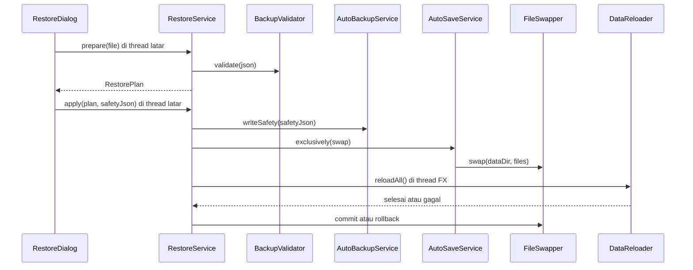

# 12. Ekspor, cadangan, dan pemulihan

## Ringkasan

Pengguna bisa mengekspor transaksi ke CSV (untuk Excel atau Google Sheets) dan membuat cadangan lengkap ke satu berkas JSON.
Aplikasi juga membuat cadangan otomatis harian. Pemulihan membaca dan memvalidasi berkas dulu, membuat cadangan pengaman dari data saat ini,
mengganti berkas data sebagai satu kesatuan, dan mengembalikan data lama bila ada langkah yang gagal.

## Cara memakai

Ekspor dan cadangan (halaman **Pengaturan**, kartu **Ekspor dan Cadangan**):

1. **Ekspor transaksi (CSV)**: pilih **Semua transaksi** atau **Hanya bulan terpilih: <Bulan Tahun>**, pilih **Pemisah** (**Koma (,)** atau **Titik koma (;)**;
   "Excel dengan pengaturan regional Indonesia biasanya memakai titik koma."), klik **Ekspor CSV...**, pilih lokasi.
2. **Cadangan lengkap (JSON)**: centang atau cabut **Sertakan daftar donor dan nomor telepon**, klik **Buat Cadangan...**, pilih lokasi.
   Status "Cadangan disimpan di <path>" muncul. Simpan di tempat yang aman.

Cadangan otomatis: dibuat sekali sehari saat aplikasi dibuka; tidak ada tombol khusus.

Pemulihan (kartu **Pulihkan dari Cadangan**):

1. Klik **Pulihkan dari cadangan...**.
2. Pilih file lewat **Pilih file cadangan...**, atau pilih satu dari daftar **Atau pulihkan dari cadangan otomatis** lalu klik **Periksa cadangan terpilih**.
3. Periksa pratinjau **Isi cadangan** yang membandingkan **Saat ini** dengan **Cadangan** (level, XP, badge, transaksi, kolom kustom, kategori, target tabungan, donor).
   Belum ada data yang berubah.
4. Ketik `RESTORE`, klik **Ganti data saat ini**. Setelah selesai: "Data berhasil dipulihkan" dan nama salinan pengaman.

## Aturan dan batasan

| Aturan | Nilai | Sumber |
|--------|-------|--------|
| Kolom CSV | **Tanggal, Tipe, Kategori, Jumlah**, lalu semua kolom kustom (tersembunyi pun ikut) | `storage/CsvExporter` |
| Format CSV | RFC 4180, baris berakhir CRLF, tanggal ISO, jumlah bilangan bulat polos, diurutkan dari terlama | `CsvExporter` |
| Anti-injeksi rumus | teks berawalan `=`, `+`, `-`, `@`, tab, atau CR diberi awalan `'` | `CsvExporter.neutralize` |
| Berkas CSV | UTF-8 dengan BOM (agar Excel di Windows membaca aksen) | `ui/ExportPanel.exportCsv` (`bom = true`), `storage/ExportFile.write` |
| Berkas JSON | UTF-8 tanpa BOM | `ExportPanel.exportJson` |
| Nama berkas saran | `jalokduitnow-transaksi-<semua atau yyyy-MM>-<tanggal>.csv`, `jalokduitnow-cadangan-<tanggal>.json` | `ExportPanel` |
| Isi cadangan JSON | `app`, `formatVersion` (1), `exportedAt`, kolom, kategori, transaksi, game, donor, id kategori donor, `appVersion`, `includesDonorData`, pengaturan pengingat | `storage/BackupDto`, `service/BackupService.snapshot` |
| Cadangan otomatis | `backups/otomatis-<tanggal>.json`, satu per hari; 5 terbaru disimpan | `service/AutoBackupService` (`KEEP_AUTO`) |
| Cadangan pengaman | `backups/sebelum-pemulihan-<waktu>.json` dan `sebelum-hapus-<waktu>.json`; tidak pernah dirotasi | `AutoBackupService.writeSafety` |
| Ukuran maksimal berkas pemulihan | 50 MB | `RestoreService.MAX_BYTES` |
| Versi format | ditolak bila lebih baru dari `CURRENT_VERSION`; bagian wajib: kolom, kategori, transaksi, game (profil dan target), penerima | `BackupValidator.parseStructure` |
| Validasi isi | semua objek dibangun di memori dengan konstruktor yang sama; kategori hilang, id ganda, tipe tidak cocok, nilai mustahil ditolak | `BackupValidator.validate` |
| Berkas yang ditulis saat pulih | `schema.json`, `categories.json`, `transactions.json`, `game.json`; `recipients.json` dan `donor-settings.json` bila cadangan memuat donor; `reminders.json` bila ada | `RestoreService.filesFor` |
| Yang tidak disentuh pemulihan | `reminder-log.json`, `notifications.json`, `settings.properties` | `RestoreService.filesFor` |
| XP dan badge saat pulih | diterapkan apa adanya, tidak memberi XP atau badge baru | `DataReloader.reloadAll` (`suspendRewards`) |

## Cara kerja (teknis)

### Alur langkah demi langkah

Ekspor CSV:

1. `ExportPanel.exportCsv()` membuat teks di thread FX: `BackupService.transactionsCsv(month, delimiter)` -> `CsvExporter.render(...)` (snapshot).
2. `FileChooser` memilih target; `ExportPanel.write` membuat `ExportTask(target, text, bom)` dan menjalankannya di thread `export` (daemon).
3. `ExportTask.call` -> `ExportFile.write`: menulis `<nama>.tmp` lalu `Files.move(..., REPLACE_EXISTING)`; menolak target yang berupa folder; membersihkan `.tmp` bila gagal.
4. `setOnSucceeded` (FX) menampilkan status; `setOnFailed` menampilkan `Alert`.

Cadangan otomatis harian: `MainApp.makeDailyBackup` mengambil `backupService.backupJson(true)` di FX lalu `CompletableFuture.runAsync` memanggil
`AutoBackupService.writeDailyIfMissing(json)` (tidak menimpa; memangkas yang lama; kegagalan hanya dicatat ke `System.err`).

Pemulihan:

1. `RestoreDialog.prepare(file)` menjalankan `Task` `restore-prepare` -> `RestoreService.prepare(file)`: baca UTF-8 (BOM ditoleransi), `BackupValidator.validate`,
   `BackupPreview.of`, dan `filesFor` -> `RestorePlan`. Tidak ada data yang berubah.
2. Pada **Ganti data saat ini** (`RestoreDialog.apply`): `flushAll.run()` (semua simpan tertunda ditulis), `backup.backupJson(true)` di FX sebagai teks pengaman.
3. `Task` `restore-apply` -> `RestoreService.apply(plan, safetyJson, progress)`:
   a. `autoBackups.writeSafety(safetyJson)`; gagal -> berhenti sebelum apa pun diganti.
   b. `AutoSaveService.exclusively(() -> swapper.swap(dataDir, plan.files()))`: membuang simpan tertunda dan menahan auto-save selama berkas ditukar;
      `FileSwapper` menulis `.restore-tmp`, memindahkan berkas lama ke `.restore-rollback`, memindahkan yang baru; gagal -> semua dikembalikan.
   c. `runOnUi()` menjalankan `Reloader.reloadAll` (di `MainApp`: `DataReloader.reloadAll()` lalu `state.selected.set(null)` dan `state.period` ke bulan default) di FX dan menunggu hingga 60 detik.
      Gagal -> `rollBack(swap, ...)` mengembalikan berkas lama dan memuat ulang.
   d. `swap.commit()` menghapus salinan rollback.
4. `DataReloader.reloadAll`: `game.suspendRewards(true)`; `schema.reload()`, `categories.reload()`, `finance.reload(...)`, `recipients.reload()`, `donors.reload()`,
   `reminders.reload()`, `game.reload()`; `finally` `suspendRewards(false)`. Tiap service memberi tahu listener, sehingga semua tampilan segar tanpa restart.
5. `onRestored` menampilkan toast "Data dipulihkan" dan entri di pusat notifikasi.

### Contoh nyata

Data saat ini: 130 transaksi, level 4, XP 900. Berkas cadangan: 120 transaksi, level 3, XP 650, tanpa donor (`includesDonorData` = false).

- Pratinjau menampilkan Transaksi 130 -> 120, Level 4 -> 3, dan catatan "Cadangan ini dibuat tanpa data donor: daftar donor saat ini dipertahankan."
- Progres: 0,05 (mulai) -> 0,25 (cadangan pengaman `sebelum-pemulihan-20261121-143005.json` tertulis) -> 0,6 (berkas ditukar) -> 1,0 (selesai).
- Sesudah: 120 transaksi, level 3, XP 650 persis seperti tersimpan (tidak ada XP baru walau data "baru" dimuat); `recipients.json` tidak diganti.
- Bila hasilnya tidak diinginkan, pulihkan `sebelum-pemulihan-...json` dari daftar cadangan: kembali ke 130 transaksi.

(Angka-angkanya contoh; urutan dan batas progres dari `RestoreService.apply`.)

### Diagram

### Apa yang terjadi di thread mana

| Langkah | Thread |
|---------|--------|
| Membuat teks CSV, JSON, snapshot pengaman, dialog | FX |
| Menulis berkas ekspor | `export` (`ExportTask`, daemon) |
| `prepare` | `restore-prepare` (`Task`) |
| `apply` (cadangan pengaman, swap berkas) | `restore-apply` (`Task`) |
| `reloadAll` | FX; `runOnUi` menunggu dengan batas 60 detik dan tidak memegang kunci saat menunggu |
| Cadangan otomatis harian | thread `ForkJoinPool` dari `CompletableFuture.runAsync` |

### Apa yang disimpan dan kapan

Ekspor: hanya saat pengguna menekan tombol. Cadangan otomatis: sekali per hari saat startup. Pemulihan: cadangan pengaman lebih dulu, lalu berkas
data diganti; setelah itu auto-save normal berlanjut.

## Data yang disimpan

Berkas cadangan JSON (format `BackupDto`) di lokasi pilihan pengguna atau di `backups/`. Isi folder `backups/` yang dikelola aplikasi hanya berkas
`otomatis-*`, `sebelum-pemulihan-*`, dan `sebelum-hapus-*` (`storage/SafeDataFolder`).

## Kasus tepi

| Kasus | Perilaku | Tes |
|-------|----------|-----|
| CSV: koma, kutip, baris baru | dikutip sesuai RFC 4180 | `storage/CsvExporterTest.fieldsWithCommasQuotesAndLineBreaksAreQuoted` |
| CSV: rumus | dinetralkan | `CsvExporterTest.textThatLooksLikeAFormulaIsDefused` |
| CSV kosong | tetap ada baris header | `CsvExporterTest.anEmptyExportStillHasTheHeader` |
| Tulis berkas gagal | `StorageException`, berkas lama utuh | `storage/ExportFileTest.aFailureThrowsStorageExceptionAndKeepsTheOldFile` |
| Cadangan harian | satu per hari, 5 terbaru, tidak pernah menghapus yang pengaman | `restore/AutoBackupServiceTest` |
| Berkas bukan JSON, bukan cadangan kita, versi lebih baru, bagian hilang | ditolak tanpa mengubah data | `restore/BackupValidatorTest`, `restore/RestoreServiceTest.aCorruptFileIsRefusedAndNothingChanges` |
| Transaksi rusak di cadangan | ketahuan saat `prepare`, bukan di tengah pemulihan | `RestoreServiceTest.aBackupWithABrokenTransactionIsFoundDuringPrepareNotMidRestore` |
| Gagal di langkah swap mana pun | data lama utuh | `RestoreServiceTest.aFailureAtEveryPossibleStepOfTheSwapLeavesTheOldDataExactlyAsItWas`, `restore/FileSwapperTest` |
| Gagal memuat ulang aplikasi | berkas lama dikembalikan dan dimuat ulang | `RestoreServiceTest.aFailureWhileReloadingTheAppRestoresTheOldFilesAndReloadsThemAgain` |
| Gagal menulis cadangan pengaman | tidak ada yang diganti | `RestoreServiceTest.aFailureToWriteTheSafetyBackupStopsBeforeAnythingIsReplaced` |
| Simpan tertunda | tidak pernah menimpa berkas hasil pulih | `RestoreServiceTest.aSaveThatWasStillWaitingNeverOverwritesTheRestoredFiles`, `thread/AutoSaveServiceTest.exclusivelyThrowsAwayWaitingSavesSoNoOldSnapshotIsWritten` |
| Berkas terkunci sebentar (Windows) | dicoba ulang | `FileSwapperTest.aBrieflyLockedFileIsRetriedAndSucceeds` |
| Cadangan tanpa donor atau tanpa pengaturan pengingat | data sekarang dipertahankan | `RestoreServiceTest.aBackupMadeWithoutDonorDataKeepsTheCurrentDonors`, `aBackupWithoutReminderSettingsKeepsTheCurrentOnes` |
| Pulihkan dua kali | hasil sama | `RestoreServiceTest.restoringTwiceGivesTheSameResult` |

## Keterkaitan

[13 Zona Berbahaya](13-zona-berbahaya.md) (memakai mekanisme yang sama), [10 Donatur](10-kirim-ke-donatur.md) (pilihan menyertakan donor),
[15 Penyimpanan dan thread](15-penyimpanan-dan-thread.md), [05 XP](05-xp-level-streak.md) dan [07 Badge](07-badge.md) (tidak ada reward saat pulih).

## Catatan dan celah

- **Cadangan otomatis hanya dibuat saat aplikasi dibuka.** Bila aplikasi terus berjalan melewati tengah malam, tidak ada cadangan baru hari itu (`DailyScheduler`
  hanya menjalankan `rollDay`).
- **Pemulihan tidak menyentuh `reminder-log.json`, `notifications.json`, dan `settings.properties`** (tema), jadi catatan "pengingat sudah muncul" dan daftar notifikasi
  tetap seperti sebelum pemulihan.
- Cadangan JSON menyertakan nomor telepon donor secara bawaan (kotak dicentang).
- Tidak ada enkripsi pada berkas cadangan.
- Saya tidak menjalankan dialog pemulihan; urutan tombol dan teks dirangkum dari `RestoreDialog` dan `RestorePanel`.
