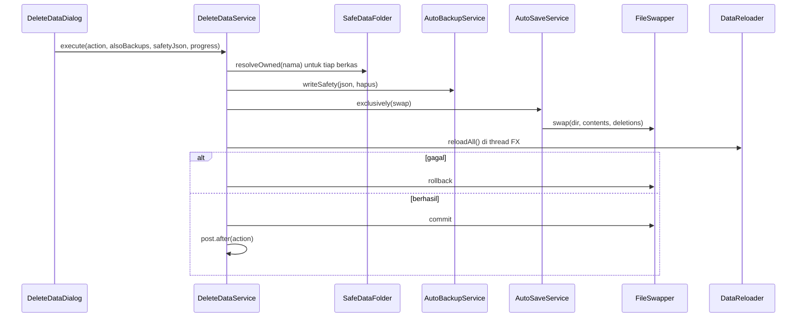

# 13. Zona Berbahaya

## Ringkasan

Zona Berbahaya berisi tiga tindakan penghapusan: **Hapus semua transaksi**, **Reset progres game**, dan **Reset pabrik**. Setiap tindakan meminta
pengguna mengetik `DELETE`, membuat cadangan pengaman penuh lebih dulu, mengganti berkas sebagai satu kesatuan, dan mengembalikan data lama bila ada langkah
yang gagal. Setelah selesai ada jendela 15 menit untuk memulihkan cadangan pengaman dengan satu klik.

## Cara memakai

1. Buka **Pengaturan**, gulir ke kartu **Zona Berbahaya** ("Penghapusan data. Setiap tindakan meminta konfirmasi dan membuat cadangan pengaman otomatis lebih dulu.").
2. Pilih salah satu dan klik **Hapus...**:
   - **Hapus semua transaksi**: "Menghapus semua transaksi. Kolom kustom, kategori, donor, pengaturan, dan progres game tetap ada."
   - **Reset progres game**: "Mengembalikan XP, level, streak, quest, badge, dan target tabungan ke awal. Transaksi dan pengaturan tetap ada."
   - **Reset pabrik**: "Menghapus semuanya: transaksi, kolom kustom, kategori, donor, pengingat, pengaturan, dan progres game. Aplikasi kembali ke keadaan pertama kali dibuka."
3. Dialog menampilkan **Yang akan dihapus** dan **Yang tetap ada** dengan jumlah yang tepat (misalnya "320 transaksi").
4. Khusus **Reset pabrik**: kotak **Hapus juga cadangan yang ada** (mati secara bawaan) dengan peringatan jumlah berkas cadangan yang akan dihapus permanen.
5. Ketik `DELETE` di kotak ("Ketik DELETE untuk melanjutkan"). Tombol merah dengan nama tindakan baru aktif bila teksnya persis `DELETE`.
6. Tunggu ("Menghapus data. Jangan tutup aplikasi..."). Hasil: nama cadangan pengaman dan tombol **Pulihkan cadangan ini** yang tersedia selama 15 menit;
   sesudahnya pulihkan dari daftar cadangan di Pengaturan.

## Aturan dan batasan

| Aturan | Nilai | Sumber |
|--------|-------|--------|
| Kata konfirmasi | persis `DELETE` (huruf besar, tanpa spasi tambahan) | `DeleteDataService.CONFIRM_WORD`, `isConfirmed` |
| Cadangan pengaman | JSON lengkap `backups/sebelum-hapus-<waktu>.json`, ditulis sebelum apa pun dihapus; gagal -> tidak ada yang dihapus | `DeleteDataService.execute` |
| Jendela pemulihan cepat | 15 menit | `DeleteDataService.RESTORE_WINDOW` |
| Hapus transaksi | menulis `transactions.json` = `[]`, menghapus `transactions.json.bak`; yang lain tetap | `DeleteDataService.plan` (`TRANSACTIONS`) |
| Reset game | menulis `game.json` baru (level 1, tanpa streak, badge, quest, dan target tabungan), menghapus `game.json.bak`; transaksi dan lainnya tetap | `plan` (`GAME`), `freshGameState` |
| Reset pabrik | menghapus semua berkas data milik aplikasi (termasuk `.bak`, `.tmp`, salinan `.corrupt-`, dan `settings.properties`); cadangan hanya bila kotak dicentang | `plan` (`FACTORY`), `SafeDataFolder.existingDataFiles` |
| Cadangan yang dihapus bila dicentang | hanya `otomatis-*`, `sebelum-pemulihan-*`, `sebelum-hapus-*`; cadangan pengaman yang baru dibuat selalu dipertahankan; berkas lain di `backups/` tidak pernah dilisting | `SafeDataFolder.existingBackupFiles` |
| Berkas yang boleh dihapus | hanya yang dikenali (`isOwnedDataName`, `isOwnedBackupName`), di dalam folder data, bukan symbolic link | `storage/SafeDataFolder` |
| Folder data tidak aman | root, folder home, atau symbolic link ditolak | `SafeDataFolder` (konstruktor) |
| Reward | ditangguhkan selama muat ulang; setelah reset, badge dan quest yang sudah dipenuhi data lama ditandai diam-diam tanpa XP | `DataReloader`, `GameService.startQuestWeek` |
| Pembersihan | hapus transaksi: notifikasi dan catatan pengingat `budget:`; reset game: `streak-risk` dan mulai quest minggu ini; pabrik: tema kembali terang | `service/DeletePostActions.after` |

## Cara kerja (teknis)

### Alur langkah demi langkah

1. `DangerZonePanel` memanggil `DeleteDataDialog.show(action, deleteService, backupService, flushAll, ...)`.
2. Dialog memakai `DeletePreview.of(action, backup.snapshot(true), notificationCount, backupFiles)` untuk jumlah yang tepat.
3. Pada tombol konfirmasi (`start`): `flushAll.run()` lalu `backup.backupJson(true)` di FX sebagai teks pengaman.
4. `Task` `delete-data` -> `DeleteDataService.execute(action, alsoDeleteBackups, safetyJson, progress)`:
   1. `plan(...)` memutuskan isi dan penghapusan dan memeriksa tiap path lewat `SafeDataFolder.resolveOwned` (menolak yang bukan milik aplikasi atau berupa link);
   2. `autoBackups.writeSafety(safetyJson, "hapus")`;
   3. `AutoSaveService.exclusively(() -> swapper.swap(dir, contents, deletions))`;
   4. `runOnUi`: `reloader.reloadAll()` dan `post.reloadAuxiliary()` (notifikasi dan log dibaca ulang); gagal -> `rollBack` mengembalikan berkas dan memuat ulang;
   5. `swap.commit()` (berkas yang dihapus baru benar-benar hilang di sini);
   6. `runOnUi(() -> post.after(action))` (pembersihan, hanya upaya terbaik).
5. `onSucceeded` (FX): `announceDeletion` menampilkan toast dan entri notifikasi dengan tombol **Pulihkan** (15 menit); `MainApp.openRestore` membuka dialog pemulihan dengan cadangan pengaman terpilih.

### Contoh nyata

**Hapus semua transaksi** pada data: 320 transaksi, 3 kolom kustom, 10 kategori, 2 donor, level 5 (1.500 XP).

- Dialog: "Yang akan dihapus: 320 transaksi". "Yang tetap ada: kolom kustom (3), kategori (10), donor (2)" dan "progres game (Lv 5, 1500 XP) dan semua pengaturan".
- Cadangan pengaman: `sebelum-hapus-20261121-150210.json` (berisi 320 transaksi).
- Sesudah: `transactions.json` berisi `[]`; `transactions.json.bak` terhapus; level dan XP tetap; notifikasi budget dan catatan `budget:` dibuang sehingga
  pengingat budget berlaku segar. Klik **Pulihkan cadangan ini** dalam 15 menit mengembalikan 320 transaksi.
- Menambah transaksi lagi berlaku seperti biasa dan memberi XP normal; menghapus dan menambah berulang tidak bisa memanen XP (lihat tes di bawah).

### Diagram

### Apa yang terjadi di thread mana

Dialog, snapshot, dan `reloadAll` berjalan di FX. `execute` berjalan di thread `delete-data` (`Task`), dan tiap langkah yang menyentuh UI dibungkus `runOnUi`
(`CompletableFuture` yang menunggu hingga 60 detik tanpa memegang kunci). Kegagalan dilaporkan lewat `setOnFailed` dengan pesan dan "Data tetap seperti semula.".

### Apa yang disimpan dan kapan

Cadangan pengaman ditulis lebih dulu. Berkas baru ditulis berdampingan lalu ditukar; berkas lama dipindah ke `.restore-rollback` dan baru dihapus saat `commit()`.

## Data yang disimpan

- `backups/sebelum-hapus-<waktu>.json`: cadangan pengaman (tidak pernah dirotasi).
- Berkas data sesuai tindakan (lihat tabel Aturan). Tidak ada berkas khusus untuk Zona Berbahaya.

## Kasus tepi

| Kasus | Perilaku | Tes |
|-------|----------|-----|
| Hanya kata `DELETE` yang mengonfirmasi | berlaku | `restore/DeleteDataServiceTest.onlyTheExactWordDeleteConfirms` |
| Cadangan pengaman penuh dengan nama jelas sebelum tiap tindakan | berlaku | `DeleteDataServiceTest.everyActionMakesAFullSafetyBackupFirstWithAHelpfulName` |
| Cadangan pengaman bisa memulihkan data | berlaku | `DeleteDataServiceTest.theSafetyBackupRestoresTheDataAfterEachAction` |
| Gagal menulis cadangan pengaman | tidak ada yang dihapus | `DeleteDataServiceTest.ifTheSafetyBackupCannotBeWrittenNothingIsDeleted` |
| Gagal di langkah mana pun | data lama utuh | `DeleteDataServiceTest.aFailureAtAnyStepOfDeletingTransactionsChangesNothing` (dan versi game dan pabrik) |
| Gagal memuat ulang | berkas dan keadaan lama kembali | `DeleteDataServiceTest.aFailureWhileReloadingTheAppBringsTheOldFilesAndTheOldStateBack` |
| Symbolic link di folder data atau folder `backups` | tidak diikuti dan tidak dihapus | `DeleteDataServiceTest.aSymbolicLinkInsideTheDataFolderIsNeverFollowedOrDeleted`, `restore/SafeDataFolderTest` |
| Folder data tidak aman | layanan menolak | `DeleteDataServiceTest.theServiceRefusesToWorkOnAnUnsafeDataFolder` |
| Reset pabrik tidak meninggalkan jejak data lama | berlaku | `DeleteDataServiceTest.aFactoryResetLeavesNoTraceOfTheOldDataInTheDataFolder` |
| Opsi hapus cadangan | hanya cadangan aplikasi; hanya untuk pabrik; cadangan pengaman baru dipertahankan | `DeleteDataServiceTest.theAlsoDeleteBackupsOptionRemovesOnlyTheAppsOldBackupsAndKeepsTheNewSafetyBackup` |
| Simpan tertunda | tidak menghidupkan data yang dihapus | `DeleteDataServiceTest.aSaveThatWasStillWaitingNeverBringsTheDeletedDataBack` |
| Reset game: quest yang sudah dipenuhi data lama | tidak dibayar | `DeleteDataServiceTest.aQuestThatOldDataAlreadySatisfiesIsNotPaidOutAfterTheReset` |
| Reset game tidak membangun ulang streak dari riwayat | berlaku | `DeleteDataServiceTest.theGameStaysResetAfterARestartAndTheStreakIsNotRebuiltFromHistory` |
| Hapus dan tambah berulang | tidak bisa memanen XP | `DeleteDataServiceTest.resettingAndAddingAgainAndAgainCannotFarmXp` |

## Keterkaitan

[12 Ekspor, cadangan, pemulihan](12-ekspor-cadangan-pemulihan.md) (mekanisme yang sama), [05 XP](05-xp-level-streak.md), [06 Quest](06-quest-mingguan.md),
[07 Badge](07-badge.md), [08 Target tabungan](08-target-tabungan.md) (ikut direset), [11 Pengingat](11-pengingat-notifikasi.md), [15](15-penyimpanan-dan-thread.md).

## Catatan dan celah

- `GameService.reset()` (yang javadoc-nya berkata target tabungan dan transaksi dipertahankan) tidak dipanggil dari kode aplikasi yang saya baca; tindakan
  **Reset progres game** memakai `DeleteDataService`, yang juga menghapus target tabungan (lihat [08](08-target-tabungan.md)).
- Reset pabrik menghapus `settings.properties` sehingga tema kembali ke terang (`Theme.resetToDefault`), tetapi folder `backups/` dipertahankan kecuali kotak dicentang.
- Jendela pemulihan cepat hanya 15 menit; sesudahnya jalur pemulihan tetap ada lewat daftar cadangan (cadangan pengaman tidak pernah dirotasi).
- Tindakan ini tidak mengenkripsi atau menimpa isi berkas secara aman (hapus biasa); tujuannya mengosongkan data aplikasi, bukan menghapus jejak di disk.
