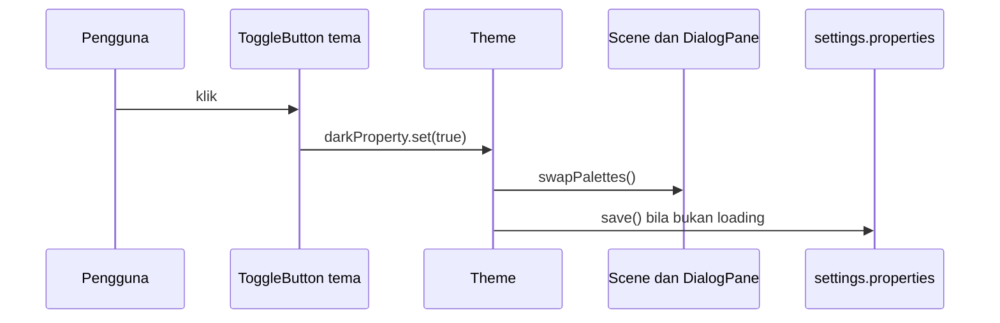

# 14. Tampilan, tema, dan pengaturan

## Ringkasan

Aplikasi punya tema terang dan gelap yang bisa diganti kapan saja dan diingat saat dibuka lagi. Semua warna ada di dua berkas CSS sebagai variabel, jadi dialog
dan jendela popup ikut berganti. Semua ikon adalah ikon vektor (Material Design lewat Ikonli) yang disimpan sebagai kunci teks, tanpa emoji. Tata letak tiga panel
menyembunyikan panel kanan saat jendela sempit.

## Cara memakai

1. Ganti tema lewat tombol bulan atau matahari di header (kanan atas), atau lewat **Pengaturan** -> kartu **Tampilan** -> kotak **Mode gelap**
   ("Ganti tema terang dan gelap. Pilihanmu diingat saat aplikasi dibuka lagi."). Keduanya terhubung ke satu properti.
2. Halaman **Pengaturan** berisi kartu berurutan: **Tampilan**, **Donor** ([10](10-kirim-ke-donatur.md)), **Pengingat** ([11](11-pengingat-notifikasi.md)),
   **Ekspor dan Cadangan** dan **Pulihkan dari Cadangan** ([12](12-ekspor-cadangan-pemulihan.md)), dan **Zona Berbahaya** ([13](13-zona-berbahaya.md)).
3. Navigasi di sidebar: **Beranda**, **Transaksi**, **Kategori**, **Kolom**, **Laporan**, **Quest & Badge**, **Pengaturan** (`ui/Page`).
4. Perkecil jendela: panel **Detail Transaksi** di kanan hilang di bawah lebar 1180; lebar minimal jendela 900 dan tinggi minimal 620.

## Aturan dan batasan

| Aturan | Nilai | Sumber |
|--------|-------|--------|
| Berkas gaya | `style.css` (dasar), `theme-light.css`, `theme-dark.css` di `src/main/resources/com/okto/jalokduitnow/ui/` | `ui/Theme` |
| Warna | semua sebagai variabel CSS di `.root` (`-bg`, `-surface`, `-accent`, `-income`, `-expense`, ...) | `theme-*.css` |
| Penyimpanan tema | `settings.properties` di folder data, kunci `theme` = `dark` atau `light` | `Theme.save`, `Theme.load` |
| Tema berlaku di dialog | tiap `Scene` dan `DialogPane` didaftarkan (`Theme.apply`, `Theme.styleDialog`); referensi lemah | `Theme.register`, `swapPalettes` |
| Ikon | kunci string ke `ui/IconCatalog` (Ikonli, font ikon dibundel di jar); kunci tak dikenal memakai `other` | `IconCatalog.FALLBACK` |
| Emoji | tidak dipakai di antarmuka; ikon kategori dan badge hanya menyimpan kunci | `achievement/Achievement`, `model/Category` |
| Ukuran jendela awal | 1360 x 840; minimal 900 x 620 | `MainApp.start` |
| Panel kanan | hanya di Beranda dan Transaksi, dan hanya bila lebar scene >= 1180 | `MainApp.SHOW_DETAIL_FROM`, `updateDetailVisibility` |
| Format angka dan tanggal | `Locale` id-ID: `Rp 25.000`, `21 November 2026` | `ui/Formats`, `util/Rupiah` |
| Toast | di kanan bawah, maksimal 4 terlihat, tampil sekitar 2,6 detik, tidak menangkap klik | `ui/ToastHost` |
| Animasi hover | 120 ms (kartu naik 2 px, tombol membesar 1,03x, navigasi bergeser 3 px) karena CSS JavaFX tidak punya transisi | `ui/Motion` |
| Salam di header | pagi (< 11), siang (< 15), sore (< 18), malam; menurut `Clock` | `MainApp.greetingText` |
| Reset pabrik | tema kembali terang tanpa menulis `settings.properties` | `Theme.resetToDefault` |

## Cara kerja (teknis)

### Alur langkah demi langkah

Mengganti ke mode gelap:

1. Kotak **Mode gelap** (`CheckBox`) dan tombol tema di header (`ToggleButton`) sama-sama `bindBidirectional` ke `Theme.darkProperty()`.
2. Listener di `Theme` (blok `static`) memanggil `swapPalettes()`: untuk setiap daftar stylesheet terdaftar, hapus palet terang dan gelap lalu pasang palet yang berlaku di indeks 0.
3. Bila `!loading`, `Theme.save()` menulis `settings.properties` (`Properties.store`).
4. Ikon tombol berganti (`sun` atau `moon`) lewat `Bindings.createObjectBinding`.

Saat startup: `MainApp.start` memanggil `Theme.load(dir)` sebelum scene dibuat; `Theme.apply(scene)` mendaftarkan scene.

Responsif: `scene.widthProperty().addListener(...)` memanggil `updateDetailVisibility()`, yang mengatur `setVisible` dan `setManaged` pada `detailHost`.

### Contoh nyata

Sebelum: tema terang; `settings.properties` berisi `theme=light` (atau tidak ada berkas).
Pengguna menekan tombol bulan: `DARK_MODE` menjadi true; `swapPalettes()` menukar `theme-light.css` dengan `theme-dark.css` pada scene utama dan semua dialog yang terbuka;
`settings.properties` ditulis `theme=dark`. Sesudah restart, `Theme.load` membaca `dark` dan jendela langsung terbuka gelap.

Lebar jendela 1300 -> panel kanan tampil. Diperkecil menjadi 1100 (< 1180) -> `detailHost` disembunyikan dan tidak lagi memakai ruang (`setManaged(false)`).

### Diagram

### Apa yang terjadi di thread mana

Semua di thread FX. Penulisan `settings.properties` dilakukan langsung di thread FX (berkas kecil), tanpa auto-save; kegagalan hanya dicatat ke `System.err`.

### Apa yang disimpan dan kapan

`settings.properties` ditulis setiap kali tema berubah (kecuali saat `Theme.load` sedang membaca). Tidak ada penyimpanan lain untuk tampilan: pilihan bulan, pencarian,
dan transaksi terpilih (`UiState`) hanya di memori.

## Data yang disimpan

`settings.properties` (Java properties): `theme=dark` atau `theme=light`. Bukan bagian cadangan JSON dan tidak disentuh oleh pemulihan; reset pabrik menghapusnya.

## Kasus tepi

| Kasus | Perilaku | Tes |
|-------|----------|-----|
| Kunci ikon tak dikenal | memakai ikon `other` | `ui/IconCatalogTest.unknownKeysFallBackToOther` |
| Kunci ikon yang dibutuhkan aplikasi | tetap ada | `IconCatalogTest.containsTheStableKeysTheAppDependsOn` |
| Ikon bawaan kategori | semua ada | `IconCatalogTest.everySeededCategoryIconExists` |
| Setiap badge memakai kunci ikon, bukan emoji | berlaku | `achievement/AchievementTest.everyAchievementHasAnIconKeyNotAnEmoji` |
| Ikon emoji lama di berkas kategori | diganti kunci ikon | `storage/CategoryIconMigrationTest` |
| `settings.properties` tidak terbaca | tema bawaan terang, pesan ke `System.err` | (tidak ada tes khusus yang saya temukan) |

## Keterkaitan

[10](10-kirim-ke-donatur.md), [11](11-pengingat-notifikasi.md), [12](12-ekspor-cadangan-pemulihan.md), [13](13-zona-berbahaya.md) (semuanya kartu di Pengaturan),
[03 Kategori](03-kategori.md) (ikon), [07 Badge](07-badge.md) (ikon).

## Catatan dan celah

- Kelas `ui/Theme` memakai keadaan statis (`DARK_MODE`, `REGISTERED`), sehingga sulit diuji di luar JavaFX; tidak ada tes untuk `Theme` yang saya temukan.
- Tema tidak ikut cadangan JSON, jadi pemulihan di komputer lain tidak membawa tema.
- Tidak ada pilihan bahasa atau ukuran font; semua teks berbahasa Indonesia.
- Saya tidak menjalankan aplikasi untuk memeriksa tampilan visual; deskripsi di atas dari kode dan berkas CSS (hanya sebagian CSS yang saya baca).
- Perilaku responsif terbatas pada penyembunyian panel kanan; saya tidak menemukan aturan responsif lain di `MainApp`.
