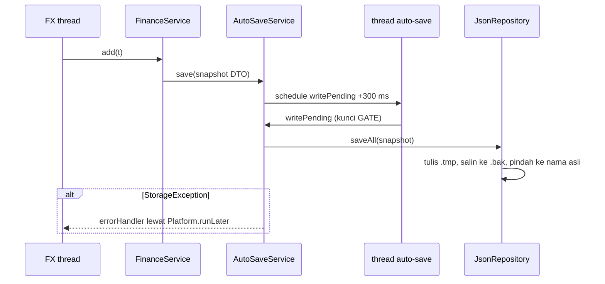

# 15. Penyimpanan dan thread

## Ringkasan

Semua data disimpan sebagai berkas JSON di folder `.jalokduitnow` milik pengguna. Setiap service menyimpan lewat `AutoSaveService` di thread latar: perubahan cepat
digabung dan hanya snapshot terbaru yang ditulis. Penulisan memakai berkas sementara dan menyimpan versi sebelumnya sebagai `.bak`. Thread JavaFX (FX) tidak pernah menunggu disk.

## Cara memakai

Fitur ini tidak punya layar sendiri. Pengguna merasakannya sebagai: perubahan langsung tersimpan tanpa tombol simpan, `Alert` bila penyimpanan gagal, dan data yang
tetap ada setelah aplikasi ditutup. Lokasi data (README): `C:\Users\<nama>\.jalokduitnow` di Windows dan `/Users/<nama>/.jalokduitnow` di macOS.

## Aturan dan batasan

| Aturan | Nilai | Sumber |
|--------|-------|--------|
| Folder data | `System.getProperty("user.home")/.jalokduitnow` | `storage/JsonRepository.defaultDataDir` |
| Format | satu berkas JSON berisi `List<T>`; Jackson dengan modul `JavaTimeModule`, tanggal ISO (bukan timestamp), rapi (`INDENT_OUTPUT`) | `storage/JsonSupport.newMapper` |
| Berkas | `transactions.json`, `schema.json`, `categories.json`, `game.json`, `recipients.json`, `donor-settings.json`, `reminders.json`, `reminder-log.json`, `notifications.json`, `settings.properties`, folder `backups/` | `MainApp.start`, `storage/SafeDataFolder` |
| Penulisan | tulis `<nama>.tmp`; salin berkas lama ke `<nama>.bak` (timpa); pindahkan `.tmp` ke nama asli (timpa) | `JsonRepository.saveAll` |
| Berkas rusak | disalin ke `<nama>.corrupt-<yyyyMMddHHmmss>.bak`, lalu `StorageException` ("File data rusak: ..."); tidak pernah ditimpa dengan data kosong | `JsonRepository.findAll`, `backupCorrupt` |
| Berkas tidak ada | dianggap daftar kosong (memicu isi bawaan di service terkait) | `JsonRepository.findAll` |
| Jeda auto-save | 300 ms, semua service | konstruktor `AutoSaveService<>(repository, 300)` |
| Penggabungan | hanya snapshot terbaru ditulis (`AtomicReference`); `AtomicBoolean scheduled` mencegah penjadwalan ganda | `thread/AutoSaveService.save` |
| Snapshot | selalu `List.copyOf` yang diambil di thread pemanggil; tidak ada keadaan bersama yang berubah | `AutoSaveService.save`, `FinanceService.persist` |
| Kunci global | satu `ReentrantLock GATE` untuk semua auto-save; `exclusively` menahan penulisan dan membuang semua simpan tertunda (dipakai pemulihan dan penghapusan) | `AutoSaveService.exclusively` |
| Kegagalan simpan | diteruskan ke `errorHandler`; di `MainApp`: `Platform.runLater(() -> showError(...))` | `MainApp.start` |
| Saat keluar | `MainApp.stop()` memanggil `flush()` pada semua service dan menghentikan `DailyScheduler`, `ReminderService`, dan `SystemTrayNotifier` | `MainApp.stop` |
| Penukaran banyak berkas | semua berubah atau tidak sama sekali, dengan `.restore-tmp` dan `.restore-rollback`; `ATOMIC_MOVE` bila didukung, dicoba ulang untuk berkas terkunci | `storage/FileSwapper` |
| Berkas ekspor | `.tmp` lalu pindah; menolak target berupa folder | `storage/ExportFile` |

## Cara kerja (teknis)

### Alur langkah demi langkah

Menyimpan perubahan transaksi:

1. Service mengubah data di memori di thread FX (misalnya `FinanceService.add`).
2. `persist()` memetakan data ke DTO (`TransactionDto.from`) menjadi daftar tak berubah dan memanggil `autoSave.save(snapshot)`.
3. `AutoSaveService.save`: `pending.set(List.copyOf(snapshot))`; bila `scheduled.compareAndSet(false, true)`, jadwalkan `writePending` setelah 300 ms di thread `auto-save`.
4. `writePending`: ambil `GATE`, `scheduled.set(false)`, `pending.getAndSet(null)`, lalu `repository.saveAll(snapshot)`.
5. `JsonRepository.saveAll`: `createDirectories`, tulis `.tmp`, salin berkas lama ke `.bak`, `Files.move(tmp, file, REPLACE_EXISTING)`.
6. `StorageException` dikirim ke `errorHandler`; UI menampilkan `Alert` lewat `Platform.runLater`.
7. Saat ditutup: `MainApp.stop()` -> `service.flush()` -> `writePending()` di thread pemanggil.

Memuat saat startup (`MainApp.start`, urutan penting): `schemaService.load()`, `categoryService.load()`, `service.load(schema, categories)`, `recipientService.load()`,
`donorSettings.load()`, `reminderSettings.load()`, `reminderLog.load()`, `notificationCenter.load()`, `gameService.load()`, lalu `gameService.rollDay()`.
Skema dimuat lebih dulu karena menentukan cara membaca nilai kustom; kategori dimuat sebelum transaksi karena transaksi menunjuk id kategori.

### Contoh nyata

Pengguna menambah tiga transaksi pada t = 0, 100, dan 200 ms.

| Waktu | Kejadian |
|-------|----------|
| t = 0 | `save(S1)`: `pending = S1`, `scheduled` menjadi true, penulisan dijadwalkan pada t = 300 |
| t = 100 | `save(S2)`: `pending = S2` (jadwal yang sama) |
| t = 200 | `save(S3)`: `pending = S3` |
| t = 300 | `writePending`: satu penulisan berisi S3 (3 transaksi baru); `transactions.json` lama disalin ke `transactions.json.bak` |

Hasil: tiga perubahan, satu penulisan. Bila aplikasi ditutup pada t = 150, `flush()` menulis S2 segera sehingga tidak ada yang hilang.

### Diagram

### Apa yang terjadi di thread mana

| Thread | Tugas |
|--------|-------|
| FX (JavaFX Application Thread) | semua logika service, listener, dialog, `GameService`, `GameEventBus` (event sinkron), `ReminderService.tick` |
| `auto-save` (daemon; satu pool satu-thread per `AutoSaveService`, 9 service) | menulis berkas JSON |
| `daily-scheduler` (daemon) | menjaga waktu tengah malam; menyerahkan `rollDay` ke FX |
| `reminder-ticker` (daemon) | menjaga waktu tiap menit; menyerahkan `tick` ke FX |
| `tray-notifier` (daemon) | notifikasi tray |
| `export` (daemon) | `ExportTask` menulis berkas ekspor |
| `restore-prepare`, `restore-apply`, `delete-data` | `Task` untuk pemulihan dan penghapusan |
| `ForkJoinPool.commonPool` | cadangan otomatis harian dan pembukaan WhatsApp (`CompletableFuture.runAsync`) |

Aturan `Platform.runLater` di kode:

- Hasil dari thread latar ke UI selalu lewat `Platform.runLater` atau callback `Task` (`setOnSucceeded`, `setOnFailed`, yang berjalan di FX):
  `MainApp` (penanganan error simpan), `GameToasts` (semua toast), `ReportView` (status setelah WhatsApp), `DailyScheduler` dan `ReminderService` (parameter `uiExecutor`),
  `RestoreService` dan `DeleteDataService` (`runOnUi` untuk muat ulang), sink pengingat (toast), dan pembuka cadangan WhatsApp.
- `GameEventBus` menjalankan pendengar di thread penerbit; karena itu kode UI di pendengar harus memanggil `Platform.runLater` sendiri.
- Listener service (`addListener`) dipanggil di thread yang mengubah data (FX) dan tidak boleh dipanggil dari thread latar.
- Snapshot untuk ekspor, cadangan, dan pengaman diambil di FX sebelum pekerjaan dilempar ke thread latar.
- `GameService` dan service lain tidak thread-safe; seluruhnya hanya dipakai dari FX.

Koleksi konkuren yang dipakai: `CopyOnWriteArrayList` (`GameEventBus.subscriptions`, `ReminderService.sinks`), `AtomicReference` dan `AtomicBoolean`
(`AutoSaveService`), `Collections.synchronizedSet` dengan `WeakHashMap` (`AutoSaveService.INSTANCES`), dan `volatile` pada `errorHandler` dan `SystemTrayNotifier.unavailable`.

### Apa yang disimpan dan kapan

Tiap perubahan data menjadwalkan simpan dalam 300 ms; `flush()` menulis seketika; `exclusively` menahan semua penulisan sementara berkas diganti dari luar.

## Data yang disimpan

Lihat tabel berkas di atas dan README ("Lokasi data"). `*.bak` adalah satu versi sebelumnya; `*.corrupt-<waktu>.bak` adalah salinan berkas rusak.

## Kasus tepi

| Kasus | Perilaku | Tes |
|-------|----------|-----|
| Perubahan cepat | digabung ke snapshot terbaru | `thread/AutoSaveServiceTest.quickChangesAreCoalescedIntoTheNewestSnapshot` |
| Snapshot disalin | perubahan sesudahnya tidak bocor | `AutoSaveServiceTest.snapshotIsCopiedSoLaterChangesDoNotLeakIn` |
| Penulisan di thread latar setelah jeda | berlaku | `AutoSaveServiceTest.writesOnABackgroundThreadAfterTheDelay` |
| Error | masuk ke handler | `AutoSaveServiceTest.errorsGoToTheHandler` |
| Kunci dilepas walau aksi gagal | berlaku | `AutoSaveServiceTest.theGateIsReleasedEvenIfTheActionFails` |
| Berkas rusak | salinan `.corrupt-` dan `StorageException` | `storage/JsonRepositoryTest.corruptFileThrowsAndLeavesABackupCopy` |
| Versi sebelumnya tersimpan | `.bak` | `JsonRepositoryTest.savingKeepsThePreviousVersionAsBak`, `service/ColumnManagementTest.thePreviousFilesAreKeptAsBackupsAfterAChange` |
| Berkas lama (format sebelumnya) | dimigrasi dan ditulis ulang | `storage/CategoryMigrationTest`, `JsonRepositoryTest.legacyDescriptionMovesIntoKeteranganColumn` |
| Keadaan bertahan setelah restart | berlaku | `storage/GameStateJsonTest`, `service/GameServiceTest.gameStateSurvivesARestart` |
| Berkas dikunci sementara (Windows) | dicoba ulang oleh `FileSwapper` | `restore/FileSwapperTest.aBrieflyLockedFileIsRetriedAndSucceeds` |
| Pendengar event yang melempar | tidak menghentikan pendengar lain | `event/GameEventBusTest.aFailingListenerDoesNotStopTheOthers` |

## Keterkaitan

[12 Ekspor dan pemulihan](12-ekspor-cadangan-pemulihan.md), [13 Zona Berbahaya](13-zona-berbahaya.md), [11 Pengingat](11-pengingat-notifikasi.md) (thread),
[05 XP](05-xp-level-streak.md) (`GameService` hanya di FX), [cara-kerja-aplikasi.md](../cara-kerja-aplikasi.md).

## Catatan dan celah

- `JsonRepository.saveAll` memindahkan `.tmp` ke berkas asli dengan `REPLACE_EXISTING` tanpa `ATOMIC_MOVE` (berbeda dengan `FileSwapper`). Berkas asli tidak ditimpa
  setengah jalan, tetapi atomisitas tingkat sistem berkas tidak dijamin oleh kode itu.
- Hanya satu versi `.bak` yang disimpan per berkas: dua simpan berturutan dengan isi rusak menimpa `.bak` yang baik.
- `AutoSaveService.shutdown()` ada tetapi tidak dipanggil dari `MainApp`; thread `auto-save` adalah daemon dan `flush()` menjamin penulisan terakhir.
- Kegagalan simpan hanya muncul sebagai `Alert` (satu per kegagalan) dan data tetap di memori; tidak ada percobaan ulang otomatis selain simpan berikutnya.
- `settings.properties` ditulis langsung dari thread FX tanpa `.tmp` atau `.bak`.
- Penulisan harian cadangan otomatis memakai `ForkJoinPool.commonPool`, bukan thread khusus.
